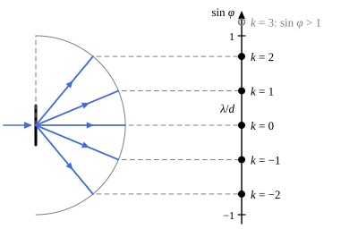

Из условия ${d\sin\varphi = k\lambda}$ кажется, что порядков бесконечно много: ${k = 1, 2, 3\dots}$ Но за решёткой на экране всегда конечное число максимумов. Где кончаются порядки?

## Синус не больше единицы

Из формулы решётки

$$
\sin\varphi = \frac{k\lambda}{d}.
$$

Каждый следующий порядок прибавляет к синусу одну и ту же ступеньку ${\lambda/d.}$ Поэтому максимумы стоят через равные шаги **по синусу** угла; сами углы растут всё быстрее.

Синус любого угла не больше ${1.}$ Значит,

$$
\frac{k\lambda}{d} \le 1,
\qquad
k \le \frac{d}{\lambda}.
$$

Наибольший порядок $k_{\max}$ — целая часть отношения ${d/\lambda.}$ Порядок — целое число, дробную часть отбрасывают, а не округляют.

**Пример.** Период ${1{,}5\ \text{мкм},}$ свет ${640\ \text{нм}\text{:}}$

$$
\frac{d}{\lambda} = \frac{1500}{640} \approx 2{,}34,
\qquad
k_{\max} = 2.
$$

## Особый случай: угол 90°

Пусть ${d/\lambda}$ получилось целым, например ${d = 2{,}4\ \text{мкм},}$ ${\lambda = 400\ \text{нм},}$ ${d/\lambda = 6.}$ Порядок ${k = 6}$ дал бы ${\sin\varphi = 1,}$ ${\varphi = 90^\circ.}$ Такой «максимум» идёт вдоль самой решётки и на экран не попадает. Его не считают. Наибольший видимый порядок — ${k_{\max} = 5.}$

Правило: $k_{\max}$ — наибольшее целое ${k,}$ при котором ${k\lambda < d}$ строго.

## Сколько всего максимумов

Максимумы стоят симметрично: центральный ${k = 0}$ и по $k_{\max}$ с каждой стороны. Всего

$$
N = 2k_{\max} + 1.
$$

В первом примере ${k_{\max} = 2,}$ и максимумов ${2 \cdot 2 + 1 = 5.}$ Во втором ${k_{\max} = 5}$ и максимумов ${11.}$

<pp-task id="ks-wopt-05"></pp-task>

## Попробуй сам

Двигай длину волны и число штрихов на миллиметр. Лучи показывают направления на максимумы, справа — те же максимумы на оси синуса. Таблица считает ${d,}$ ${d/\lambda,}$ $k_{\max}$ и число максимумов.

<pp-grating>Модель дифракционной решётки: ползунки длины волны и числа штрихов на миллиметр, направления на максимумы и их положение на оси синуса угла, таблица периода, наибольшего порядка, числа максимумов и углов по порядкам; переключатель на белый свет.</pp-grating>

Посмотри, что выходит:

- чем длиннее волна, тем дальше от центра максимумы и тем их меньше;
- чем больше штрихов на миллиметр (меньше период), тем шире разъезжаются максимумы и тем их меньше;
- на оси синуса шаг между максимумами всегда один и тот же — ${\lambda/d;}$
- найди положение, где ${d/\lambda}$ целое, например ${500\ \text{нм}}$ и ${250}$ штрихов: последний порядок попадает ровно на ${90^\circ}$ и в счёт не идёт.

<pp-task id="ks-wopt-14"></pp-task>

Проверь себя: может ли решётка дать только один, центральный максимум?

Может, если период не больше длины волны: тогда уже первый порядок требует синуса не меньше единицы. Такие решётки бывают для длинных волн, а у решётки для видимого света период всегда больше λ.

## Частые ловушки

- **Округляют ${d/\lambda}$ вверх.** Порядок — целая часть: ${5{,}7 \to 5,}$ а не 6.
- **Считают порядок с ${\sin\varphi = 1.}$** Максимум под ${90^\circ}$ не наблюдается.
- **Дают $k_{\max}$ вместо числа максимумов** или забывают центральный: всего ${2k_{\max} + 1.}$
- **Считают, что максимумы стоят через равные углы.** Равные шаги — по синусу угла.

## Коротко

- ${\sin\varphi = k\lambda/d \le 1,}$ поэтому ${k \le d/\lambda.}$
- $k_{\max}$ — наибольшее целое $k$ с ${k\lambda < d}$ (под ${90^\circ}$ не считается).
- Всего максимумов ${2k_{\max} + 1.}$
