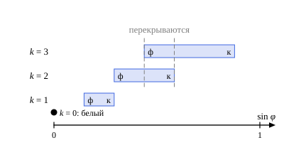
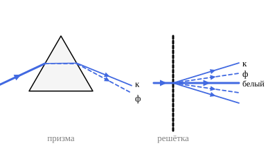

Пусть на решётку падает не лазерный луч одной длины волны, а белый свет — смесь всех цветов. Каждый цвет даёт свои максимумы под своими углами. Что получится на экране?

## Центр белый, дальше — спектры

Условие максимума ${d\sin\varphi = k\lambda}$ одинаково для каждого цвета, только $\lambda$ своя.

- При ${k = 0}$ угол нулевой для **всех** длин волн. Все цвета приходят в центр вместе, и центральный максимум **белый**.
- При ${k = 1}$ у каждого цвета свой угол: ${\sin\varphi = \lambda/d.}$ Чем длиннее волна, тем больше угол. Ближе к центру фиолетовый (${380\ \text{нм}}$), дальше — красный (${760\ \text{нм}}$). Получается спектр **первого порядка**.
- При ${k = 2, 3, \dots}$ — спектры второго, третьего порядков, всё дальше и всё шире.

Ширина спектра растёт с порядком: по синусу спектр $k$-го порядка занимает от ${k \cdot 380\ \text{нм}/d}$ до ${k \cdot 760\ \text{нм}/d.}$

## Спектры перекрываются

Красный край спектра второго порядка: ${2 \cdot 760 = 1520\ \text{нм}}$ в числителе. Фиолетовый край третьего: ${3 \cdot 380 = 1140\ \text{нм}.}$ Фиолетовый третьего порядка начинается раньше, чем кончается красный второго: эти спектры **перекрываются**. И так при любой решётке — период $d$ сокращается.

А первый и второй? ${1 \cdot 760 = 2 \cdot 380\text{:}}$ они лишь касаются краями. Поэтому чистым, ни с чем не смешанным получается только спектр первого порядка.

Под одним углом в перекрытии идут два цвета разных порядков. Условие совпадения: ${k_1\lambda_1 = k_2\lambda_2.}$

**Пример.** Какой свет во втором порядке идёт под тем же углом, что и фиолетовый ${400\ \text{нм}}$ в третьем?

$$
2\lambda = 3 \cdot 400\ \text{нм},
\qquad
\lambda = 600\ \text{нм}
$$

— оранжевый. Период решётки для ответа не нужен.

<pp-task id="ks-wopt-15"></pp-task>

## Попробуй сам

Модель из урока 16.6, теперь в белом свете. Каждый порядок — полоса от фиолетового «ф» до красного «к». Меняй число штрихов на миллиметр: спектры сдвигаются и растягиваются, но второй и третий перекрываются всегда, а у дальних порядков красный край уходит за ${90^\circ.}$

<pp-grating light="white" lines="500">Модель дифракционной решётки в белом свете: спектры порядков 1, 2, 3… как полосы от фиолетового до красного, таблица углов их краёв и порядков, которые перекрываются; ползунок числа штрихов на миллиметр, переключатель на одну длину волны.</pp-grating>

## Решётка и призма

И призма, и решётка раскладывают белый свет в спектр, но по-разному.

| | Призма | Решётка |
|---|---|---|
| причина | дисперсия: $n$ зависит от цвета | интерференция: ${d\sin\varphi = k\lambda}$ |
| сильнее отклоняет | фиолетовый | красный |
| сколько спектров | один | по одному в каждом порядке, с обеих сторон |
| прямо проходит | ничего: всё отклонено | белый центральный максимум |

Призма сильнее всего отклоняет **фиолетовый**: у него больше показатель преломления (урок 16.1). Решётка сильнее отклоняет **красный**: у него больше ${\lambda,}$ а значит, больше и угол.

Проверь себя: белый свет падает на решётку. Какой цвет в спектре первого порядка ближе всего к белому центральному максимуму?

Фиолетовый: у него самая короткая волна и самый маленький угол. Красный — дальше всех.

## Частые ловушки

- **Путают, что сильнее отклоняет призма и решётка.** Призма — фиолетовый, решётка — красный.
- **Думают, что центральный максимум цветной.** При ${k = 0}$ все цвета идут прямо: он белый.
- **Ищут перекрытие с периодом решётки.** Совпадение цветов ${k_1\lambda_1 = k_2\lambda_2}$ от $d$ не зависит.
- **Думают, что первый и второй спектры перекрываются.** Они только касаются; перекрываются второй и третий.

## Коротко

- В белом свете центральный максимум белый, дальше — спектры порядков 1, 2, 3…
- В спектре решётки фиолетовый ближе к центру, красный дальше.
- Спектры второго и третьего порядков перекрываются всегда: ${k_1\lambda_1 = k_2\lambda_2.}$
- Призма сильнее отклоняет фиолетовый, решётка — красный.

Это последний урок темы и всего раздела «Электродинамика». Дальше — новый раздел, «Основы СТО», и его тема «Основы специальной теории относительности»: что происходит, когда тела движутся почти со скоростью света, — почему скорость света одинакова для всех наблюдателей, почему тело нельзя до неё разогнать и откуда берётся знаменитое ${E = mc^2.}$
