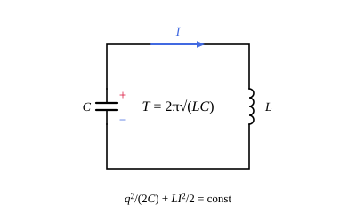

Радиоприёмник выбирает нужную станцию, вращая ручку настройки. Внутри меняется ёмкость конденсатора в колебательном контуре. Тема нужна в задаче 13 и в задачах 14–15.

Колебательный контур и формулу Томсона знакомят ещё в 9 классе. Энергию, амплитуды и аналогию с маятником разбирают в 11. Пригодятся темы «Конденсаторы», «Самоиндукция» и «Механические колебания».

## Шаг 1. Что такое колебательный контур (9 класс)

**Колебательный контур** — конденсатор и катушка, соединённые в замкнутую цепь.

Зарядим конденсатор и замкнём цепь. Конденсатор начинает разряжаться через катушку. Ток растёт не мгновенно — мешает самоиндукция. Когда конденсатор разрядился, ток максимален, и вся энергия — в магнитном поле катушки. Ток не может мгновенно исчезнуть — он продолжает идти и перезаряжает конденсатор в обратную сторону. Затем всё повторяется в обратном направлении.

Это **свободные электромагнитные колебания**: заряд, напряжение и ток меняются периодически.

## Шаг 2. Формула Томсона (9 класс)

Период свободных колебаний:

$$
T = 2\pi\sqrt{L C}.
$$

- $L$ — индуктивность, Гн;
- $C$ — ёмкость, Ф;
- $T$ — период, с.

Больше ёмкость или индуктивность — колебания медленнее. Под корнем: увеличили ёмкость в 4 раза — период вырос в 2 раза. Так и настраивается приёмник.

<pp-task id="ks-lc-01"></pp-task>

## Шаг 3. Аналогия с пружинным маятником (11 класс)

| Пружинный маятник | Контур |
|---|---|
| координата $x$ | заряд $q$ |
| скорость $v$ | сила тока $I$ |
| масса $m$ | индуктивность $L$ |
| жёсткость $k$ | величина $1/C$ |
| $kx^2/2$ | $q^2/(2C)$ |
| $mv^2/2$ | $LI^2/2$ |

Это помогает запомнить все формулы. Например, $T = 2\pi\sqrt{m/k}$ превращается в $T = 2\pi\sqrt{LC}$.

## Шаг 4. Период и частота (11 класс)

Частота $\nu = 1/T$, циклическая частота $\omega = 2\pi/T = 1/\sqrt{LC}$.

При расчёте не забудь приставки: $1\ \text{мкФ} = 10^{-6}\ \text{Ф}$, $1\ \text{мГн} = 10^{-3}\ \text{Гн}$. Сначала перемножь $L$ и $C$ в СИ, потом извлеки корень.

<pp-task id="ks-lc-02"></pp-task>

## Шаг 5. Закон сохранения энергии (11 класс)

В идеальном контуре (без сопротивления) полная энергия сохраняется:

$$
\frac{q^2}{2C} + \frac{L I^2}{2} = \frac{q_{\max}^2}{2C} = \frac{L I_{\max}^2}{2}.
$$

Когда заряд конденсатора максимален, ток равен нулю. Когда ток максимален, конденсатор разряжен. Если конденсатор зарядили до напряжения $U$, вся энергия контура равна $CU^2/2$.

<pp-task id="ks-lc-03"></pp-task>

## Шаг 6. Связь амплитуд (11 класс)

Из закона сохранения энергии:

$$
I_{\max} = q_{\max}\,\omega = \frac{q_{\max}}{\sqrt{LC}}.
$$

Как у маятника: $v_{\max} = A\omega$.

<pp-task id="ks-lc-04"></pp-task>

## Шаг 7. Энергия в промежуточный момент (11 класс)

В любой момент энергия делится между конденсатором и катушкой, а сумма постоянна. Электрическая энергия пропорциональна $q^2$: если заряд вдвое меньше максимального, на конденсаторе $\frac14$ энергии, а остальные $\frac34$ — в катушке.

<pp-task id="ks-lc-05"></pp-task>

## Шаг 8. Энергия колеблется вдвое чаще (11 класс)

Энергия электрического поля и энергия магнитного поля колеблются с частотой, **вдвое большей**, чем заряд и ток. За один период колебаний заряда конденсатор дважды полностью заряжается (с разными знаками) и дважды разряжается. Период колебаний энергии — $T/2$.

<pp-task id="ks-lc-06"></pp-task>

## Шаг 9. Затухание и резонанс (11 класс)

В реальном контуре есть сопротивление, энергия переходит в тепло, колебания затухают.

Если к контуру подключить источник переменного напряжения, возникают **вынужденные колебания**. Когда частота источника совпадает с собственной частотой контура, амплитуда тока резко растёт — **резонанс**. Так приёмник «выбирает» станцию: из всех волн откликается на ту, с которой контур в резонансе.

## Частые ловушки

- **Забывают корень в формуле Томсона.** $C$ в 4 раза больше — $T$ в 2 раза больше.
- **Считают, что ток максимален при максимальном заряде.** Наоборот.
- **Путают частоту колебаний энергии и заряда.** Энергия колеблется вдвое чаще.
- **Не переводят мкФ и мГн.**

## Как это выглядит на ЕГЭ

*Контур состоит из конденсатора ёмкостью $4\ \text{мкФ}$ и катушки индуктивностью $0{,}1\ \text{Гн}$. Найди период колебаний. $\pi \approx 3{,}14$.*

$$
T = 2\pi\sqrt{LC} = 6{,}28 \cdot \sqrt{0{,}1 \cdot 4 \cdot 10^{-6}} = 6{,}28 \cdot 6{,}32 \cdot 10^{-4} \approx 4{,}0 \cdot 10^{-3}\ \text{с}.
$$

Около $4\ \text{мс}$, то есть частота около $250\ \text{Гц}$.

## Коротко

- Контур: конденсатор + катушка; энергия перетекает между полями.
- $T = 2\pi\sqrt{LC}$, $\omega = 1/\sqrt{LC}$.
- $q^2/(2C) + LI^2/2 = \text{const}$; $I_{\max} = q_{\max}/\sqrt{LC}$.
- Энергии колеблются с удвоенной частотой.
- Резонанс: частота источника равна собственной частоте контура.
