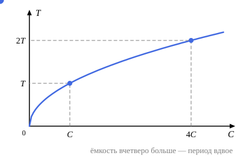

Чтобы поймать другую радиостанцию, вращают ручку настройки. Она поворачивает пластины конденсатора переменной ёмкости в контуре приёмника, и меняется период колебаний в контуре. Как именно период зависит от конденсатора и катушки?

## От чего зависит период

**Катушка.** Чем больше индуктивность, тем сильнее катушка мешает току меняться (урок 11.4). Ток медленнее нарастает и медленнее спадает — колебания идут медленнее.

**Конденсатор.** Ёмкость ${C = q/U}$ (урок 4.1): чем она больше, тем меньше напряжение при том же заряде. Меньшее напряжение слабее гонит ток, а заряда надо перенести больше. Конденсатор дольше разряжается и дольше перезаряжается — колебания тоже идут медленнее.

## Формула Томсона

Период свободных колебаний в контуре:

$$
T = 2\pi\sqrt{LC}.
$$

- $L$ — индуктивность катушки, Гн;
- $C$ — ёмкость конденсатора, Ф;
- $T$ — период, с.

Формулу вывел в 1853 году британский физик Уильям Томсон (позже — лорд Кельвин). Откуда в ней корень, станет ясно в уроке 12.3.

Ёмкость и индуктивность стоят **под корнем**. Увеличили ёмкость вчетверо — период вырос только вдвое: ${\sqrt 4 = 2.}$ С индуктивностью так же.

<pp-task id="ks-lc-01"></pp-task>

## Частота

Частота — число колебаний за секунду (урок 13.1 из механики):

$$
\nu = \frac{1}{T} = \frac{1}{2\pi\sqrt{LC}}.
$$

Частота измеряется в герцах: ${1\ \text{Гц} = 1/\text{с}.}$ Она обратна периоду: чем больше $L$ или $C$, тем больше период и тем **меньше** частота. Повернули ручку приёмника, ёмкость выросла — контур настроился на станцию с меньшей частотой.

<pp-task id="ks-lc-08"></pp-task>

## Считаем период

Ёмкости обычно даны в микрофарадах, индуктивности — в миллигенри. Сначала переведи всё в СИ:

$$
1\ \text{мкФ} = 10^{-6}\ \text{Ф}, \qquad 1\ \text{мГн} = 10^{-3}\ \text{Гн}.
$$

Потом перемножь $L$ и $C$ и только после этого извлеки корень. Удобно записать произведение так, чтобы степень десяти была чётной: ${\sqrt{25 \cdot 10^{-8}} = 5 \cdot 10^{-4}.}$

**Пример.** Катушка индуктивностью ${0{,}25\ \text{Гн}}$ и конденсатор ёмкостью ${1\ \text{мкФ}.}$ Прими ${\pi \approx 3{,}14.}$

$$
\begin{aligned}
LC &= 0{,}25 \cdot 10^{-6} = 25 \cdot 10^{-8}\ \text{с}^2, \qquad \sqrt{LC} = 5 \cdot 10^{-4}\ \text{с},\\
T &= 2\pi\sqrt{LC} = 6{,}28 \cdot 5 \cdot 10^{-4} = 3{,}14 \cdot 10^{-3}\ \text{с} \approx 3{,}1\ \text{мс}.
\end{aligned}
$$

Частота ${\nu = 1/T \approx 318\ \text{Гц}.}$ Произведение генри на фарад — секунда в квадрате, поэтому корень даёт секунды.

<pp-task id="ks-lc-02"></pp-task>

Проверь себя: ёмкость конденсатора увеличили в 4 раза, а индуктивность катушки уменьшили в 4 раза. Как изменился период?

Не изменился: произведение $LC$ осталось прежним, а период зависит только от него.

## Частые ловушки

- **Забывают корень.** Ёмкость в 4 раза больше — период в 2 раза больше, а не в 4.
- **Не переводят приставки.** мкФ — это ${10^{-6}\ \text{Ф},}$ мГн — ${10^{-3}\ \text{Гн}.}$
- **Путают период и частоту.** Больше ёмкость — больше период, но меньше частота.
- **Теряют двойку в $2\pi$.** ${2\pi \approx 6{,}28.}$

## Коротко

- ${T = 2\pi\sqrt{LC}}$ — формула Томсона.
- $L$ и $C$ под корнем: вчетверо больше — период вдвое больше.
- ${\nu = 1/T}$: больше $L$ или $C$ — меньше частота.
- Перед расчётом переведи мкФ и мГн в СИ.

Дальше — урок 12.3: почему контур колеблется как груз на пружине.
