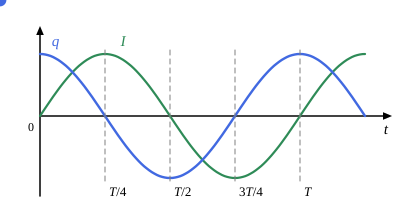

Посмотри ещё раз на четыре момента из урока 12.1 и вспомни груз на пружине (урок 13.5 из механики). Оттянули груз и отпустили: он разгоняется, проскакивает положение равновесия, сжимает пружину, останавливается и идёт обратно. Очень похоже на контур. Это не просто сходство — это одна и та же математика.

## Одна история, два рассказа

- Груз оттянули — конденсатор зарядили.
- Пружина разгоняет груз — конденсатор гонит ток через катушку.
- В положении равновесия пружина не растянута, а скорость наибольшая — конденсатор разряжен, а ток наибольший.
- Груз не останавливается в равновесии из-за инерции (урок 5.1 из механики) — ток не прекращается из-за «электрической инерции» катушки (урок 11.4).
- Груз сжимает пружину и останавливается — ток перезаряжает конденсатор и прекращается.

В уроке 11.5 мы уже видели: индуктивность играет роль массы, а сила тока — роль скорости. Теперь достроим всю таблицу.

## Таблица соответствий

| Пружинный маятник | Колебательный контур |
|---|---|
| координата $x$ | заряд конденсатора $q$ |
| скорость ${v = \Delta x/\Delta t}$ | сила тока ${I = \Delta q/\Delta t}$ |
| масса $m$ | индуктивность $L$ |
| жёсткость $k$ | величина $1/C$ |
| сила упругости ${kx}$ | напряжение на конденсаторе ${q/C}$ |
| энергия пружины ${kx^2/2}$ | энергия конденсатора ${q^2/(2C)}$ |
| кинетическая энергия ${mv^2/2}$ | энергия катушки ${LI^2/2}$ |

Почему жёсткости соответствует ${1/C}$, а не $C$? Жёсткая пружина сильно тянет груз даже при малом растяжении. Конденсатор малой ёмкости даёт большое напряжение даже при малом заряде (урок 4.1). Значит, малая ёмкость — как жёсткая пружина.

Теперь переведём формулу периода пружинного маятника:

$$
T = 2\pi\sqrt{\frac{m}{k}} \quad\longrightarrow\quad T = 2\pi\sqrt{\frac{L}{1/C}} = 2\pi\sqrt{LC}.
$$

Получилась формула Томсона из урока 12.2. Так её проще всего запомнить и вспомнить на экзамене.

## Заряд меняется гармонически

Координата груза меняется по закону ${x = A\cos\omega t}$ (урок 13.3 из механики). Значит, заряд конденсатора — так же:

$$
q = q_{\max}\cos\omega t, \qquad \omega = \frac{2\pi}{T} = \frac{1}{\sqrt{LC}}.
$$

- $q_{\max}$ — амплитуда заряда, Кл;
- $\omega$ — циклическая частота, рад/с.

Для груза ${\omega = \sqrt{k/m}}$; замени $k$ на $1/C$ и $m$ на $L$ — получится ${1/\sqrt{LC}.}$ Напряжение на конденсаторе ${u = q/C}$ меняется в такт с зарядом.

Сила тока показывает, как быстро меняется заряд, — как скорость показывает, как быстро меняется координата (урок 13.4 из механики). Поэтому ток сдвинут на четверть периода.

**Пример.** Заряд конденсатора меняется по закону ${q = 3 \cdot 10^{-6}\cos(100\pi t)\ \text{Кл}.}$ Число перед косинусом — амплитуда: ${q_{\max} = 3\ \text{мкКл}.}$ Число перед $t$ — циклическая частота: ${\omega = 100\pi\ \text{рад/с}.}$ Период и частота:

$$
T = \frac{2\pi}{\omega} = \frac{2\pi}{100\pi} = 0{,}02\ \text{с}, \qquad \nu = \frac{1}{T} = 50\ \text{Гц}.
$$

По графику $q(t)$ период читают так же, как у груза: это время между двумя соседними максимумами.

<pp-task id="ks-lc-09"></pp-task>

Проверь себя: на графике заряда конденсатора кривая в некоторый момент пересекает ось времени. Что в этот момент с силой тока?

Ток наибольший по модулю: конденсатор разряжен, вся энергия в катушке. Как у груза, который проходит положение равновесия с наибольшей скоростью.

## Частые ловушки

- **Ставят $C$ на место жёсткости.** Жёсткости соответствует ${1/C}$, поэтому в формуле периода $C$ стоит в числителе под корнем, как масса.
- **Путают $\omega$ и $\nu$.** ${\omega = 2\pi\nu}$; в законе ${q = q_{\max}\cos\omega t}$ стоит именно $\omega$.
- **Думают, что ток наибольший, когда заряд наибольший.** Наоборот: ток наибольший, когда заряд проходит через ноль.

## Коротко

- $q \leftrightarrow x$, ${I \leftrightarrow v}$, ${L \leftrightarrow m}$, ${1/C \leftrightarrow k}$.
- ${T = 2\pi\sqrt{m/k}}$ переходит в ${T = 2\pi\sqrt{LC}.}$
- ${q = q_{\max}\cos\omega t,}$ ${\omega = 2\pi/T = 1/\sqrt{LC}.}$
- Ток сдвинут на четверть периода: он наибольший, когда заряд равен нулю.

Дальше — урок 12.4: как энергия переходит из конденсатора в катушку.
