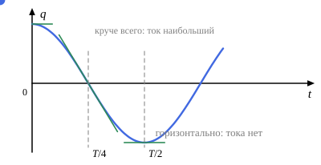

Конденсатор зарядили сильнее — ток в контуре стал больше. А если взять другую катушку? Найдём точную связь между наибольшим зарядом и наибольшим током.

## Связь амплитуд из энергии

Наибольшая энергия конденсатора равна наибольшей энергии катушки (урок 12.4):

$$
\frac{q_{\max}^2}{2C} = \frac{LI_{\max}^2}{2}, \qquad I_{\max}^2 = \frac{q_{\max}^2}{LC}.
$$

Извлечём корень и вспомним, что ${1/\sqrt{LC} = \omega}$ (урок 12.3):

$$
I_{\max} = \frac{q_{\max}}{\sqrt{LC}} = q_{\max}\,\omega.
$$

- $q_{\max}$ — амплитуда заряда, Кл;
- $\omega$ — циклическая частота, рад/с;
- $I_{\max}$ — амплитуда силы тока, А.

Это та же формула, что у груза на пружине: ${v_{\max} = A\omega}$ (урок 13.4 из механики). Заряд — как координата, ток — как скорость.

Амплитуда напряжения на конденсаторе следует из ${C = q/U}$ (урок 4.1):

$$
U_{\max} = \frac{q_{\max}}{C}.
$$

## Ток — крутизна графика заряда

Ток показывает, какой заряд проходит за единицу времени: ${I = \Delta q/\Delta t.}$ На графике $q(t)$ это крутизна — так же, как ЭДС самоиндукции была крутизной графика тока (урок 11.3).

- На вершинах графика касательная горизонтальна: заряд на мгновение не меняется, тока нет.
- Где заряд проходит через ноль, график круче всего: ток наибольший.

**Пример.** В контуре катушка ${0{,}4\ \text{Гн}}$ и конденсатор ${0{,}1\ \text{мкФ},}$ амплитуда заряда ${8\ \text{мкКл}.}$ Найдём амплитуды тока и напряжения.

$$
\begin{aligned}
LC &= 0{,}4 \cdot 10^{-7} = 4 \cdot 10^{-8}\ \text{с}^2,\\
\omega &= \frac{1}{\sqrt{LC}} = \frac{1}{2 \cdot 10^{-4}} = 5000\ \text{рад/с},\\
I_{\max} &= q_{\max}\,\omega = 8 \cdot 10^{-6} \cdot 5000 = 0{,}04\ \text{А} = 40\ \text{мА},\\
U_{\max} &= \frac{q_{\max}}{C} = \frac{8 \cdot 10^{-6}}{10^{-7}} = 80\ \text{В}.
\end{aligned}
$$

<pp-task id="ks-lc-04"></pp-task>

Формулу можно читать и в обратную сторону. Если известны обе амплитуды, то ${\omega = I_{\max}/q_{\max},}$ а период ${T = 2\pi/\omega = 2\pi q_{\max}/I_{\max}.}$

<pp-task id="ks-lc-11"></pp-task>

Проверь себя: в том же контуре конденсатор зарядили вдвое сильнее. Как изменятся амплитуда тока и период?

Амплитуда тока вырастет вдвое: ${I_{\max} = q_{\max}\,\omega,}$ а $\omega$ зависит только от $L$ и $C$. Период не изменится — как у груза на пружине, он не зависит от амплитуды (урок 13.5 из механики).

## Частые ловушки

- **Берут частоту $\nu$ вместо $\omega$.** ${I_{\max} = q_{\max}\,\omega,}$ а ${\omega = 2\pi\nu.}$
- **Не переводят мкКл и мА.** ${1\ \text{мкКл} = 10^{-6}\ \text{Кл},}$ ${1\ \text{мА} = 10^{-3}\ \text{А}.}$
- **Думают, что период зависит от заряда.** Он зависит только от $L$ и $C$.

## Коротко

- ${I_{\max} = q_{\max}\,\omega = q_{\max}/\sqrt{LC}}$ — как ${v_{\max} = A\omega.}$
- ${U_{\max} = q_{\max}/C.}$
- Ток — крутизна графика $q(t)$: наибольший при ${q = 0,}$ ноль на вершинах.

Дальше — урок 12.6: как делится энергия в любой момент.
