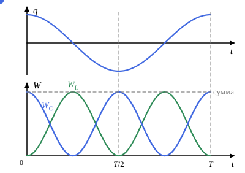

Мы знаем, где энергия в особые моменты: вся в конденсаторе или вся в катушке (урок 12.4). А как она делится, когда заряд, скажем, вчетверо меньше наибольшего?

## Доли энергии

Полная энергия ${W = q_{\max}^2/(2C).}$ Энергия конденсатора в любой момент ${q^2/(2C).}$ Поделим одно на другое:

$$
\frac{W_C}{W} = \left(\frac{q}{q_{\max}}\right)^2, \qquad \frac{W_L}{W} = \left(\frac{I}{I_{\max}}\right)^2.
$$

Вторая формула — так же из ${W_L = LI^2/2}$ и ${W = LI_{\max}^2/2.}$ Главное здесь — **квадрат**: энергия пропорциональна квадрату заряда или тока, а не им самим.

**Пример.** Заряд конденсатора вчетверо меньше наибольшего. Энергия конденсатора

$$
W_C = \left(\frac14\right)^2 W = \frac{W}{16},
$$

а остальное — в катушке: ${W_L = W - W/16 = 15W/16.}$ Заряд ещё четверть от наибольшего, а энергии на конденсаторе — всего одна шестнадцатая.

<pp-task id="ks-lc-05"></pp-task>

Так же рассуждают про ток: по доле энергии катушки находят, какую долю амплитуды составляет ток.

<pp-task id="ks-lc-12"></pp-task>

## Когда энергии равны

Энергии конденсатора и катушки равны, когда у каждой половина: ${(q/q_{\max})^2 = 1/2,}$ то есть ${q = q_{\max}/\sqrt 2 \approx 0{,}71\,q_{\max}.}$ Впервые это случается через восьмую часть периода, в момент $T/8$ — посередине между «всё в конденсаторе» и «всё в катушке». Это видно и на столбиках из урока 12.4.

## Энергия колеблется вдвое чаще

Энергия конденсатора ${q^2/(2C)}$ не зависит от знака заряда. За один период заряд дважды становится наибольшим по модулю: ${+q_{\max}}$ в начале и ${-q_{\max}}$ через $T/2$. И оба раза энергия конденсатора наибольшая.

Значит, энергия конденсатора и энергия катушки меняются с периодом $T/2$ и частотой $2\nu$ — вдвое чаще, чем заряд и ток. Так же у маятника: потенциальная и кинетическая энергии меняются вдвое чаще координаты (урок 13.7 из механики).

<pp-task id="ks-lc-06"></pp-task>

Проверь себя: конденсатор полностью заряжен. Через какую долю периода энергии конденсатора и катушки впервые станут равны?

Через $T/8$. В этот момент ${q = q_{\max}/\sqrt 2,}$ и у каждой части по половине энергии.

## Частые ловушки

- **Делят энергию пропорционально заряду.** Доля энергии конденсатора — квадрат доли заряда: ${(q/q_{\max})^2,}$ а не ${q/q_{\max}.}$
- **Ищут энергию катушки по заряду напрямую.** Сначала энергия конденсатора, потом ${W_L = W - W_C.}$
- **Думают, что энергия меняется с тем же периодом, что и заряд.** Её период $T/2$.

## Коротко

- ${W_C/W = (q/q_{\max})^2,}$ ${W_L/W = (I/I_{\max})^2,}$ ${W_C + W_L = W.}$
- Энергии равны при ${q = q_{\max}/\sqrt 2,}$ впервые через $T/8$.
- Энергии меняются с периодом $T/2$ — вдвое чаще заряда и тока.

Дальше — урок 12.7: почему колебания затухают и что такое резонанс.
