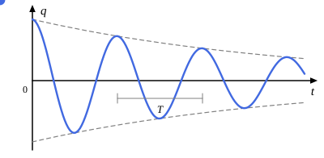
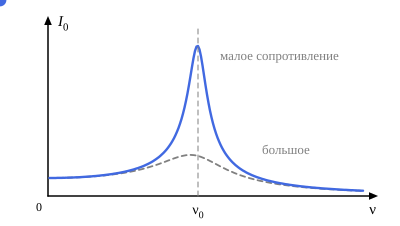

В опыте из урока 12.1 стрелка гальванометра качалась всё слабее и остановилась. А в радиоприёмнике колебания в контуре не затухают, пока работает станция. Почему так?

## Затухание

У настоящих проводов и катушки есть сопротивление. Ток нагревает их (урок 7.4), и с каждым колебанием часть энергии контура уходит в тепло. Амплитуды заряда, напряжения и тока убывают — колебания **затухают**.

Период при этом почти не меняется, если сопротивление небольшое, — как у маятника, который качается в воздухе (урок 13.2 из механики). Чем больше сопротивление, тем быстрее затухание.

Сколько энергии ушло в тепло? Ровно столько, на сколько уменьшилась энергия контура. Удобно считать её в моменты, когда конденсатор заряжен сильнее всего: тогда вся энергия ${CU_{\max}^2/2.}$

**Пример.** Полная энергия контура ${75\ \text{мкДж}.}$ Через некоторое время амплитуда напряжения на конденсаторе стала в 5 раз меньше. Энергия ${CU_{\max}^2/2}$ пропорциональна квадрату напряжения, поэтому уменьшилась в 25 раз: осталось ${75/25 = 3\ \text{мкДж}.}$ В тепло ушло

$$
Q = 75 - 3 = 72\ \text{мкДж}.
$$

<pp-task id="ks-lc-13"></pp-task>

## Вынужденные колебания и резонанс

Чтобы колебания не затухали, контур надо подпитывать. Подключим к нему источник переменного напряжения, которое само меняется с какой-то частотой $\nu$. В контуре пойдут **вынужденные колебания** — с частотой источника, а не с собственной.

Собственная частота контура — частота его свободных колебаний (урок 12.2):

$$
\nu_0 = \frac{1}{2\pi\sqrt{LC}}.
$$

Будем менять частоту источника и смотреть на амплитуду тока. Пока частоты далеки, ток слабый. Когда частота источника совпадает с собственной, амплитуда тока резко растёт. Это **резонанс** — как у качелей, которые раскачивают в такт (урок 13.2 из механики).

Чем меньше сопротивление контура, тем выше и острее резонансный пик.

## Как приёмник выбирает станцию

Антенна принимает волны сразу многих станций, и каждая вызывает в контуре приёмника слабые вынужденные колебания со своей частотой. Сильно откликается только та станция, с частотой которой контур в резонансе. Её сигнал и усиливается дальше.

Чтобы настроиться на другую станцию, меняют собственную частоту контура — обычно ёмкость конденсатора. Частота обратна корню из ёмкости: чтобы частота стала вдвое меньше, ёмкость нужно увеличить вчетверо.

<pp-task id="ks-lc-14"></pp-task>

Проверь себя: почему колебания в контуре приёмника не затухают, пока станция работает, хотя у его проводов есть сопротивление?

Это вынужденные колебания: волна от станции всё время подпитывает контур энергией и восполняет то, что уходит в тепло.

## Частые ловушки

- **Думают, что при затухании меняется период.** Убывает амплитуда, период почти тот же.
- **Считают теплоту по разности амплитуд.** Энергия пропорциональна квадрату амплитуды: сначала найди энергии, потом их разность.
- **Думают, что резонанс бывает на любой частоте.** Только когда частота источника равна собственной частоте контура.
- **Ошибаются в направлении настройки.** Больше ёмкость — меньше собственная частота.

## Коротко

- Сопротивление превращает энергию контура в тепло: колебания затухают, период почти тот же.
- Теплота — разность энергий контура в начале и в конце.
- Вынужденные колебания идут с частотой источника; резонанс — когда она равна ${\nu_0 = 1/(2\pi\sqrt{LC}).}$
- Приёмник настраивают на станцию, меняя ёмкость контура.

Это последний урок темы. Дальше — тема «Переменный ток и электромагнитные волны»: как генератор создаёт переменный ток, как трансформатор меняет напряжение и как электромагнитные колебания порождают волны — от радиоволн до света.
