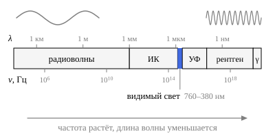

В розетке — переменный ток с частотой $50\ \text{Гц}$. Телефон ловит сигнал вышки, а микроволновка греет еду. Всё это электромагнитные колебания и волны. Тема нужна в задаче 13 и в задаче 14.

Генератор, трансформатор, электромагнитные волны и их шкалу проходят в 9 классе. Действующие значения, токи в трансформаторе и потери при передаче энергии — в 11. Пригодятся темы «Электромагнитная индукция», «Колебательный контур» и «Механические волны».

## Шаг 1. Переменный ток (9 класс)

**Переменный ток** — ток, который периодически меняет величину и направление. Его вырабатывает генератор: рамка вращается в магнитном поле, поток через неё меняется, и по закону Фарадея возникает переменная ЭДС:

$$
e = \mathcal{E}_{\max}\sin(\omega t).
$$

В розетке частота $50\ \text{Гц}$: за секунду $50$ полных колебаний, и ток меняет направление $100$ раз в секунду. Период $T = 1/\nu$ — как у любых колебаний.

<pp-task id="ks-em-01"></pp-task>

## Шаг 2. Трансформатор (9 класс)

Трансформатор повышает или понижает переменное напряжение. Две катушки на общем железном сердечнике. В идеальном трансформаторе:

$$
\frac{U_1}{U_2} = \frac{N_1}{N_2}.
$$

Больше витков во вторичной обмотке — напряжение выше. Трансформатор не работает на постоянном токе: нет изменения магнитного потока — нет индукции.

<pp-task id="ks-em-02"></pp-task>

## Шаг 3. Электромагнитные волны (9 класс)

Переменное электрическое поле порождает магнитное, а переменное магнитное — электрическое. Они поддерживают друг друга и распространяются в пространстве. Это **электромагнитная волна**.

Свойства:

- распространяется и в вакууме (среда не нужна);
- скорость в вакууме $c = 3 \cdot 10^8\ \text{м/с}$;
- волна **поперечная**: векторы $\vec E$ и $\vec B$ перпендикулярны друг другу и направлению распространения;
- излучает волну заряд, движущийся с ускорением.

Связь длины волны и частоты — как у механических волн:

$$
\lambda = \frac{c}{\nu} = c T.
$$

<pp-task id="ks-em-03"></pp-task>

## Шаг 4. Шкала электромагнитных волн (9 класс)

По убыванию длины волны (и росту частоты):

1. радиоволны;
2. инфракрасное излучение (тепло от батареи);
3. видимый свет — от красного (около $760\ \text{нм}$) до фиолетового (около $380\ \text{нм}$);
4. ультрафиолет (загар);
5. рентгеновское излучение;
6. гамма-излучение.

Физическая природа у всех одна, отличаются частота и длина волны.

## Шаг 5. Действующие значения (11 класс)

Переменный ток всё время меняется. Как сравнить его с постоянным? **Действующее значение** — такое значение постоянного тока, который выделит в резисторе столько же теплоты:

$$
I_{\text{д}} = \frac{I_{\max}}{\sqrt 2}, \qquad U_{\text{д}} = \frac{U_{\max}}{\sqrt 2}.
$$

«$220\ \text{В}$ в розетке» — это действующее напряжение. Амплитуда около $311\ \text{В}$. Амперметры и вольтметры переменного тока показывают действующие значения.

<pp-task id="ks-em-04"></pp-task>

## Шаг 6. Токи в трансформаторе (11 класс)

Идеальный трансформатор не теряет энергию: мощность в первичной обмотке равна мощности во вторичной, $U_1 I_1 = U_2 I_2$. Значит, во сколько раз трансформатор повышает напряжение, во столько раз он понижает ток:

$$
\frac{I_1}{I_2} = \frac{U_2}{U_1} = \frac{N_2}{N_1}.
$$

Трансформатор не может повысить мощность.

<pp-task id="ks-em-05"></pp-task>

## Шаг 7. Передача электроэнергии (11 класс)

Электроэнергию передают на большие расстояния при высоком напряжении. Мощность $P = UI$ задана, поэтому при большом $U$ ток $I = P/U$ маленький, и потери на нагрев проводов $I^2 R$ (закон Джоуля — Ленца) сильно меньше. Повысили напряжение в 10 раз — потери уменьшились в 100 раз.

<pp-task id="ks-em-06"></pp-task>

## Шаг 8. Волна в веществе (11 класс)

При переходе в вещество частота волны не меняется — её задаёт источник (как у механических волн). Скорость в веществе меньше $c$, поэтому и длина волны меньше: $\lambda = v/\nu$. Подробнее — в теме «Преломление света».

<pp-task id="ks-em-07"></pp-task>

## Частые ловушки

- **Путают действующее значение и амплитуду.** Делить на $\sqrt 2$.
- **Думают, что трансформатор повышает мощность.** Он меняет напряжение и ток, мощность сохраняется (в идеальном).
- **Считают, что ЭМ волне нужна среда.** Не нужна.
- **Путают порядок в шкале.** Инфракрасное — длиннее видимого, ультрафиолет — короче.

## Как это выглядит на ЕГЭ

*Радиостанция вещает на частоте $100\ \text{МГц}$. Найди длину волны.*

$$
\lambda = \frac{c}{\nu} = \frac{3 \cdot 10^8}{10^8} = 3\ \text{м}.
$$

Это УКВ-диапазон. Длинные волны радиовещания — сотни метров и километры.

## Коротко

- В розетке $220\ \text{В}$ действующее, $50\ \text{Гц}$; $I_{\text{д}} = I_{\max}/\sqrt 2$.
- Трансформатор: $U_1/U_2 = N_1/N_2$, $I_1/I_2 = N_2/N_1$, работает только на переменном токе.
- Высокое напряжение в ЛЭП — меньше ток и потери $I^2R$.
- ЭМ волна поперечная, $c = 3 \cdot 10^8\ \text{м/с}$, $\lambda = c/\nu$.
- Шкала: радио → ИК → видимый → УФ → рентген → гамма.
