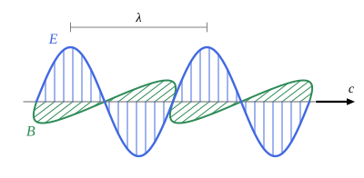

Нажми кнопку на телефоне — и через доли секунды сообщение уже на другом конце страны. Никаких проводов между телефоном и вышкой нет. Что несёт сигнал? Электромагнитная волна. Свет от Солнца — тоже она: восемь минут летит через пустой космос.

## Поле порождает поле

Вспомним электромагнитную индукцию. Магнитный поток через кольцо меняется — и в кольце идёт ток (урок 10.1). Заряды в кольце гонит электрическое поле. Значит, **меняющееся магнитное поле порождает электрическое поле**. Причём это поле возникает и без кольца, в пустом пространстве, — кольцо лишь показывает, что поле есть.

Джеймс Максвелл в XIX веке предположил, что верно и обратное: **меняющееся электрическое поле порождает магнитное поле** — так же, как его порождает ток.

Тогда получается цепочка. Где-то быстро меняется электрическое поле. Оно порождает рядом меняющееся магнитное поле, а то — снова электрическое, чуть дальше, и так далее. Поля поддерживают друг друга и бегут от источника. Максвелл подсчитал скорость такого «бега», и она совпала со скоростью света. Он заключил, что свет — это тоже электромагнитная волна. Через двадцать лет Генрих Герц получил такие волны в опыте.

## Определения

**Электромагнитная волна** — переменное электромагнитное поле, которое распространяется в пространстве.

Свойства электромагнитной волны:

- ей не нужна среда — она бежит и в вакууме, в отличие от звука (урок 14.4 из механики);
- в вакууме её скорость ${c = 3 \cdot 10^8\ \text{м/с}}$ — скорость света, самая большая скорость в природе;
- волна **поперечная**: векторы $\vec E$ и $\vec B$ перпендикулярны направлению, в котором она бежит, и друг другу;
- $\vec E$ и $\vec B$ колеблются **в фазе**: оба одновременно наибольшие и одновременно равны нулю;
- волна переносит энергию — поэтому солнечный свет греет.

## Кто излучает волну

Заряд, который стоит на месте, создаёт только электрическое поле. Заряд, который движется равномерно, — ещё и магнитное, но волны нет. Электромагнитную волну излучает заряд, который движется **с ускорением**.

Так работает антенна. Колебательный контур передатчика (уроки 12.1–12.7) гонит электроны в антенне туда и обратно с частотой $\nu$ — они всё время то разгоняются, то тормозят. Вокруг антенны поле меняется с той же частотой, и волна уходит в пространство. Антенна приёмника ловит волну: её поле раскачивает электроны в антенне, а контур приёмника, настроенный в резонанс (урок 12.7), выделяет нужную станцию.

## Длина волны

У электромагнитной волны есть длина волны $\lambda$ — расстояние между соседними гребнями. Связь та же, что у механических волн (уроки 14.2 и 14.3 из механики): за один период волна убегает на одну длину волны,

$$
\lambda = cT = \frac{c}{\nu}.
$$

Частоту задаёт источник — частота колебаний электронов в антенне.

**Пример.** Радиостанция вещает на частоте ${100\ \text{МГц} = 10^8\ \text{Гц}.}$ Длина её волны

$$
\lambda = \frac{c}{\nu} = \frac{3 \cdot 10^8}{10^8} = 3\ \text{м}.
$$

<pp-task id="ks-em-03"></pp-task>

Скорость волны огромна, но конечна. Радиосигнал до Луны, до которой ${3{,}84 \cdot 10^8\ \text{м},}$ идёт ${t = s/c \approx 1{,}3\ \text{с}.}$ По такому же опозданию радиолокатор находит расстояние до самолёта.

<pp-task id="ks-em-10"></pp-task>

Проверь себя: почему звук от взрыва на Солнце до нас не доходит, а свет доходит?

Звуку нужна среда — воздух, вода, твёрдое тело. Между Солнцем и Землёй почти пустой космос, и звук там не распространяется. Электромагнитной волне среда не нужна: поля поддерживают друг друга и в вакууме.

## Частые ловушки

- **Думают, что электромагнитной волне нужна среда.** Не нужна, она бежит и в вакууме.
- **Считают волну продольной.** Она поперечная: $\vec E$ и $\vec B$ перпендикулярны направлению волны.
- **Думают, что $\vec E$ и $\vec B$ сдвинуты на четверть периода, как заряд и ток в контуре.** В волне они колеблются в фазе.
- **Путают, что делить на что.** ${\lambda = c/\nu}$ — делят скорость на частоту; произведение $c\nu$ смысла не имеет.

## Коротко

- Меняющееся магнитное поле порождает электрическое, электрическое — магнитное; вместе они бегут волной.
- Излучает заряд, движущийся с ускорением; антенна — электроны, колеблющиеся с частотой $\nu$.
- Волна поперечная, $\vec E \perp \vec B,$ в фазе; в вакууме ${c = 3 \cdot 10^8\ \text{м/с}.}$
- ${\lambda = cT = c/\nu.}$

Дальше — урок 13.4: какие бывают электромагнитные волны — от радиоволн до гамма-излучения.
