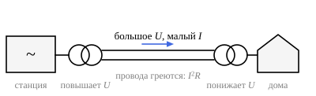

Трансформатор может поднять напряжение с ${220\ \text{В}}$ до тысяч вольт. Нельзя ли так получить энергию из ничего — больше вольт, больше ватт? Нет. Посмотрим, что при этом происходит с током, и выясним, зачем электростанции поднимают напряжение до сотен тысяч вольт.

## Мощность сохраняется

Хороший трансформатор почти не нагревается: в тепло уходит лишь несколько процентов энергии. В **идеальном** трансформаторе потерь нет совсем. Тогда вся мощность, которую первичная обмотка берёт из сети, уходит во вторичную, к потребителю (урок 7.2):

$$
U_1 I_1 = U_2 I_2.
$$

Отсюда

$$
\frac{I_1}{I_2} = \frac{U_2}{U_1} = \frac{N_2}{N_1}.
$$

Во сколько раз трансформатор повышает напряжение, во столько же раз он понижает ток — и наоборот. Токи относятся обратно числам витков: в обмотке с большим числом витков ток меньше. Поэтому её мотают тонким проводом, а обмотку с малым числом витков — толстым.

Трансформатор меняет напряжение и ток, но **не может повысить мощность**.

Ток в первичной обмотке зависит от того, что подключено ко вторичной. Нет нагрузки — вторичная обмотка разомкнута, ${I_2 = 0,}$ и первичная почти не берёт ток из сети. Подключили мощный прибор — вырос ${I_2,}$ а с ним и ${I_1.}$

**Пример.** Трансформатор понижает ${220\ \text{В}}$ до ${12\ \text{В}.}$ Во вторичной цепи ток ${5{,}5\ \text{А}.}$ Мощность ${P = U_2I_2 = 12 \cdot 5{,}5 = 66\ \text{Вт}}$ — столько же берёт первичная обмотка, и ток в ней

$$
I_1 = \frac{P}{U_1} = \frac{66}{220} = 0{,}3\ \text{А}.
$$

Напряжение уменьшилось в ${220/12 \approx 18}$ раз — и ток во столько же раз больше во вторичной обмотке, чем в первичной.

<pp-task id="ks-em-05"></pp-task>

## Передача электроэнергии

Электростанции часто стоят далеко от городов, и энергию передают по проводам длиной в сотни километров. У длинных проводов заметное сопротивление $R$, и в них выделяется тепло ${P_{\text{пот}} = I^2R}$ (уроки 7.4 и 7.5). Это потери: энергия греет воздух вокруг проводов, а до потребителя не доходит.

Станция передаёт мощность ${P = UI.}$ Её можно передать большим током при низком напряжении или малым током при высоком. Потери зависят от **квадрата** тока, поэтому выгоднее малый ток и высокое напряжение. Если поднять напряжение в $n$ раз, ток уменьшится в $n$ раз, а потери — в $n^2$ раз.

Поэтому у электростанции стоит повышающий трансформатор, и по линиям электропередачи идёт напряжение в сотни тысяч вольт. У городов понижающие трансформаторы снижают его ступенями — до ${220\ \text{В}}$ в домах. Именно ради этого в сетях переменный ток: постоянный трансформатор не меняет (урок 13.2).

А почему бы просто не сделать провода толще? Сопротивление ${R = \rho l/S}$ (урок 5.4): чтобы уменьшить потери в $16$ раз при прежнем токе, сечение провода нужно увеличить в $16$ раз — это огромная масса меди или алюминия на сотни километров. Поднять напряжение в $4$ раза гораздо дешевле.

**Пример.** Станция передаёт мощность ${1{,}2\ \text{МВт}}$ по линии сопротивлением ${3\ \text{Ом}.}$ При напряжении ${6\ \text{кВ}}$ ток и потери

$$
\begin{aligned}
I &= \frac{P}{U} = \frac{1{,}2 \cdot 10^6}{6 \cdot 10^3} = 200\ \text{А},\\
P_{\text{пот}} &= I^2R = 200^2 \cdot 3 = 120\ \text{кВт}.
\end{aligned}
$$

Это десятая часть всей мощности. При ${24\ \text{кВ}}$ ток ${50\ \text{А},}$ а потери ${50^2 \cdot 3 = 7{,}5\ \text{кВт}}$ — в $16$ раз меньше.

<pp-task id="ks-em-06"></pp-task>

<pp-task id="ks-em-14"></pp-task>

Проверь себя: почему потери в линии нельзя считать по формуле U²/R, подставив напряжение линии?

Напряжение линии — это напряжение между проводами у потребителя, почти всё оно приходится на потребителя, а не на сами провода. На проводах падает лишь малая его часть. Надёжнее считать через ток, который один и тот же в проводах и у потребителя: ${P_{\text{пот}} = I^2R,}$ где ${I = P/U.}$

## Частые ловушки

- **Думают, что трансформатор повышает мощность.** Он меняет напряжение и ток, а мощность в идеальном трансформаторе та же.
- **Думают, что ток меняется так же, как напряжение.** Наоборот: напряжение выросло — ток во столько же раз уменьшился.
- **Забывают квадрат в потерях.** Ток меньше в $n$ раз — потери меньше в $n^2$ раз.
- **Считают потери по напряжению линии.** Потери — ${I^2R}$ с сопротивлением проводов, а не ${U^2/R.}$

## Коротко

- Идеальный трансформатор: ${U_1I_1 = U_2I_2,}$ ${I_1/I_2 = N_2/N_1.}$
- Повышает напряжение — понижает ток; мощность не повышает.
- Потери в проводах ${I^2R;}$ при той же мощности напряжение в $n$ раз выше — потери в $n^2$ раз меньше.
- Поэтому энергию передают под высоким напряжением, а в домах понижают до ${220\ \text{В}.}$

Дальше — урок 13.7: что происходит с электромагнитной волной, когда она входит в вещество.
