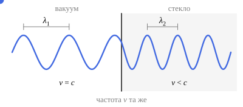

Свет из воздуха входит в стекло или в воду. В вакууме все электромагнитные волны бегут со скоростью $c$ (урок 13.3). А в веществе? И что тогда происходит с частотой и длиной волны?

## Что задаёт частоту

Вспомним механические волны. Когда звук переходит из воздуха в воду, его частота не меняется: частицы воды на границе раскачиваются в том же ритме, в каком их толкает воздух. Меняются скорость и длина волны (урок 14.6 из механики).

С электромагнитной волной так же. Её частоту задаёт источник — электроны в антенне или атомы раскалённого тела. Поле волны раскачивает заряды вещества в своём ритме, а они излучают волну с той же частотой. Частота на границе не может «сбиться»: сколько гребней пришло к границе за секунду, столько же и ушло дальше.

А скорость в веществе меньше $c$: в стекле примерно в $1{,}5$ раза, в воде — в $1{,}33$ раза. Значит, и длина волны меньше: за один период волна убегает на меньшее расстояние.

## Формулы

В веществе, где скорость волны $v$:

$$
\lambda = \frac{v}{\nu}.
$$

Частота $\nu$ та же, что в вакууме, где ${\lambda_0 = c/\nu.}$ Поделим одно на другое — частота сократится:

$$
\frac{\lambda}{\lambda_0} = \frac{v}{c}.
$$

Во сколько раз скорость меньше $c$, во столько же раз короче волна.

**Пример.** Свет частотой ${6 \cdot 10^{14}\ \text{Гц}}$ в вакууме имеет длину волны

$$
\lambda_0 = \frac{c}{\nu} = \frac{3 \cdot 10^8}{6 \cdot 10^{14}} = 5 \cdot 10^{-7}\ \text{м} = 500\ \text{нм}.
$$

В алмазе свет бежит со скоростью около ${1{,}2 \cdot 10^8\ \text{м/с}}$ — в ${2{,}5}$ раза медленнее. Частота та же, а длина волны

$$
\lambda = \frac{v}{\nu} = \frac{1{,}2 \cdot 10^8}{6 \cdot 10^{14}} = 2 \cdot 10^{-7}\ \text{м} = 200\ \text{нм}
$$

— тоже в ${2{,}5}$ раза меньше.

<pp-task id="ks-em-07"></pp-task>

## Цвет определяет частота

В вакууме ${200\ \text{нм}}$ — это ультрафиолет (урок 13.4). Значит ли это, что зелёный свет в алмазе стал невидимым ультрафиолетом? Нет. Глаз и любой приёмник откликаются на **частоту** колебаний поля, а она не изменилась. Поэтому под водой красный предмет остаётся красным, а зелёный — зелёным. Когда на шкале волн пишут длины волн цветов, имеют в виду длины волн в вакууме.

<pp-task id="ks-em-15"></pp-task>

Проверь себя: радиоволна из воздуха уходит в морскую воду. Что из трёх величин — частота, скорость, длина волны — не изменится?

Частота: её задаёт передатчик. Скорость в воде меньше, и длина волны во столько же раз короче.

## Частые ловушки

- **Думают, что в веществе меняется частота.** Частота та же, меняются скорость и длина волны.
- **Думают, что в веществе волна длиннее.** Скорость в веществе меньше $c$, значит, и длина волны меньше.
- **Берут скорость в вакууме для длины волны в веществе.** В веществе ${\lambda = v/\nu}$ со скоростью в этом веществе.
- **Думают, что цвет меняется вместе с длиной волны.** Цвет определяет частота.

## Коротко

- При переходе в вещество частота волны не меняется — её задаёт источник.
- Скорость в веществе ${v < c,}$ длина волны ${\lambda = v/\nu}$ меньше.
- ${\lambda/\lambda_0 = v/c.}$
- Цвет света определяет частота.

Это последний урок темы. Дальше — тема «Отражение и преломление света»: почему луч света ломается на границе воды и воздуха и как скорость света в веществе связана с показателем преломления.
