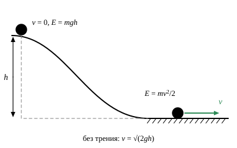

Энергия — самый мощный инструмент механики. Многие задачи, которые через силы решаются в пять строк, через энергию решаются в две. Тема нужна в задаче 3, в задачах 5–6 и почти в каждой задаче 22 и 26.

## Кинетическая энергия

Мяч, летящий быстро, может разбить окно. Неподвижный — нет. Энергия движения — **кинетическая**:

$$
E_{\text{к}} = \frac{m v^2}{2}.
$$

- $m$ — масса, кг;
- $v$ — скорость, м/с;
- $E_{\text{к}}$ — энергия, Дж.

Скорость входит в квадрате: вдвое быстрее — вчетверо больше энергии.

**Теорема о кинетической энергии**: работа всех сил, действующих на тело, равна изменению его кинетической энергии:

$$
A_{\text{всех сил}} = E_{\text{к2}} - E_{\text{к1}}.
$$

Эта теорема работает всегда — и с трением, и без.

## Потенциальная энергия

Кирпич на крыше «запасает» энергию: если он упадёт, он разгонится. Это **потенциальная энергия** — энергия положения.

Тело в поле тяжести на высоте $h$:

$$
E_{\text{п}} = m g h.
$$

Высоту отсчитывают от выбранного нулевого уровня (пол, земля, стол). Сама по себе потенциальная энергия зависит от выбора нуля, а её **изменение** — нет.

Деформированная пружина:

$$
E_{\text{п}} = \frac{k x^2}{2},
$$

где $x$ — удлинение или сжатие, а не длина пружины.

## Закон сохранения механической энергии

Качели: в верхней точке они на миг замирают — вся энергия потенциальная. Внизу несутся быстрее всего — энергия перешла в кинетическую. Сумма остаётся постоянной.

**Механическая энергия** — сумма кинетической и потенциальной:

$$
E = E_{\text{к}} + E_{\text{п}}.
$$

Если на тело действуют только потенциальные силы (тяжесть, упругость), а остальные работы не совершают, механическая энергия сохраняется:

$$
\frac{m v_1^2}{2} + m g h_1 = \frac{m v_2^2}{2} + m g h_2.
$$

Важное следствие: скорость тела, соскользнувшего без трения с высоты $h$, равна $\sqrt{2gh}$ — неважно, по какой горке, крутой или пологой.

## Когда энергия не сохраняется

Если есть трение или сопротивление, часть механической энергии переходит во внутреннюю (тела нагреваются):

$$
E_2 - E_1 = A_{\text{тр}}, \qquad A_{\text{тр}} < 0.
$$

При неупругом ударе тоже теряется механическая энергия. Полная энергия при этом не исчезает — она переходит в тепло.

Типичный план задачи 26: «на одном участке — закон сохранения энергии, в момент удара — закон сохранения импульса, после удара — снова энергия».

## Частые ловушки

- **Применяют сохранение энергии при трении** без учёта работы трения.
- **Применяют сохранение энергии при неупругом ударе.** На удар — только импульс.
- **Путают удлинение пружины с её длиной** в $kx^2/2$.
- **Забывают, что в верхней точке броска под углом кинетическая энергия не равна нулю.** Горизонтальная скорость остаётся.

## Как это выглядит на ЕГЭ

*Шайбу толкнули вверх по гладкой горке со скоростью $6\ \text{м/с}$. На какую высоту она поднимется? $g = 10\ \text{м/с}^2$.*

Трения нет, нормальная реакция перпендикулярна скорости и работы не совершает. Механическая энергия сохраняется. Внизу вся энергия кинетическая, в верхней точке — потенциальная (шайба остановилась):

$$
\frac{m v^2}{2} = m g h,
$$

$$
h = \frac{v^2}{2g} = \frac{36}{20} = 1{,}8\ \text{м}.
$$

Масса сократилась — её и не дали. Это хороший знак, что выбран верный путь.

## Коротко

- $E_{\text{к}} = mv^2/2$; теорема: $A_{\text{всех}} = \Delta E_{\text{к}}$.
- $E_{\text{п}} = mgh$; пружина $kx^2/2$.
- Без трения и неупругих ударов $E_{\text{к}} + E_{\text{п}} = \text{const}$.
- С трением: $\Delta E = A_{\text{тр}} < 0$.
- С высоты $h$ без трения: $v = \sqrt{2gh}$.
