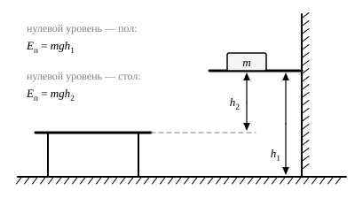

Строители забивают сваи копром: тяжёлый молот поднимают повыше и отпускают. Падая, он вбивает сваю в землю — совершает работу. Пока молот висел наверху, он ничего не делал, но был готов. Эту «готовность совершить работу» физики называют энергией. В этом уроке разберём первый её вид — энергию поднятого тела.

## Что такое энергия

Сжатая пружина может подбросить шарик. Ветер может крутить мельницу. Поднятый молот может забить сваю. Во всех примерах тело **может совершить работу**. Тогда говорят, что у тела есть **энергия**.

Энергию измеряют в тех же единицах, что и работу (урок 11.1), — в **джоулях**. Чем больше работы тело способно совершить, тем больше у него энергии.

## Энергия поднятого тела

Чтобы поднять молот массой $m$ на высоту $h$, надо совершить работу $mgh$ (урок 11.1). Эта работа не пропала: она будто запаслась в поднятом молоте. Отпусти его — и, падая обратно на ту же высоту, он может совершить ту же работу.

Энергию, которая зависит от положения тела, называют **потенциальной** (от латинского «возможный»). Для тела на высоте $h$:

$$
E_{\text{п}} = m g h.
$$

- $m$ — масса, кг;
- $g = 10\ \text{Н/кг}$;
- $h$ — высота, м;
- $E_{\text{п}}$ — потенциальная энергия, Дж.

**Пример.** Молот копра массой $500\ \text{кг}$ подняли на $4\ \text{м}$ над сваей:

$$
E_{\text{п}} = 500 \cdot 10 \cdot 4 = 20\,000\ \text{Дж} = 20\ \text{кДж}.
$$

Тяжелее молот или выше подняли — больше энергия и сильнее удар.

<pp-task id="ks-energy-01"></pp-task>

## Высота — от чего?

Книга лежит на полке. На какой она высоте? Смотря откуда мерить: от пола — одна высота, от стола — другая. Высоту отсчитывают от **нулевого уровня**, и выбираешь его ты сам: пол, стол, землю — как удобнее в задаче.

**Пример.** Книга массой $0{,}5\ \text{кг}$ лежит на полке в $2\ \text{м}$ от пола. Стол высотой $0{,}8\ \text{м}$. Относительно пола:

$$
E_{\text{п}} = 0{,}5 \cdot 10 \cdot 2 = 10\ \text{Дж}.
$$

Относительно стола полка выше всего на $2 - 0{,}8 = 1{,}2\ \text{м}$:

$$
E_{\text{п}} = 0{,}5 \cdot 10 \cdot 1{,}2 = 6\ \text{Дж}.
$$

Разные числа — и оба верные. **Сама потенциальная энергия зависит от выбора нулевого уровня.**

А теперь переложим книгу со стола на полку. Относительно пола энергия была $0{,}5 \cdot 10 \cdot 0{,}8 = 4\ \text{Дж}$, стала $10\ \text{Дж}$ — выросла на $6\ \text{Дж}$. Относительно стола была $0$, стала $6\ \text{Дж}$ — выросла на те же $6\ \text{Дж}$. **Изменение потенциальной энергии от выбора нуля не зависит**: важна только разница высот. А в задачах почти всегда нужно именно изменение.

Если тело ниже нулевого уровня, его высота и потенциальная энергия отрицательны. Ничего страшного: просто тело ниже, чем выбранный ноль.

Проверь себя: мяч массой 0,4 кг лежит на дне ямы глубиной 1,5 м. Какова его потенциальная энергия относительно края ямы? А относительно дна?

Относительно края мяч ниже нуля на $1{,}5\ \text{м}$: $E_{\text{п}} = 0{,}4 \cdot 10 \cdot (-1{,}5) = -6\ \text{Дж}$. Относительно дна высота ноль, и $E_{\text{п}} = 0$. Чтобы вытащить мяч наверх, в обоих случаях энергия должна вырасти на $6\ \text{Дж}$.

<pp-task id="ks-energy-09"></pp-task>

## Частые ловушки

- **Забыли $g$.** $E_{\text{п}} = mgh$, а не $mh$.
- **Высоту взяли не от того уровня.** Сначала реши, где ноль, и все высоты отсчитывай от него.
- **Ищут изменение, а считают энергию в одной точке.** Изменение — разность: $mg\,(h_2 - h_1)$.
- **Сантиметры.** Высоту подставляй в метрах.

## Коротко

- Энергия — способность тела совершить работу; измеряется в джоулях.
- Потенциальная энергия поднятого тела $E_{\text{п}} = mgh$.
- Высоту отсчитывают от нулевого уровня, который выбирают сами.
- От выбора нуля зависит $E_{\text{п}}$, но не её изменение.

Дальше — урок 12.2: энергия движения. Почему пуля, которая весит меньше яблока, опаснее брошенного кирпича.
