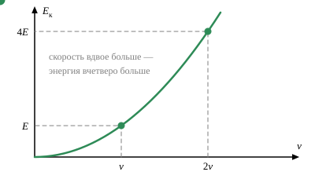

Пуля весит меньше яблока. Кирпич — в сотни раз больше. Но брошенный рукой кирпич можно поймать в рукавицу, а пулю — нет. Дело в скорости: быстро летящее тело может совершить огромную работу — пробить, смять, разрушить. Это энергия движения. В этом уроке узнаем, как её посчитать.

## Энергия движения

Мяч, летящий быстро, может разбить окно. Неподвижный — нет. Шар в боулинге сбивает кегли. Энергию, которая есть у тела потому, что оно движется, называют **кинетической** (от греческого «движение»):

$$
E_{\text{к}} = \frac{m v^2}{2}.
$$

- $m$ — масса, кг;
- $v$ — скорость, м/с;
- $E_{\text{к}}$ — кинетическая энергия, Дж.

**Пример.** Велосипедист вместе с велосипедом имеет массу $80\ \text{кг}$ и едет со скоростью $5\ \text{м/с}$:

$$
E_{\text{к}} = \frac{80 \cdot 5^2}{2} = \frac{80 \cdot 25}{2} = 1000\ \text{Дж}.
$$

Сначала возводи скорость в квадрат, потом умножай на массу и дели на два.

## Откуда формула

Кинетическая энергия — это работа, которую нужно совершить, чтобы разогнать тело из покоя.

Толкнём тележку массой $m$ постоянной силой $F$ на пути $s$. Работа силы $A = Fs$ (урок 11.1). По второму закону Ньютона $F = ma$ (урок 5.4), значит, $A = mas$. А из урока 2.4 при разгоне из покоя $v^2 = 2as$, то есть $as = v^2/2$. Получаем:

$$
A = m \cdot a s = \frac{m v^2}{2}.
$$

Работа, которую совершили при разгоне, запаслась в движущемся теле. Затормози его — и оно отдаст её обратно: сомнёт, нагреет, сдвинет то, во что врежется.

<pp-task id="ks-energy-02"></pp-task>

## Скорость — в квадрате

Масса стоит в формуле в первой степени, а скорость — во второй. Тяжелее вдвое — энергия вдвое больше. **Быстрее вдвое — энергия вчетверо больше.** Быстрее втрое — в девять раз.

Отсюда важный вывод про тормозной путь. Из урока 2.4 тормозной путь $s = v^2/(2a)$ тоже растёт как квадрат скорости: тормоза должны забрать у машины всю её кинетическую энергию. При тех же тормозах у машины на $100\ \text{км/ч}$ тормозной путь не вдвое, а **вчетверо** длиннее, чем на $50\ \text{км/ч}$. Поэтому превышение скорости так опасно.

Если нужно сравнить энергии одного тела, переводить скорость в метры в секунду не обязательно: отношение скоростей в км/ч то же самое.

Проверь себя: у чего больше кинетическая энергия — у грузовика массой 10 т, едущего со скоростью 10 м/с, или у пули массой 10 г, летящей со скоростью 1000 м/с?

Грузовик: $\dfrac{10\,000 \cdot 100}{2} = 500\,000\ \text{Дж}$. Пуля: $\dfrac{0{,}01 \cdot 1\,000\,000}{2} = 5000\ \text{Дж}$. У грузовика в $100$ раз больше. Пуля опасна не запасом энергии, а тем, что отдаёт его на крошечной площади.

<pp-task id="ks-energy-10"></pp-task>

## Частые ловушки

- **Не возвели скорость в квадрат.** $E_{\text{к}} = mv^2/2$, а не $mv/2$.
- **Забыли поделить на 2.**
- **Масса в граммах, скорость в км/ч.** Для энергии в джоулях — килограммы и метры в секунду.
- **«Скорость вдвое больше — энергия вдвое больше».** Вчетверо: скорость в квадрате.

## Коротко

- Кинетическая энергия $E_{\text{к}} = mv^2/2$.
- Она равна работе, которую надо совершить, чтобы разогнать тело из покоя.
- Скорость в $n$ раз больше — энергия в $n^2$ раз больше.
- Тормозной путь растёт как квадрат скорости.

Дальше — урок 12.3: как потенциальная энергия превращается в кинетическую и обратно, и что при этом остаётся неизменным.
