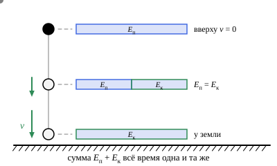

Качели в верхней точке на миг замирают. Потом несутся вниз и внизу летят быстрее всего. Потом снова поднимаются и снова замирают — почти на той же высоте. Скорость то есть, то нет, высота то есть, то нет. Но что-то при этом остаётся неизменным. В этом уроке найдём, что именно, — и получим самый полезный закон механики.

## Энергия переходит из одного вида в другой

Отпустим камень с высоты $h$. Наверху он неподвижен: кинетической энергии нет, есть только потенциальная $mgh$. Камень падает — высота уменьшается, и потенциальная энергия тоже. Зато растёт скорость, а с ней кинетическая энергия.

Если сопротивлением воздуха можно пренебречь, потенциальная энергия уменьшается **ровно на столько**, на сколько растёт кинетическая. На половине высоты их поровну. Перед самой землёй вся бывшая потенциальная энергия стала кинетической.

Почему ровно? Пока камень опускается на $\Delta h$, сила тяжести совершает работу $mg\,\Delta h$ (урок 11.5). Эта работа разгоняет камень — добавляет ему кинетическую энергию (урок 12.2). А потенциальная энергия $mgh$ уменьшилась на те же $mg\,\Delta h$.

На качелях — то же самое, туда и обратно: вниз потенциальная переходит в кинетическую, вверх — кинетическая в потенциальную.

<pp-task id="ks-energy-03"></pp-task>

## Закон сохранения механической энергии

Сумму кинетической и потенциальной энергии называют **механической энергией**:

$$
E = E_{\text{к}} + E_{\text{п}}.
$$

Мы только что увидели: одна часть убывает, другая растёт на столько же, а сумма не меняется. Это **закон сохранения механической энергии**:

$$
\frac{m v_1^2}{2} + m g h_1 = \frac{m v_2^2}{2} + m g h_2.
$$

Слева — энергия в одной точке пути, справа — в другой. Какие точки взять, решаешь сам: те, где что-то известно или что-то нужно найти.

Когда закон работает? Когда работу совершают **только сила тяжести и сила упругости** (её энергию разберём в уроке 12.5). Другие силы могут действовать, но не должны совершать работы. Например, реакция опоры перпендикулярна движению — её работа ноль (урок 11.4). А трение и сопротивление воздуха работу совершают — с ними механическая энергия убывает (урок 12.7).

**Пример.** Камень отпустили с высоты $20\ \text{м}$. Какая у него скорость на высоте $15\ \text{м}$? Нулевой уровень — земля. Наверху скорость ноль:

$$
m g \cdot 20 = \frac{m v^2}{2} + m g \cdot 15.
$$

Масса есть в каждом слагаемом — сократим её:

$$
v^2 = 2 g\,(20 - 15) = 2 \cdot 10 \cdot 5 = 100, \qquad v = 10\ \text{м/с}.
$$

Тот же ответ дала бы формула $v = \sqrt{2gh}$ из урока 3.2: камень пролетел $5\ \text{м}$. Только теперь она получилась в одну строчку — и, как увидим в уроке 12.4, работает не только для падения.

Проверь себя: камень отпустили с высоты 30 м. На какой высоте его кинетическая энергия равна потенциальной?

Вся энергия $mg \cdot 30$. Когда $E_{\text{к}} = E_{\text{п}}$, каждая из них — половина: $mgh = \dfrac{mg \cdot 30}{2}$, $h = 15\ \text{м}$. На половине высоты.

<pp-task id="ks-energy-04"></pp-task>

## Попробуй сам

В модели шайба скользит без трения по жёлобу: слева крутой склон, справа пологий, а между ними ровное дно. Пунктир — высота, с которой шайбу отпускают. Нажми «Пуск» и следи за полосами: синяя — потенциальная энергия, зелёная — кинетическая. Последняя строка, «сумма», — обе полосы подряд: её длина не меняется.

<pp-energy h="3" m="1" mu="0">Модель: шайба скользит без трения по жёлобу с крутым и пологим склонами. Потенциальная энергия переходит в кинетическую и обратно, сумма не меняется, и шайба поднимается на другом склоне на ту же высоту, с которой её отпустили.</pp-energy>

Посмотри, что выходит:

- на дне вся энергия кинетическая, скорость наибольшая;
- на пологом склоне шайба поднимается **на ту же высоту**, хотя склон другой. Точки, где она останавливалась, остаются на пунктире;
- увеличь массу: обе энергии растут, а скорость на дне та же — масса сокращается.

## Частые ловушки

- **Забыли начальную кинетическую энергию.** Если тело бросили, а не отпустили, в первой точке есть и $mv_1^2/2$.
- **Высоты от разных уровней.** Обе высоты — от одного нулевого уровня.
- **Применили закон при трении.** Если трение совершает работу, механическая энергия не сохраняется (урок 12.7).
- **Не сократили массу.** Её часто не дают в условии — значит, она сократится.

## Коротко

- Без трения потенциальная энергия переходит в кинетическую и обратно.
- Механическая энергия $E = E_{\text{к}} + E_{\text{п}}$.
- Если работу совершают только сила тяжести и сила упругости, $E$ сохраняется: $\dfrac{mv_1^2}{2} + mgh_1 = \dfrac{mv_2^2}{2} + mgh_2$.
- Масса в этом уравнении сокращается.

Дальше — урок 12.4: горка, маятник и бросок под углом. Закон сохранения решает их, не спрашивая о форме пути.
