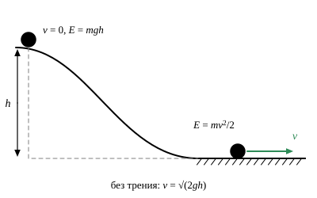
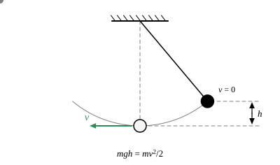
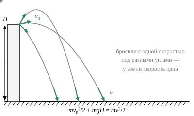

Три задачи выглядят совсем по-разному. Шайба скатывается с горки причудливой формы. Шарик качается на нити. Камень бросают с башни под углом. Через силы каждая — отдельная история: где-то сила меняет направление, где-то путь кривой. А через энергию все три решаются одинаково и в две строчки. В этом уроке научимся.

## План решения

1. **Проверь, что энергия сохраняется.** Трения и сопротивления нет, остальные силы работы не совершают.
2. **Выбери нулевой уровень** — обычно самую нижнюю точку.
3. **Выбери две точки** — где всё известно и где нужно найти.
4. **Запиши энергию в каждой**: $\dfrac{mv^2}{2} + mgh$. Приравняй и сократи массу.

## Горка любой формы

Шайбу отпустили с вершины гладкой горки высотой $h$. Наверху энергия $mgh$, у подножия — $\dfrac{mv^2}{2}$:

$$
m g h = \frac{m v^2}{2}
\quad\Rightarrow\quad
v = \sqrt{2 g h}.
$$

Та же скорость, что у камня, упавшего с высоты $h$ (урок 3.2). Форма горки, её крутизна и длина в ответ **не вошли**. Почему? Реакция опоры перпендикулярна движению и работы не совершает, а работа силы тяжести зависит только от разницы высот (урок 11.5). Крутая горка или пологая — шайба внизу едет с одной скоростью. По крутой она только скатится быстрее.

**Пример с ЕГЭ.** Шайбу толкнули вверх по гладкой горке со скоростью $6\ \text{м/с}$. На какую высоту она поднимется? Внизу энергия кинетическая, в верхней точке шайба остановилась — энергия потенциальная:

$$
\frac{m v^2}{2} = m g h, \qquad h = \frac{v^2}{2g} = \frac{36}{20} = 1{,}8\ \text{м}.
$$

Масса сократилась — её и не дали. Это хороший знак, что выбран верный путь.

## Маятник

Шарик на нити отвели в сторону и отпустили. Нить всё время тянет шарик к точке подвеса, а скорость направлена по касательной к дуге — перпендикулярно нити. Значит, сила натяжения работы не совершает (урок 11.4), и механическая энергия сохраняется:

$$
m g h = \frac{m v^2}{2}.
$$

Здесь $h$ — на сколько шарик **опустился** от точки старта до нижней точки, а не длина нити.

**Пример.** Качели отклонили так, что сиденье поднялось на $0{,}8\ \text{м}$ выше нижнего положения. Скорость внизу:

$$
v = \sqrt{2 g h} = \sqrt{2 \cdot 10 \cdot 0{,}8} = \sqrt{16} = 4\ \text{м/с}.
$$

С другой стороны шарик поднимется на ту же высоту $h$ — как шайба в модели урока 12.3.

<pp-task id="ks-energy-11"></pp-task>

## Бросок под любым углом

Энергия — не вектор, а просто число. Ей всё равно, куда направлена скорость. Бросим камень с башни высотой $H$ со скоростью $v_0$ — вверх, вбок или вниз. Нулевой уровень — земля:

$$
\frac{m v_0^2}{2} + m g H = \frac{m v^2}{2}
\quad\Rightarrow\quad
v^2 = v_0^2 + 2 g H.
$$

Угла в ответе нет. **Скорость у земли от угла броска не зависит** — от угла зависит только её направление и то, куда камень упадёт.

А вот в верхней точке броска под углом кинетическая энергия **не ноль**. Горизонтальная составляющая скорости $v_0\cos\alpha$ не меняется весь полёт (урок 3.5), и наверху камень летит горизонтально с этой скоростью.

**Пример.** Мяч бросили с земли со скоростью $20\ \text{м/с}$ под углом $30^\circ$. Наверху скорость $v_x = 20\cos 30^\circ$, и

$$
\frac{m v_0^2}{2} = \frac{m v_x^2}{2} + m g h,
$$

$$
h = \frac{v_0^2 - v_x^2}{2g} = \frac{(v_0 \sin\alpha)^2}{2g} = \frac{10^2}{20} = 5\ \text{м}.
$$

Тот же ответ, что в уроке 3.5. Если приравнять $\dfrac{mv_0^2}{2} = mgh$, получится $20\ \text{м}$ — ошибка: так бы взлетел мяч, брошенный вертикально.

Проверь себя: с балкона на высоте 5 м бросили мяч со скоростью 10 м/с — один раз вертикально вверх, другой раз вертикально вниз. В каком случае он упадёт на землю с большей скоростью?

Скорости одинаковые: $v^2 = 10^2 + 2 \cdot 10 \cdot 5 = 200$, $v \approx 14\ \text{м/с}$ в обоих случаях. Мяч, брошенный вверх, вернётся на высоту балкона с той же скоростью $10\ \text{м/с}$, только направленной вниз (урок 3.3), — дальше всё как у второго.

<pp-task id="ks-energy-12"></pp-task>

## Частые ловушки

- **Взяли длину горки или нити вместо высоты.** В $mgh$ — разница высот.
- **В верхней точке броска под углом приравняли кинетическую энергию к нулю.** Горизонтальная скорость остаётся.
- **Искали угол, чтобы найти скорость у земли.** Он не нужен: энергия — не вектор.
- **Применили закон к горке с трением.** Только для гладких.

## Коротко

- Гладкая горка любой формы: $v = \sqrt{2gh}$.
- Маятник: нить работы не совершает, $mgh = mv^2/2$, где $h$ — на сколько опустился шарик.
- Скорость у земли не зависит от угла броска: $v^2 = v_0^2 + 2gH$.
- В верхней точке броска под углом $E_{\text{к}} = mv_x^2/2 \ne 0$.

Дальше — урок 12.5: энергия сжатой пружины и как пружинный пистолет разгоняет шарик.
