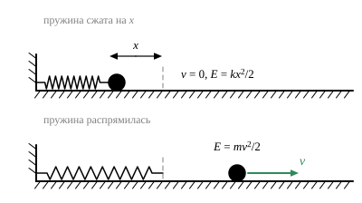

Игрушечный пистолет стреляет шариком без пороха и без батарейки. Ты сжал пружину — и она будто запомнила твоё усилие, а потом отдала его шарику. Пружина, как и поднятый молот из урока 12.1, может совершить работу — значит, у неё есть энергия. В этом уроке посчитаем сколько.

## Энергия деформированной пружины

В уроке 11.6 мы нашли: чтобы растянуть пружину жёсткостью $k$ из недеформированного состояния на $x$, нужна работа $kx^2/2$ — площадь треугольника под графиком силы. Эта работа не пропадает: она запасается в пружине. Отпусти пружину — и, возвращаясь к прежней длине, она совершит ту же работу.

Такую энергию тоже называют **потенциальной** — она зависит от того, насколько пружина деформирована:

$$
E_{\text{п}} = \frac{k x^2}{2}.
$$

- $k$ — жёсткость, Н/м (урок 6.1);
- $x$ — **деформация**: удлинение или сжатие, м. Не длина пружины!
- $E_{\text{п}}$ — энергия, Дж.

Сжатая и растянутая на одно и то же $x$ пружина запасает одинаковую энергию: $x$ в квадрате, знак не важен. Нулевой уровень здесь выбирать не нужно: у недеформированной пружины энергия ноль.

**Пример.** Пружину жёсткостью $800\ \text{Н/м}$ сжали на $5\ \text{см} = 0{,}05\ \text{м}$:

$$
E_{\text{п}} = \frac{800 \cdot 0{,}05^2}{2} = \frac{800 \cdot 0{,}0025}{2} = 1\ \text{Дж}.
$$

## Пружинный пистолет

Пружина распрямляется и разгоняет шарик. Трения нет — энергия пружины целиком переходит в кинетическую энергию шарика. Закон сохранения из урока 12.3 работает и здесь: сила упругости, как и сила тяжести, может совершать работу, не нарушая его.

$$
\frac{k x^2}{2} = \frac{m v^2}{2}.
$$

**Пример.** Пружиной из примера выше ($1\ \text{Дж}$) выстрелили горизонтально шариком массой $80\ \text{г} = 0{,}08\ \text{кг}$:

$$
v = \sqrt{\frac{2 E_{\text{п}}}{m}} = \sqrt{\frac{2 \cdot 1}{0{,}08}} = \sqrt{25} = 5\ \text{м/с}.
$$

<pp-task id="ks-energy-05"></pp-task>

## Пружина и высота

Теперь пистолет смотрит вверх. Пружина разгоняет шарик, тот взлетает и в верхней точке на миг останавливается. Энергия пружины перешла в потенциальную энергию шарика:

$$
\frac{k x^2}{2} = m g h.
$$

Высоту $h$ отсчитывают от положения шарика на сжатой пружине. Строго говоря, пока пружина распрямляется, шарик уже немного поднимается, но в задачах это либо учтено в $h$, либо слишком мало.

Удобно видеть цепочку целиком: энергия пружины → кинетическая энергия шарика → потенциальная энергия шарика наверху. Промежуточная скорость часто вообще не нужна: приравнивай сразу начало и конец.

Проверь себя: пружину пистолета сжали вдвое сильнее. Как изменятся энергия пружины, скорость шарика и высота, на которую он взлетит?

Энергия $kx^2/2$ вырастет в $2^2 = 4$ раза. Высота пропорциональна энергии — тоже в $4$ раза. А скорость: $mv^2/2$ вчетверо больше, значит, $v$ больше в $\sqrt{4} = 2$ раза.

<pp-task id="ks-energy-13"></pp-task>

## Частые ловушки

- **Подставили длину пружины вместо деформации.** $x$ — на сколько пружину сжали или растянули.
- **Сантиметры и граммы.** $x$ — в метрах, $m$ — в килограммах.
- **Забыли половину.** Энергия пружины $kx^2/2$, а не $kx^2$.
- **Перепутали силу и энергию.** $kx$ — сила (урок 6.1), $kx^2/2$ — энергия.

## Коротко

- Энергия деформированной пружины $E_{\text{п}} = kx^2/2$, $x$ — деформация.
- Это работа, которую затратили на деформацию (урок 11.6).
- Горизонтальный выстрел: $kx^2/2 = mv^2/2$; вертикальный: $kx^2/2 = mgh$.
- Сжатие вдвое больше — энергия вчетверо больше, скорость вдвое больше.

Дальше — урок 12.6: как работа любых сил, даже трения, меняет кинетическую энергию, и почему закон сохранения работает только для силы тяжести и пружины.
