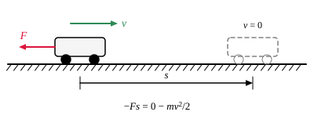

Машина тормозит: сила трения отнимает у неё скорость. Санки тянут за верёвку: сила тяги разгоняет их, а трение сдерживает. Как связать работу сил, которую мы научились считать в теме «Работа и мощность», с энергией тела? Связь простая и работает всегда. А из неё, как бонус, получится закон сохранения из урока 12.3 — и станет ясно, почему он не работает с трением.

## Теорема о кинетической энергии

На тело действует несколько сил. Их суммарная работа равна работе равнодействующей (урок 11.4): $A = F s$, где $F$ — равнодействующая вдоль движения. По второму закону $F = ma$, а из урока 2.4 $as = \dfrac{v_2^2 - v_1^2}{2}$. Получаем:

$$
A_{\text{всех сил}} = m a s = \frac{m v_2^2}{2} - \frac{m v_1^2}{2}.
$$

**Работа всех сил, действующих на тело, равна изменению его кинетической энергии.** Это теорема о кинетической энергии. В уроке 12.2 мы видели её частный случай: разгон из покоя, $A = mv^2/2$.

Теорема работает **всегда** — с трением и без, с любыми силами. Главное — сложить работы всех сил со знаками:

- работа положительна — сила разгоняет тело, $E_{\text{к}}$ растёт;
- работа отрицательна — сила тормозит, $E_{\text{к}}$ убывает.

## Тормозной путь без кинематики

Машина тормозит под действием силы $F$. Сила направлена против движения, её работа $-Fs$. Сила тяжести и реакция опоры работы не совершают. В конце машина стоит:

$$
-F s = 0 - \frac{m v^2}{2}
\quad\Rightarrow\quad
s = \frac{m v^2}{2F}.
$$

Ни ускорения, ни времени — а тормозной путь найден. И снова видно: он растёт как квадрат скорости (урок 12.2).

**Пример.** Санки массой $10\ \text{кг}$ катятся со скоростью $4\ \text{м/с}$ и тормозят под действием силы трения $20\ \text{Н}$:

$$
s = \frac{10 \cdot 16}{2 \cdot 20} = 4\ \text{м}.
$$

<pp-task id="ks-energy-06"></pp-task>

## Потенциальная энергия — работа со знаком минус

Вспомним урок 11.5: тело опустилось с высоты $h_1$ на $h_2$, сила тяжести совершила работу

$$
A_{\text{тяж}} = m g h_1 - m g h_2 = E_{\text{п1}} - E_{\text{п2}} = -\Delta E_{\text{п}}.
$$

**Работа силы тяжести равна изменению потенциальной энергии со знаком минус.** Спуск: сила тяжести совершает положительную работу, а потенциальная энергия убывает. С пружиной то же самое: когда деформация меняется от $x_1$ до $x_2$, сила упругости совершает работу $\dfrac{kx_1^2}{2} - \dfrac{kx_2^2}{2}$ (урок 11.6).

Так можно сделать только потому, что работа этих сил **не зависит от формы пути** (урок 11.5): она определяется начальным и конечным положением. Поэтому её и можно записать как разность «энергии положения». Для трения так нельзя — его работа зависит от длины пути. Потенциальной энергии трения не бывает.

## Откуда закон сохранения

Пусть работу совершают только сила тяжести и сила упругости. По теореме их работа равна $\Delta E_{\text{к}}$. А по только что сказанному она же равна $-\Delta E_{\text{п}}$:

$$
\Delta E_{\text{к}} = -\Delta E_{\text{п}}
\quad\Rightarrow\quad
\Delta (E_{\text{к}} + E_{\text{п}}) = 0.
$$

Вот и закон сохранения механической энергии из урока 12.3. И сразу видно, когда он ломается: если работу совершает ещё какая-то сила — трение, тяга, рука, — она добавляется в левую часть. Об этом урок 12.7.

Когда что применять:

- нужна скорость, а силы известны (тяга, трение, торможение) — теорема о кинетической энергии;
- работают только сила тяжести и пружина — закон сохранения, с ним проще.

Проверь себя: камень массой 0,2 кг бросили вертикально вверх со скоростью 10 м/с, и он поднялся на 4 м. Какую работу совершила сила сопротивления воздуха?

По теореме работа всех сил равна $\Delta E_{\text{к}} = 0 - \dfrac{0{,}2 \cdot 100}{2} = -10\ \text{Дж}$. Сила тяжести совершила $-mgh = -0{,}2 \cdot 10 \cdot 4 = -8\ \text{Дж}$. На сопротивление остаётся $-10 - (-8) = -2\ \text{Дж}$.

<pp-task id="ks-energy-14"></pp-task>

## Частые ловушки

- **Забыли силу.** В теореме — работа **всех** сил. Пропустил трение — ответ неверный.
- **Сложили работы без знаков.** Трение и торможение — работа отрицательная.
- **Учли силу тяжести дважды.** Либо её работа в теореме, либо потенциальная энергия в законе сохранения — не то и другое вместе.
- **Применили к потенциальной энергии.** Теорема — про изменение кинетической энергии.

## Коротко

- Теорема: $A_{\text{всех сил}} = \dfrac{mv_2^2}{2} - \dfrac{mv_1^2}{2}$; работает всегда.
- Тормозной путь: $-Fs = 0 - mv^2/2$.
- Работа силы тяжести и силы упругости $A = -\Delta E_{\text{п}}$: она не зависит от пути.
- Если работают только они, $E_{\text{к}} + E_{\text{п}} = \text{const}$.

Дальше — урок 12.7: что происходит с механической энергией, когда есть трение, и куда она девается.
