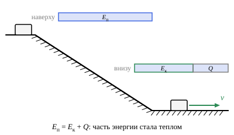

Санки съехали с горки и остановились на ровном снегу. Шайба проскользила по льду и замерла. Наверху была потенциальная энергия, внизу — кинетическая, а теперь ни той, ни другой. Куда делась энергия? Потрогай полозья санок после долгого спуска — они тёплые. В этом уроке посчитаем, сколько энергии превратилось в тепло.

## Трение уменьшает механическую энергию

В уроке 12.6 закон сохранения получился так: работа силы тяжести и пружины — это убыль потенциальной энергии. Добавим трение. Его работу нельзя записать через потенциальную энергию (урок 12.6), и она остаётся отдельным слагаемым:

$$
E_2 - E_1 = A_{\text{тр}}.
$$

Здесь $E_1$ и $E_2$ — механическая энергия $E_{\text{к}} + E_{\text{п}}$ в начале и в конце. Трение скольжения всегда направлено против движения (урок 6.3), и его работа отрицательна (урок 11.4): $A_{\text{тр}} < 0$. Значит, механическая энергия **убывает**.

Если на тело действует ещё и внешняя сила — тяга, рука, — её работа тоже добавляется:

$$
E_2 - E_1 = A_{\text{внеш}} + A_{\text{тр}}.
$$

Например, ящик равномерно втаскивают по гладкому склону на высоту $h$. Кинетическая энергия не меняется, потенциальная растёт на $mgh$ — ровно на работу руки.

## Куда девается энергия

Энергия не исчезает. При трении поверхности нагреваются: механическая энергия переходит во **внутреннюю** — энергию движения молекул (о ней подробнее в теме «Внутренняя энергия и работа газа»). Сколько механической энергии потеряно, столько выделилось **теплоты**:

$$
Q = E_1 - E_2 = -A_{\text{тр}}.
$$

$Q$ — положительное число, а работа трения — отрицательное. В задаче читай внимательно, что спрашивают: «работу силы трения» (с минусом) или «сколько энергии перешло во внутреннюю», «сколько теплоты выделилось» (без минуса).

**Пример.** Шайба массой $0{,}2\ \text{кг}$ скользит по льду со скоростью $6\ \text{м/с}$, коэффициент трения $0{,}1$. Сколько она проедет? Сила трения $\mu mg$ (урок 6.3), работа $-\mu mg\,s$. В конце шайба стоит:

$$
-\mu m g\,s = 0 - \frac{m v^2}{2}
\quad\Rightarrow\quad
s = \frac{v^2}{2 \mu g} = \frac{36}{2 \cdot 0{,}1 \cdot 10} = 18\ \text{м}.
$$

Вся кинетическая энергия, $\dfrac{0{,}2 \cdot 36}{2} = 3{,}6\ \text{Дж}$, стала теплом.

<pp-task id="ks-energy-07"></pp-task>

## Попробуй сам

Та же модель, что в уроке 12.3, но теперь с трением. Нажми «Пуск»: шайба качается всё ниже и ниже, а точки, где она разворачивалась, опускаются. Серая полоса — тепло $Q$ — растёт. Посмотри на строку «сумма»: синяя и зелёная части вместе — механическая энергия — уменьшаются, но вся полоса с серой частью по-прежнему той же длины.

<pp-energy h="4" m="1" mu="0.1">Модель: шайба скользит с трением по жёлобу с крутым и пологим склонами. С каждым качанием она поднимается ниже: часть механической энергии переходит в тепло. В конце шайба останавливается на дне, и вся начальная энергия mgh становится теплом.</pp-energy>

Попробуй:

- поставь трение побольше — шайба остановится быстрее;
- поставь трение $0$ — шайба снова поднимается до пунктира;
- дождись, пока шайба остановится на дне: $E_{\text{п}} = 0$, $E_{\text{к}} = 0$, и всё, что было, — тепло.

Проверь себя: брусок массой 1 кг съехал с наклонной плоскости высотой 2 м, и у основания его скорость 6 м/с. Сохранилась ли механическая энергия? Сколько теплоты выделилось?

Наверху $E_1 = 1 \cdot 10 \cdot 2 = 20\ \text{Дж}$, внизу $E_2 = \dfrac{1 \cdot 36}{2} = 18\ \text{Дж}$. Не сохранилась: было трение. Теплота $Q = 20 - 18 = 2\ \text{Дж}$, а работа трения $-2\ \text{Дж}$.

<pp-task id="ks-energy-15"></pp-task>

## Частые ловушки

- **Применили закон сохранения, когда есть трение.** Сначала проверь, гладкая ли поверхность.
- **Перепутали знак.** Работа трения отрицательна, выделившееся тепло положительно.
- **Решили, что энергия исчезла.** Механическая — да, убыла. Полная — нет: она стала внутренней.
- **Забыли, что на наклонной плоскости трение $\mu mg\cos\alpha$**, а не $\mu mg$ (урок 6.5).

## Коротко

- С трением: $E_2 - E_1 = A_{\text{тр}} < 0$.
- С внешней силой: $E_2 - E_1 = A_{\text{внеш}} + A_{\text{тр}}$.
- Потерянная механическая энергия переходит во внутреннюю: $Q = E_1 - E_2$.
- Полная энергия сохраняется всегда; механическая — только без трения.

Дальше — урок 12.8: удары. Импульс при ударе сохраняется, а механическая энергия — не всегда. Как решать задачи, где нужны оба закона.
