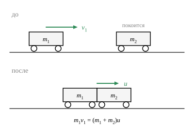

Почему ружьё отдаёт в плечо? Как ракета разгоняется в пустоте, где не от чего оттолкнуться? Всё это закон сохранения импульса. Он нужен в задаче 3, в задачах 5–6 и почти всегда в задачах 22 и 26.

## Импульс тела

Остановить катящийся мяч легко, а грузовик с той же скоростью — невозможно. Остановить пулю, пущенную рукой, легко, а летящую из ружья — нет. Значит, «количество движения» зависит и от массы, и от скорости. Это **импульс**:

$$
\vec p = m \vec v.
$$

- $m$ — масса, кг;
- $\vec v$ — скорость, м/с;
- $\vec p$ — импульс, $\text{кг} \cdot \text{м/с}$.

Импульс — вектор, направлен как скорость. Импульс системы тел — векторная сумма импульсов всех тел.

## Импульс силы

Второй закон Ньютона можно записать иначе:

$$
\vec F \Delta t = \Delta \vec p.
$$

Произведение $\vec F \Delta t$ называют **импульсом силы**. Изменение импульса тела равно импульсу силы, действовавшей на него.

Вот почему при прыжке с высоты сгибают колени: торможение длится дольше, и сила удара меньше. Тот же смысл у подушек безопасности в машине.

## Закон сохранения импульса

Встань на скейт и брось тяжёлый мяч вперёд — тебя откатит назад. Ты и мяч вместе были неподвижны, суммарный импульс был нулём. После броска мяч получил импульс вперёд, ты — такой же назад. Сумма осталась нулём.

**Закон сохранения импульса**: если система замкнута (внешние силы отсутствуют или скомпенсированы), её суммарный импульс не меняется:

$$
m_1 \vec v_1 + m_2 \vec v_2 = m_1 \vec v_1\,' + m_2 \vec v_2\,'.
$$

Когда закон можно применять, даже если внешние силы есть:

- взаимодействие очень короткое (удар, выстрел, взрыв) — внешние силы не успевают заметно изменить импульс;
- внешние силы есть, но их проекция на какую-то ось равна нулю — тогда сохраняется **проекция** импульса на эту ось. Пример: пушка на гладких рельсах стреляет под углом. Вертикальный импульс не сохраняется (опора толкает пушку), а горизонтальный сохраняется.

## Удары

**Абсолютно неупругий удар** — тела после удара слипаются и движутся вместе:

$$
m_1 v_1 + m_2 v_2 = (m_1 + m_2)\,u.
$$

При таком ударе часть кинетической энергии переходит во внутреннюю (тела нагреваются, деформируются). Механическая энергия **не сохраняется**.

**Абсолютно упругий удар** — тела разлетаются, механическая энергия сохраняется. Тогда работают оба закона сохранения. Шар налетает на такой же неподвижный шар по центру — первый останавливается, второй уезжает со скоростью первого.

## Реактивное движение

Ракета выбрасывает газ назад и получает импульс вперёд. Ей не нужно ни от чего отталкиваться: она «отталкивается» от собственного топлива. Поэтому ракета работает и в космосе.

## Частые ловушки

- **Складывают импульсы как числа, забывая про направления.** Тела, летящие навстречу, имеют проекции разных знаков.
- **При неупругом ударе используют сохранение энергии.** Энергия теряется; сохраняется только импульс.
- **Применяют закон к незамкнутой системе.** Проверь, нет ли внешней силы вдоль выбранной оси.
- **При вычислении изменения импульса берут разность модулей.** Мяч ударился о стену и отскочил с той же скоростью: $|\Delta \vec p| = 2mv$, а не ноль.

## Как это выглядит на ЕГЭ

*Тележка массой $2\ \text{кг}$ едет со скоростью $3\ \text{м/с}$ и сцепляется с неподвижной тележкой массой $1\ \text{кг}$. Найди скорость тележек после сцепки.*

Удар короткий, по горизонтали внешних сил нет — горизонтальный импульс сохраняется. Тележки едут вместе, это неупругий удар:

$$
m_1 v_1 = (m_1 + m_2)\,u,
$$

$$
u = \frac{2 \cdot 3}{2 + 1} = 2\ \text{м/с}.
$$

Проверим энергию. До удара: $\dfrac{2 \cdot 9}{2} = 9\ \text{Дж}$. После: $\dfrac{3 \cdot 4}{2} = 6\ \text{Дж}$. Три джоуля ушли в нагрев и деформацию сцепки — так и должно быть.

## Коротко

- $\vec p = m\vec v$, вектор.
- $\vec F \Delta t = \Delta \vec p$.
- В замкнутой системе $\sum \vec p = \text{const}$; если внешние силы перпендикулярны оси — сохраняется проекция.
- Неупругий удар: $m_1v_1 + m_2v_2 = (m_1+m_2)u$, энергия теряется.
- Упругий удар: сохраняются и импульс, и энергия.
