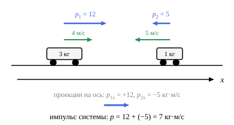

Футбольный мяч катится к тебе со скоростью $5\ \text{м/с}$ — ты останавливаешь его ногой. Грузовик ползёт к стене со скоростью $1\ \text{м/с}$ — его не остановит никто. Мяч, брошенный рукой, легко поймать. А такой же мяч, пущенный из пушки, лучше не ловить. Значит, «сколько в теле движения», зависит сразу от двух вещей: от массы и от скорости. В этом уроке дадим этому имя.

## Масса и скорость вместе

Вспомни урок 5.1: чем больше масса тела, тем труднее изменить его скорость. А чем быстрее тело едет, тем больше скорости надо «отнять», чтобы его остановить. Обе величины работают в одну сторону. Поэтому их перемножают.

**Импульс тела** — произведение массы тела на его скорость:

$$
\vec p = m \vec v.
$$

- $m$ — масса тела, кг;
- $\vec v$ — скорость тела, м/с;
- $\vec p$ — импульс, $\text{кг} \cdot \text{м/с}$.

Своего названия у единицы импульса нет: так и говорят — «килограмм-метр в секунду».

**Пример.** Грузовик массой $6\ \text{т}$ ползёт со скоростью $0{,}5\ \text{м/с}$. Мяч массой $0{,}5\ \text{кг}$ летит со скоростью $10\ \text{м/с}$.

- Грузовик: $p = 6000 \cdot 0{,}5 = 3000\ \text{кг} \cdot \text{м/с}$.
- Мяч: $p = 0{,}5 \cdot 10 = 5\ \text{кг} \cdot \text{м/с}$.

Медленный грузовик несёт в $600$ раз больший импульс, чем быстрый мяч. Поэтому его и не остановить руками.

Не забывай переводить массу в килограммы: $6\ \text{т} = 6000\ \text{кг}$, $9\ \text{г} = 0{,}009\ \text{кг}$.

Проверь себя: у тележки массой 2 кг импульс 7 кг·м/с. С какой скоростью она едет?

$v = p/m = 7/2 = 3{,}5\ \text{м/с}$.

<pp-task id="ks-momentum-01"></pp-task>

## Импульс — вектор

Скорость — вектор, масса — просто положительное число. Значит, импульс тоже вектор, и направлен он **так же, как скорость**. Тело едет вправо — импульс смотрит вправо.

С векторами на прямой мы уже умеем работать (урок 2.2): выбираем ось и берём **проекции**. Тело едет по оси — проекция импульса $+mv$. Против оси — $-mv$.

Посмотри на рисунок. Зелёные стрелки — скорости, синие — импульсы. Лёгкая тележка едет быстрее, а импульс у неё меньше: $1 \cdot 5 = 5$ против $3 \cdot 4 = 12\ \text{кг} \cdot \text{м/с}$. Длина стрелки импульса зависит и от скорости, и от массы.

## Импульс системы тел

Часто нас интересует не одно тело, а несколько сразу — **система тел**: две тележки, ружьё и пуля, лодка и человек. **Импульс системы** — векторная сумма импульсов всех её тел.

Если тела движутся вдоль одной прямой, складываем проекции **со знаками**. На рисунке ось $x$ смотрит вправо:

$$
p_x = p_{1x} + p_{2x} = 12 + (-5) = 7\ \text{кг} \cdot \text{м/с}.
$$

Импульс системы $7\ \text{кг} \cdot \text{м/с}$, направлен вправо — туда, куда едет тележка с большим импульсом.

А теперь две одинаковые тележки едут навстречу друг другу с одинаковыми скоростями. У каждой импульс есть, а у системы — **ноль**: $mv + (-mv) = 0$. Это не ошибка. Импульсы, направленные в разные стороны, гасят друг друга, как силы в уроке 5.2.

Проверь себя: тело массой 2 кг едет вправо со скоростью 2 м/с, тело массой 3 кг — влево со скоростью 3 м/с. Найди импульс системы.

Ось вправо: $p_x = 2 \cdot 2 + 3 \cdot (-3) = 4 - 9 = -5\ \text{кг} \cdot \text{м/с}$. Минус значит, что импульс системы направлен влево, против оси. Его модуль $5\ \text{кг} \cdot \text{м/с}$.

<pp-task id="ks-momentum-02"></pp-task>

## Частые ловушки

- **Сложили модули импульсов, забыв про направления.** Тела, которые едут навстречу, дают проекции разных знаков.
- **Не перевели массу.** Граммы и тонны — в килограммы.
- **«Быстрое тело — большой импульс».** Не обязательно: медленный грузовик несёт больший импульс, чем быстрый мяч.
- **Перепутали импульс и скорость системы.** Импульс системы ноль не значит, что тела стоят: они могут ехать навстречу.

## Коротко

- Импульс тела $\vec p = m\vec v$, единица — $\text{кг} \cdot \text{м/с}$.
- Импульс — вектор, направлен как скорость. Считаем в проекциях: по оси плюс, против оси минус.
- Импульс системы — векторная сумма импульсов тел; на прямой — сумма проекций со знаками.

Дальше — урок 10.2: что происходит с импульсом, когда тела толкают друг друга?
