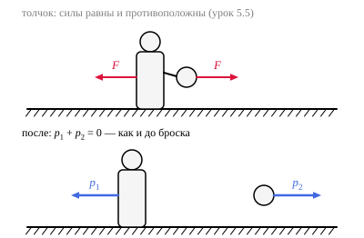

Встань на скейт и брось вперёд тяжёлый мяч. Тебя откатит назад, хотя никто тебя не толкал. Две тележки сцепились — и поехали вместе, медленнее, чем ехала первая. Каждый раз скорости тел меняются, но что-то остаётся прежним. В этом уроке найдём, что именно.

## Бросок со скейта

До броска ты и мяч стояли. Импульс каждого — ноль, импульс системы — тоже ноль.

Пока длится толчок, ты давишь на мяч, а мяч — на тебя. По третьему закону Ньютона (урок 5.5) эти силы равны и противоположны. И действуют они **одно и то же время** $t$: пока руки касаются мяча.

Что сделает каждая сила? Пусть для простоты сила постоянна. По второму закону (урок 5.4) мяч массой $m_2$ получит ускорение $F/m_2$ и за время $t$ наберёт скорость $v_2 = Ft/m_2$. Значит, его импульс станет

$$
m_2 v_2 = F t.
$$

Ты получишь такую же по модулю силу, но назад. Твой импульс станет $Ft$, направленный назад. Импульсы равны и противоположны, их сумма — снова ноль. Мяч лёгкий — он полетит быстро. Ты тяжёлый — поедешь медленно.

Вспомни папу и сына на льду из урока 5.1: $\dfrac{v_1}{v_2} = \dfrac{m_2}{m_1}$. Это то же самое: $m_1 v_1 = m_2 v_2$ — импульсы, которые они получили, равны.

## Закон сохранения импульса

Так бывает при любом взаимодействии двух тел, не только когда они сначала стояли. Сколько импульса одно тело получило, столько другое потеряло: силы равны, а время общее.

Силы, с которыми тела системы действуют друг на друга, называют **внутренними**. Силы со стороны тел, которые в систему не входят, — **внешними**. Внутренние силы всегда приходят парами по третьему закону, поэтому импульс системы они не меняют. Меняют его только внешние.

**Замкнутая система** — система, на которую внешние силы не действуют или их сумма равна нулю.

**Закон сохранения импульса:** суммарный импульс замкнутой системы не меняется, как бы тела ни взаимодействовали между собой:

$$
m_1 \vec v_1 + m_2 \vec v_2 = m_1 \vec v_1\,' + m_2 \vec v_2\,'.
$$

Слева — импульсы до взаимодействия, справа (со штрихами) — после. На прямой записываем проекции со знаками, как в уроке 10.1.

**Пример.** Человек массой $60\ \text{кг}$ стоит на неподвижной тележке массой $80\ \text{кг}$. Тележка на гладких рельсах. Человек спрыгивает вперёд со скоростью $1\ \text{м/с}$. С какой скоростью покатится тележка?

1. До прыжка всё стояло: импульс системы ноль.
2. После: импульс человека $60 \cdot 1 = 60\ \text{кг} \cdot \text{м/с}$ вперёд. Тележка должна получить столько же назад.
3. $80\,u = 60$, $u = 0{,}75\ \text{м/с}$ — назад.

Проверь ответ здравым смыслом: тележка тяжелее человека, поэтому едет медленнее.

Проверь себя: два конькобежца массами 50 кг и 75 кг стоят на льду и отталкиваются друг от друга. Первый поехал со скоростью 0,9 м/с. С какой скоростью поедет второй?

Импульсы равны: $50 \cdot 0{,}9 = 75\,v$, $v = 45 / 75 = 0{,}6\ \text{м/с}$ — в другую сторону.

<pp-task id="ks-momentum-03"></pp-task>

## Посмотри сам

В модели две тележки на гладких рельсах. Сейчас стоит «липкий» удар: тележки сцепятся и поедут вместе. Нажми «Пуск» и сравни нижние полосы. Импульсы $p_1$ и $p_2$ после удара другие, а их сумма — та же, $5\ \text{кг} \cdot \text{м/с}$. Отметки под рельсами показывают, где тележки были каждые полсекунды: после удара отметки стоят теснее — тележки поехали медленнее.

Поменяй массы и скорости, пусти тележки навстречу (отрицательная скорость — влево). Сумма до и после удара всё время одна и та же.

<pp-collide m1="2" v1="2.5" m2="3" v2="0" mode="sticky">Модель: две тележки на гладких рельсах сталкиваются и сцепляются. Полосы внизу показывают импульсы тележек и их сумму до удара и после: сумма не меняется.</pp-collide>

## Когда система замкнута

Строго замкнутых систем на Земле почти нет: всё притягивает Земля, на всё давит опора. Но часто внешние силы **уравновешены**. Тележки на горизонтальных рельсах притягивает Земля, а рельсы держат: сила тяжести и сила реакции опоры в сумме дают ноль. Если рельсы гладкие, система тележек замкнута.

А вот трение — внешняя сила, и его не уравновешивает ничто (урок 6.3). Тележка на шероховатом полу тормозит: её импульс уменьшается. Импульс никуда не исчез: через трение тележка отдала его полу, а с ним всей Земле. Система «тележка» не замкнута.

Поэтому в задачах пишут «гладкий лёд», «сопротивлением воды пренебречь». Это и есть условие, что систему можно считать замкнутой.

Проверь себя: шайба скользит по асфальту и останавливается. Нарушен ли закон сохранения импульса?

Нет. Шайба не замкнутая система: на неё действует трение асфальта — внешняя сила. Она и забирает импульс шайбы.

<pp-task id="ks-momentum-08"></pp-task>

## Частые ловушки

- **«Импульс сохраняется у каждого тела».** Сохраняется только **сумма**. Импульс каждого тела меняется.
- **Забыли знаки.** После толчка тела едут в разные стороны: одна из проекций отрицательная.
- **Перепутали массы.** Лёгкое тело получает большую скорость. Если тележка уехала быстрее человека, ищи ошибку.
- **Применили закон к незамкнутой системе.** Сначала спроси: есть ли внешние силы, которые ничем не уравновешены, — трение, сопротивление воды, толчок извне?

## Коротко

- Тела действуют друг на друга с равными силами одно и то же время: сколько импульса получил один, столько потерял другой.
- Замкнутая система — внешних сил нет или их сумма равна нулю.
- В замкнутой системе суммарный импульс сохраняется: $m_1 \vec v_1 + m_2 \vec v_2 = m_1 \vec v_1\,' + m_2 \vec v_2\,'$.
- Трение — внешняя сила: тело на шероховатой поверхности замкнутой системой не является.

Дальше — урок 10.3: как ракета разгоняется там, где не от чего оттолкнуться.
