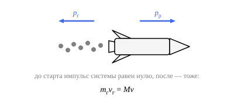

Надуй воздушный шарик и отпусти, не завязав. Он с шипением мечется по комнате. Его никто не толкает, а он летит. Так же летит ракета в космосе, где нет ни воздуха, ни дороги. От чего она отталкивается? В этом уроке ответим: от собственного топлива.

## Ракета и газ

Ракета на старте стоит, топливо внутри неё. Импульс системы «ракета + топливо» равен нулю. Топливо сгорает, и горячий газ с огромной скоростью вылетает из сопла назад. Газ получил импульс назад. Значит, по закону сохранения импульса (урок 10.2) ракета получает такой же импульс вперёд.

Движение, при котором тело отбрасывает часть себя и от этого разгоняется в другую сторону, называют **реактивным**.

Если ракета стояла и газ вылетел быстро, импульсы газа и ракеты равны по модулю:

$$
m_{\text{г}} v_{\text{г}} = M v.
$$

- $m_{\text{г}}$, $v_{\text{г}}$ — масса и скорость вылетевшего газа;
- $M$ — масса ракеты **после** того, как газ вылетел;
- $v$ — скорость ракеты.

Ракете не нужен воздух, чтобы от него отталкиваться. Она «отталкивается» от газа, который сама выбросила. Поэтому ракета летит и в пустоте. Воздух ей даже мешает: тормозит.

**Пример.** Ракета массой $2050\ \text{кг}$ стоит в космосе. Двигатель за короткое время выбрасывает $50\ \text{кг}$ газа со скоростью $800\ \text{м/с}$. Какую скорость получит ракета?

1. После выброса масса ракеты $M = 2050 - 50 = 2000\ \text{кг}$.
2. Импульс газа $50 \cdot 800 = 40\,000\ \text{кг} \cdot \text{м/с}$ назад.
3. Ракета получает столько же вперёд: $v = 40\,000 / 2000 = 20\ \text{м/с}$.

Газ лёгкий, но очень быстрый. Ракета тяжёлая и разгоняется медленно. Настоящий двигатель выбрасывает газ порциями одну за другой, и каждая добавляет ракете скорость. Чтобы разогнаться до космической скорости, нужно много топлива. Поэтому ракеты делают из нескольких ступеней: пустые баки сбрасывают, чтобы не разгонять лишнюю массу.

Проверь себя: почему в формулу ставят массу ракеты без вылетевшего газа?

Импульс $Mv$ после выброса несёт только то, что осталось в ракете. Вылетевший газ уже летит назад, и его импульс записан отдельно, слева.

<pp-task id="ks-momentum-04"></pp-task>

## Отдача

Реактивное движение — не только ракеты. Ружьё при выстреле выбрасывает пулю вперёд и само получает импульс назад. Это **отдача**. Пуля лёгкая и летит быстро, ружьё тяжёлое и отскакивает медленно, но заметно.

Почему стрелок плотно прижимает приклад к плечу? Тогда назад отъезжает не одно ружьё, а ружьё вместе со стрелком. Импульс тот же, а масса во много раз больше. Значит, скорость отдачи во много раз меньше — как у папы на льду в уроке 5.1. Если держать ружьё неплотно, оно успеет разогнаться и ударит в плечо.

Так же плавают кальмары и медузы: набирают воду и выталкивают её струёй назад. Так работают водомёт катера и садовый шланг, который «вырывается» из рук.

Проверь себя: пушка массой 1000 кг стоит на гладком льду и стреляет горизонтально снарядом массой 20 кг. Снаряд вылетает со скоростью 250 м/с. С какой скоростью откатится пушка?

До выстрела импульс системы ноль. После: $1000\,V = 20 \cdot 250 = 5000$, $V = 5\ \text{м/с}$ — назад.

<pp-task id="ks-momentum-09"></pp-task>

## Частые ловушки

- **Разделили на полную массу.** $M$ — масса того, что осталось, без вылетевшего газа или снаряда.
- **Не перевели граммы.** Пуля $8\ \text{г} = 0{,}008\ \text{кг}$.
- **«Ракета отталкивается от воздуха».** Она отталкивается от собственного газа и в пустоте летит лучше.
- **Перепутали массы местами.** Тяжёлое тело получает маленькую скорость: ружьё отскакивает во много раз медленнее, чем летит пуля.

## Коротко

- Реактивное движение: тело выбрасывает часть себя назад и получает такой же импульс вперёд.
- Если всё сначала покоилось: $m_{\text{г}} v_{\text{г}} = M v$, где $M$ — масса после выброса.
- Ракете не нужна опора и воздух: она отталкивается от своего газа.
- Отдача ружья и пушки — то же самое; приклад у плеча увеличивает массу и уменьшает скорость отдачи.

Дальше — урок 10.4: что происходит при ударе двух тел — когда они слипаются и когда отскакивают.
