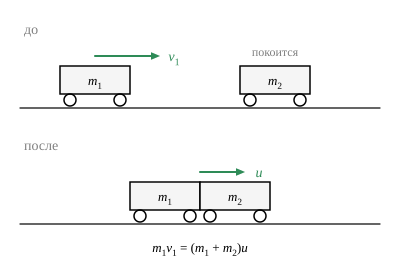

На станции вагон накатывается на стоящий состав, лязгает сцепка — и дальше вагоны едут вместе. На бильярде шар бьёт по стоящему шару и замирает, а тот укатывается. Какие силы действовали при ударе, мы не знаем: они огромные и длятся сотые доли секунды. Но куда покатятся тела, узнать можно. В этом уроке посчитаем.

## Почему при ударе импульс сохраняется

Вагоны на рельсах — не идеально замкнутая система: колёса немного трутся. Но удар длится очень недолго. Силы между вагонами при ударе огромные, а трение маленькое. За доли секунды трение почти не успевает изменить импульс. Поэтому при ударе, выстреле или взрыве импульс системы сохраняется, даже если внешние силы есть, — **если удар короткий, а внешние силы не огромные**. Подробнее об этом — в уроке 10.6.

## Неупругий удар

**Абсолютно неупругий удар** — тела после удара слипаются и движутся дальше вместе, с общей скоростью $u$. Так сцепляются вагоны, слипаются пластилиновые шары, пуля застревает в бруске.

После удара масса «одного тела» — $m_1 + m_2$. Закон сохранения импульса:

$$
m_1 v_1 + m_2 v_2 = (m_1 + m_2)\,u.
$$

Здесь $v_1$, $v_2$ — **проекции**, со знаками. Если тела летят навстречу, у одного из них проекция отрицательная.

**Пример 1.** Тележка массой $2\ \text{кг}$ едет со скоростью $4\ \text{м/с}$ и сцепляется с неподвижной тележкой массой $3\ \text{кг}$:

$$
u = \frac{2 \cdot 4 + 3 \cdot 0}{2 + 3} = \frac{8}{5} = 1{,}6\ \text{м/с}.
$$

**Пример 2.** Пластилиновый шар массой $2\ \text{кг}$ летит со скоростью $5\ \text{м/с}$ навстречу шару массой $3\ \text{кг}$, который летит со скоростью $2\ \text{м/с}$. Шары слиплись. Ось — по движению первого шара:

$$
2 \cdot 5 + 3 \cdot (-2) = 5\,u, \qquad u = \frac{10 - 6}{5} = 0{,}8\ \text{м/с}.
$$

Ответ положительный: слипшиеся шары летят туда, куда летел первый. Если бы ответ вышел отрицательным, они полетели бы в сторону второго шара. Знак — это направление.

При неупругом ударе тела мнутся и нагреваются: сцепка вагонов лязгает, пластилин сплющивается. Часть механической энергии переходит во внутреннюю. Как это посчитать, узнаешь в теме 12 «Механическая энергия и её сохранение». Для импульса это не важно: он сохраняется всё равно.

Проверь себя: тележка массой 1 кг едет со скоростью 3 м/с навстречу тележке массой 2 кг, которая едет со скоростью 3 м/с. Тележки сцепились. Куда и с какой скоростью они поедут?

Ось — по движению первой: $1 \cdot 3 + 2 \cdot (-3) = 3u$, $u = -3/3 = -1\ \text{м/с}$. Минус: тележки поедут в ту сторону, куда ехала вторая, со скоростью $1\ \text{м/с}$.

<pp-task id="ks-momentum-05"></pp-task>

<pp-task id="ks-momentum-10"></pp-task>

## Упругий удар

**Абсолютно упругий удар** — тела отскакивают друг от друга и полностью восстанавливают форму. Ничего не мнётся и не греется: механическая энергия сохраняется. Почти так сталкиваются бильярдные шары и стальные шарики.

Импульс здесь тоже сохраняется. Но теперь неизвестных скоростей после удара **две**, $u_1$ и $u_2$, а уравнение одно:

$$
m_1 v_1 + m_2 v_2 = m_1 u_1 + m_2 u_2.
$$

Второе уравнение даёт закон сохранения энергии — тема 12. Пока задачи на упругий удар решаем так: одну скорость после удара дают в условии, другую находим из импульса.

**Пример.** Шар массой $2\ \text{кг}$ катится со скоростью $10\ \text{м/с}$ и упруго ударяет неподвижный шар массой $3\ \text{кг}$. Лёгкий шар отскакивает назад со скоростью $2\ \text{м/с}$. С какой скоростью покатится тяжёлый? Ось — по движению лёгкого шара до удара, после удара его проекция **отрицательная**:

$$
2 \cdot 10 = 2 \cdot (-2) + 3\,u_2, \qquad u_2 = \frac{20 + 4}{3} = 8\ \text{м/с}.
$$

Лёгкий шар отскочил назад, поэтому тяжёлому досталось **больше** импульса, чем было у лёгкого: $24$ против $20\ \text{кг} \cdot \text{м/с}$. Сумма при этом та же: $-4 + 24 = 20$.

## Одинаковые шары меняются скоростями

Важный частный случай. Шар налетает точно по центру на **такой же** неподвижный шар, удар упругий. Опыт показывает: первый шар останавливается, второй уезжает со скоростью первого.

Проверим импульсом: до удара $mv + m \cdot 0 = mv$, после $m \cdot 0 + mv = mv$. Сходится. Так работает «колыбель Ньютона»: шарик ударяет в ряд, а отлетает только крайний с другой стороны.

Проверь всё это на модели. Сейчас выбран упругий удар и равные массы, тележки едут навстречу. Нажми «Пуск»: тележки обменяются скоростями. Сделай первую тележку лёгкой, а вторую тяжёлой и неподвижной: лёгкая отскочит назад. Потом переключи на «липкий» и сравни. В любом случае сумма импульсов внизу до и после удара одна и та же.

<pp-collide m1="2" v1="3.5" m2="2" v2="-1" mode="elastic">Модель: две тележки на гладких рельсах сталкиваются — сцепляются или упруго отскакивают. Полосы внизу показывают импульсы тележек и их сумму до удара и после: сумма не меняется. Одинаковые тележки при упругом ударе обмениваются скоростями.</pp-collide>

<pp-task id="ks-momentum-11"></pp-task>

## Частые ловушки

- **Сложили импульсы без знаков.** Тела летят навстречу — одна проекция отрицательная.
- **Забыли, что тело отскочило.** Скорость после отскока назад входит в уравнение с минусом.
- **При неупругом ударе поделили не на ту массу.** После удара тело одно, его масса $m_1 + m_2$.
- **«При упругом ударе тела всегда меняются скоростями».** Только при равных массах и ударе по центру.
- **Решили, что при неупругом ударе что-то «потерялось» и импульс не сохраняется.** Теряется механическая энергия, а импульс сохраняется при любом коротком ударе.

## Коротко

- Удар короткий: импульс системы сохраняется, даже если есть трение.
- Неупругий удар (тела слиплись): $m_1 v_1 + m_2 v_2 = (m_1 + m_2)\,u$; часть механической энергии уходит в тепло.
- Упругий удар (тела отскочили): $m_1 v_1 + m_2 v_2 = m_1 u_1 + m_2 u_2$; механическая энергия сохраняется.
- Одинаковые шары при упругом ударе по центру меняются скоростями.

Дальше — урок 10.5: как импульс связан с силой и почему при прыжке с высоты сгибают колени.
