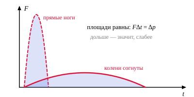
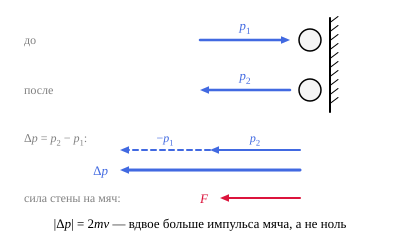

Прыгни со стула на прямые ноги — удар отдастся в пятки и в голову. Прыгни, согнув колени, — почти ничего не почувствуешь. Высота та же, скорость приземления та же. Почему же удар такой разный? Яйцо, упавшее на пол, разбивается, а на подушку — нет. В этом уроке разберёмся, что тут решает время.

## Второй закон в импульсах

Вспомни второй закон Ньютона (урок 5.4): $\vec F = m\vec a$. А ускорение — это изменение скорости за единицу времени (урок 2.1): $\vec a = \Delta \vec v / \Delta t$. Подставим:

$$
\vec F = m\frac{\Delta \vec v}{\Delta t} \quad\Rightarrow\quad \vec F \Delta t = m\Delta \vec v = \Delta \vec p.
$$

Произведение силы на время её действия $\vec F \Delta t$ называют **импульсом силы**. Получилось:

$$
\vec F \Delta t = \Delta \vec p.
$$

**Изменение импульса тела равно импульсу силы, которая на него действовала.** Это тот же второй закон Ньютона, только записанный иначе. Единица импульса силы — $\text{Н} \cdot \text{с}$, и это то же самое, что $\text{кг} \cdot \text{м/с}$.

Если сила во время удара меняется, $F$ в формуле — её **среднее** значение. На ЕГЭ так и спрашивают: «найди среднюю силу удара».

## Дольше — значит, слабее

Чтобы остановить тело, надо отнять у него весь импульс $mv$. Это можно сделать большой силой за короткое время или маленькой силой за долгое. Произведение $F\Delta t$ одно и то же.

Посмотри на график. Площадь под графиком силы — это импульс силы, так же как путь был площадью под графиком скорости (урок 2.3). Площади одинаковые: скорость приземления одна, и импульс надо погасить тот же. Но с согнутыми коленями торможение длится в пять раз дольше, и сила в пять раз меньше.

Вот зачем:

- при прыжке сгибают колени, а спортсмены приземляются на мягкие маты;
- в машине подушки безопасности и ремни, которые немного растягиваются;
- мяч ловят, отводя руки назад, а не держа их неподвижно.

**Пример.** Ты ловишь мяч массой $0{,}5\ \text{кг}$, летящий со скоростью $14\ \text{м/с}$. Его импульс $0{,}5 \cdot 14 = 7\ \text{кг} \cdot \text{м/с}$ надо погасить.

- Жёсткие руки, мяч остановился за $0{,}01\ \text{с}$: $F = 7 / 0{,}01 = 700\ \text{Н}$.
- Руки отводишь назад, мяч остановился за $0{,}1\ \text{с}$: $F = 7 / 0{,}1 = 70\ \text{Н}$.

Сила в десять раз меньше — ладони не болят.

<pp-task id="ks-momentum-12"></pp-task>

## Изменение импульса — вектор

Мяч ударился о стену и отскочил с той же скоростью. Модуль импульса не изменился. Значит, $\Delta p = 0$? Нет. Импульс — вектор, и вычитать надо векторы:

$$
\Delta \vec p = \vec p_2 - \vec p_1.
$$

Направим ось от стены. До удара мяч летел к стене: $p_{1x} = -mv$. После — от стены: $p_{2x} = +mv$. Изменение:

$$
\Delta p_x = mv - (-mv) = 2mv.
$$

Вдвое больше импульса мяча! Сначала стена гасит импульс мяча до нуля, а потом разгоняет мяч обратно. Сила стены направлена туда же, куда $\Delta \vec p$, — от стены.

Сравни с пластилиновым шариком, который прилип к стене. Его импульс изменился с $mv$ до нуля: $|\Delta p| = mv$. Резиновый мяч, который отскочил, толкает стену вдвое сильнее пластилина (при той же длительности удара).

Проверь себя: мяч массой 0,2 кг летит к стене со скоростью 8 м/с и отскакивает с той же скоростью. Найди модуль изменения его импульса.

$|\Delta p| = 2mv = 2 \cdot 0{,}2 \cdot 8 = 3{,}2\ \text{кг} \cdot \text{м/с}$. Не ноль: импульс сменил направление.

<pp-task id="ks-momentum-06"></pp-task>

## Сила, которая действует долго

Импульс силы бывает не только при ударах. Сила тяжести действует на падающее тело всё время. За время $t$ она даёт импульс $mg\,t$, и на столько вырастает импульс тела. Поделим на массу — получим $\Delta v = g t$. Это знакомая формула свободного падения (урок 3.1), просто записанная через импульс.

<pp-task id="ks-momentum-13"></pp-task>

## Частые ловушки

- **Вычли модули импульсов при отскоке.** При отскоке с той же скоростью $|\Delta \vec p| = 2mv$, а не ноль.
- **Взяли $\Delta p = mv$ для отскока.** Так бывает, только если тело остановилось или прилипло.
- **Нашли изменение импульса, а спрашивали силу.** Раздели на время удара: $F = \Delta p / \Delta t$.
- **«Мягкая подушка уменьшает импульс».** Изменение импульса то же; подушка растягивает время, и сила меньше.

## Коротко

- Импульс силы $\vec F \Delta t$; второй закон Ньютона: $\vec F \Delta t = \Delta \vec p$.
- $\text{Н} \cdot \text{с} = \text{кг} \cdot \text{м/с}$; $F$ — средняя сила за время удара.
- То же $\Delta p$ за большее время — меньшая сила: колени, маты, подушки безопасности.
- $\Delta \vec p = \vec p_2 - \vec p_1$ — вектор; при отскоке с той же скоростью $|\Delta \vec p| = 2mv$.
- На графике $F(t)$ импульс силы — площадь под графиком.

Дальше — урок 10.6: что делать, если внешние силы есть, но действуют только вдоль одной оси.
