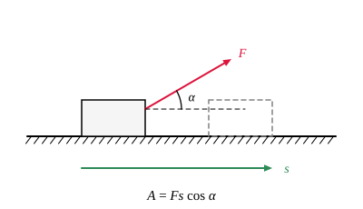

В быту «работой» называют всё подряд: и чтение, и сидение за компьютером. В физике работа — строгая величина: сила должна что-то сдвинуть. Тема нужна в задаче 3 и в задачах 5–6, а дальше на ней держится вся энергия.

Работу, мощность и КПД проходят в 7 классе — начнём с них. Потом, как в 10 классе, добавим силу под углом, знак работы, работу пружины и мгновенную мощность. Пригодятся силы из темы «Силы в механике» и блоки из темы «Момент силы».

## Шаг 1. Механическая работа (7 класс)

Ты тянешь санки за верёвку. Санки едут — ты совершаешь работу. Держишь тяжёлую сумку на месте — устаёшь, но механической работы над сумкой не совершаешь: она никуда не сдвинулась.

Если сила направлена вдоль движения, работа равна силе, умноженной на пройденный путь:

$$
A = F s.
$$

- $F$ — сила, Н;
- $s$ — путь, м;
- $A$ — работа, Дж ($1\ \text{Дж} = 1\ \text{Н} \cdot \text{м}$).

Чтобы равномерно поднять груз на высоту $h$, нужно тянуть его вверх с силой, равной силе тяжести $mg$. Значит, работа по подъёму груза $A = mgh$.

<pp-task id="ks-work-01"></pp-task>

## Шаг 2. Мощность (7 класс)

Два грузчика подняли одинаковые ящики на один и тот же этаж. Один за минуту, другой за десять. Работа одинаковая, но первый — мощнее. **Мощность** — работа за единицу времени:

$$
N = \frac{A}{t}.
$$

Единица — ватт: $1\ \text{Вт} = 1\ \text{Дж/с}$. Часто пишут киловатты: $1\ \text{кВт} = 1000\ \text{Вт}$.

<pp-task id="ks-work-02"></pp-task>

## Шаг 3. Простые механизмы и КПД (7 класс)

В теме «Момент силы» мы видели «золотое правило» механики: рычаг или блок дают выигрыш в силе, но во столько же раз проигрыш в расстоянии. На языке работы: **ни один механизм не даёт выигрыша в работе**. Наклонная плоскость тоже: тащить ящик по ней легче, чем поднимать, но путь длиннее.

На деле всё ещё хуже: часть работы уходит на трение и нагрев. **Коэффициент полезного действия**:

$$
\eta = \frac{A_{\text{полезн}}}{A_{\text{затр}}} \cdot 100\,\%.
$$

- $A_{\text{полезн}}$ — то, ради чего всё делали (например, подъём груза: $mgh$);
- $A_{\text{затр}}$ — работа, которую совершили на самом деле (например, сила тяги на длину наклонной плоскости).

КПД всегда меньше $100\,\%$.

<pp-task id="ks-work-03"></pp-task>

## Шаг 4. Сила под углом к перемещению (10 класс)

Санки тянут за верёвку, а верёвка идёт вверх под углом. Двигает санки вперёд только горизонтальная часть силы — $F\cos\alpha$. Вертикальная часть их немного приподнимает, но вперёд не тянет. Поэтому в 10 классе работу постоянной силы определяют так:

$$
A = F s \cos\alpha.
$$

- $s$ — модуль перемещения, м;
- $\alpha$ — угол между вектором силы и вектором перемещения.

При $\alpha = 0$ получается знакомое $A = Fs$.

<pp-task id="ks-work-04"></pp-task>

## Шаг 5. Знак работы (10 класс)

Косинус бывает и нулём, и отрицательным. Поэтому:

- $\alpha < 90^\circ$ — работа положительна (сила «помогает» движению);
- $\alpha = 90^\circ$ — работа равна нулю (сила перпендикулярна движению);
- $\alpha > 90^\circ$ — работа отрицательна (сила «мешает»).

Примеры. Сила трения скольжения направлена против движения ($\alpha = 180^\circ$, $\cos\alpha = -1$): её работа $A = -F_{\text{тр}} s$. Сила реакции опоры при скольжении по неподвижной поверхности работы не совершает. Центростремительная сила при движении по окружности тоже: она всё время перпендикулярна скорости.

<pp-task id="ks-work-05"></pp-task>

## Шаг 6. Работа силы тяжести не зависит от пути (10 класс)

Сила тяжести при падении тела совершает положительную работу, при подъёме — отрицательную. Её работа не зависит от формы пути, только от разности высот:

$$
A = mg\,(h_1 - h_2).
$$

Спускаешься по прямой лестнице или по винтовой — сила тяжести совершает одну и ту же работу. Съезжаешь с горки — важна её высота, а не длина. Такие силы называют **потенциальными** (консервативными). Сила упругости тоже потенциальная. А сила трения — нет: чем длиннее путь, тем больше работа трения.

<pp-task id="ks-work-06"></pp-task>

## Шаг 7. Работа как площадь и работа пружины (10 класс)

Если сила меняется, $A = Fs$ уже не применишь. Тогда работу находят как площадь под графиком $F_s(s)$ — проекции силы на направление движения от координаты. Для постоянной силы это прямоугольник со сторонами $F$ и $s$ — то же $Fs$.

Самый частый пример — пружина. По закону Гука сила растёт линейно, $F = kx$, график — треугольник. Работа, которую надо совершить, чтобы растянуть пружину из недеформированного состояния на $x$, — площадь треугольника:

$$
A = \frac{1}{2} \cdot x \cdot kx = \frac{k x^2}{2}.
$$

<pp-task id="ks-work-07"></pp-task>

## Шаг 8. Мощность при движении: $N = Fv$ (10 класс)

Пусть тело движется с постоянной скоростью $v$ под действием силы $F$, направленной по скорости. За время $t$ оно проходит $s = vt$, и

$$
N = \frac{A}{t} = \frac{F v t}{t} = F v.
$$

Отсюда понятно, почему на подъёме водитель включает пониженную передачу: при той же мощности двигателя меньшая скорость даёт большую силу тяги.

Если скорость меняется, $Fv$ — **мгновенная** мощность в данный момент. Для средней мощности за время разгона бери $A/t$.

<pp-task id="ks-work-08"></pp-task>

## Частые ловушки

- **Забывают косинус**, если сила направлена под углом к перемещению.
- **Путают угол.** Нужен угол между силой и **перемещением**, а не между силой и горизонтом (иногда это одно и то же, иногда нет).
- **Считают, что работа силы тяжести зависит от пути.** Важна только разность высот.
- **Теряют знак у работы трения.** Трение скольжения против движения — работа отрицательна.
- **Подставляют $N = Fv$ при разгоне без оговорок.** Формула даёт мгновенную мощность; для средней нужна средняя скорость или $A/t$.

## Как это выглядит на ЕГЭ

*Мальчик тянет санки за верёвку, направленную под углом $60^\circ$ к горизонту, с силой $50\ \text{Н}$. Санки проехали по горизонтали $20\ \text{м}$. Какую работу совершил мальчик?*

Перемещение горизонтальное, сила — под углом $60^\circ$ к нему:

$$
A = F s \cos\alpha = 50 \cdot 20 \cdot \cos 60^\circ = 50 \cdot 20 \cdot 0{,}5 = 500\ \text{Дж}.
$$

Вертикальная часть силы санки не двигает, она только уменьшает давление на снег.

## Коротко

- $A = Fs\cos\alpha$; знак — по углу между силой и перемещением.
- Сила, перпендикулярная перемещению, работы не совершает.
- Работа силы тяжести $mg(h_1 - h_2)$ — не зависит от пути.
- Работа переменной силы — площадь под графиком; пружина: $A = kx^2/2$.
- $N = A/t = Fv$; $\eta = A_{\text{полезн}}/A_{\text{затр}}$, всегда меньше $100\,\%$.
