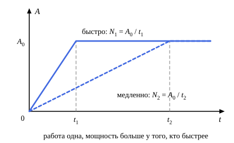

Два грузчика заносят одинаковые ящики на один и тот же этаж. Первый управился за минуту, второй — за десять. Работу они сделали одинаковую: ящики те же, высота та же. Но первый явно сильнее. Чем? Он сделал ту же работу быстрее. Величину, которая это показывает, называют мощностью.

## Работа за секунду

**Мощность** — работа, совершённая за единицу времени:

$$
N = \frac{A}{t}.
$$

- $A$ — работа, Дж;
- $t$ — время, за которое она совершена, с;
- $N$ — мощность, Вт.

Единица мощности — **ватт**: $1\ \text{Вт} = 1\ \text{Дж/с}$. Мощность в один ватт — это работа в один джоуль каждую секунду. Для машин ватт маленький, поэтому пишут киловатты: $1\ \text{кВт} = 1000\ \text{Вт}$. Мощность автомобиля — десятки киловатт, человека, который бежит по лестнице, — несколько сотен ватт.

Посмотри на график. Оба подъёмника выполнили одну и ту же работу $A_0$. Но первый успел за время $t_1$, а второй — за $t_2$. Линия первого круче. Наклон графика $A(t)$ — это и есть мощность: сколько работы прибавляется за каждую секунду.

**Пример.** Грузчики заносят ящик массой $30\ \text{кг}$ на высоту $6\ \text{м}$. Работа одна и та же:

$$
A = m g h = 30 \cdot 10 \cdot 6 = 1800\ \text{Дж}.
$$

- Первый поднял ящик за $15\ \text{с}$: $N_1 = 1800 / 15 = 120\ \text{Вт}$.
- Второй — за $45\ \text{с}$: $N_2 = 1800 / 45 = 40\ \text{Вт}$.

Втрое быстрее — втрое больше мощность.

<pp-task id="ks-work-02"></pp-task>

## Формулу можно повернуть

Из $N = A/t$ получаются ещё две формулы:

$$
A = N t, \qquad t = \frac{A}{N}.
$$

Первая — сколько работы сделает двигатель известной мощности за данное время. Вторая — сколько времени ему понадобится на нужную работу.

Не забывай переводить единицы. Мощность — в ватты, время — в секунды. Тогда работа выйдет в джоулях.

Проверь себя: двигатель мощностью 450 Вт работал 2 минуты. Какую работу он совершил?

Время в секундах: $2\ \text{мин} = 120\ \text{с}$. Работа $A = Nt = 450 \cdot 120 = 54\,000\ \text{Дж} = 54\ \text{кДж}$.

<pp-task id="ks-work-10"></pp-task>

## Частые ловушки

- **Нашли работу, а спрашивали мощность.** Не забудь поделить на время.
- **Время в минутах.** В формулу $N = A/t$ время подставляют в секундах.
- **Киловатты.** $1\ \text{кВт} = 1000\ \text{Вт}$. Перед расчётом переведи в ватты, а в ответе дай то, что просят.
- **«Мощнее — значит, сделал больше работы».** Нет: мощнее — значит, быстрее делает работу.

## Коротко

- Мощность — работа за единицу времени: $N = A/t$.
- Единица — ватт: $1\ \text{Вт} = 1\ \text{Дж/с}$; $1\ \text{кВт} = 1000\ \text{Вт}$.
- $A = Nt$, $t = A/N$.
- На графике $A(t)$ мощность — наклон: круче линия — больше мощность.

Дальше — урок 11.3: рычаг, блок и наклонная плоскость дают выигрыш в силе. А в работе?
