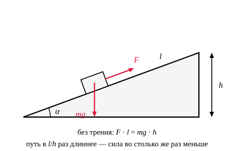

Бочку на кузов грузовика не поднимают руками, а вкатывают по доске. Камень сдвигают ломом. Ведро поднимают через блок. Механизмы помогают: с ними нужна сила меньше, чем вес груза. Так может, они экономят нам работу? В уроках 8.1 и 8.3 мы уже видели подсказку: выигрыш в силе всегда оплачивается проигрышем в пути. Теперь поймём, что это значит для работы.

## «Золотое правило» — это про работу

Вспомни правило рычага из урока 8.1. Лом подсунули под камень так, что плечо руки в $12$ раз длиннее плеча камня. Рука давит с силой $120\ \text{Н}$, а на камень действует сила в $12$ раз больше — $1440\ \text{Н}$. Но когда лом поворачивается, длинный конец проходит в $12$ раз больший путь, чем короткий. Пусть камень приподнялся на $1\ \text{см}$. Тогда рука опустилась на $12\ \text{см}$. Посчитаем работу:

- рука: $120\ \text{Н} \cdot 0{,}12\ \text{м} = 14{,}4\ \text{Дж}$;
- лом над камнем: $1440\ \text{Н} \cdot 0{,}01\ \text{м} = 14{,}4\ \text{Дж}$.

Работа одна и та же! Во сколько раз сила больше, во столько раз путь меньше, а их произведение не меняется:

$$
F_1 s_1 = F_2 s_2.
$$

Так у любого простого механизма:

- **подвижный блок** (урок 8.3): тянешь с силой $P/2$, но верёвку вытягиваешь на $2h$. Работа $\dfrac{P}{2} \cdot 2h = Ph$ — как при подъёме руками;
- **гидравлический пресс** (урок 9.3): малый поршень сдвигается далеко, большой — чуть-чуть, $F_1 h_1 = F_2 h_2$;
- **наклонная плоскость** — о ней ниже.

Это и есть **«золотое правило» механики** в точной форме: **ни один механизм не даёт выигрыша в работе**. Выиграть можно в силе или в пути, но не в том и другом сразу.

<pp-task id="ks-work-11"></pp-task>

## Наклонная плоскость

Поднять ящик на высоту $h$ прямо вверх — значит совершить работу $mgh$. Втащить его по наклонной плоскости длиной $l$ — значит тянуть с силой $F$ на пути $l$. Если трения нет, работа та же:

$$
F l = m g h, \qquad F = m g\,\frac{h}{l}.
$$

Плоскость в $l/h$ раз длиннее высоты — и сила во столько же раз меньше веса.

**Пример.** Бочку массой $70\ \text{кг}$ вкатывают в кузов высотой $1{,}2\ \text{м}$ по доске длиной $3\ \text{м}$. Поднять бочку руками — нужна сила $700\ \text{Н}$. Работа по подъёму $mgh = 700 \cdot 1{,}2 = 840\ \text{Дж}$. По доске без трения хватит силы

$$
F = \frac{840}{3} = 280\ \text{Н}.
$$

Сила в $2{,}5$ раза меньше, путь в $2{,}5$ раза больше.

## КПД: часть работы уходит впустую

На деле трение есть всегда. Бочку тянут, а часть усилий уходит на то, чтобы преодолеть трение, — доска и бочка немного нагреваются. Поэтому работа, которую совершили на самом деле, **больше** полезной.

- **Полезная работа** $A_{\text{полезн}}$ — то, ради чего всё делали. Например, подъём груза: $mgh$.
- **Затраченная работа** $A_{\text{затр}}$ — работа, которую совершили на самом деле. Например, сила тяги на длину плоскости: $Fl$.

Какая доля работы пошла в дело, показывает **коэффициент полезного действия**:

$$
\eta = \frac{A_{\text{полезн}}}{A_{\text{затр}}} \cdot 100\,\%.
$$

**Пример.** Бочку из примера выше на самом деле пришлось тянуть с силой $400\ \text{Н}$, а не $280\ \text{Н}$. Затраченная работа $400 \cdot 3 = 1200\ \text{Дж}$, полезная — по-прежнему $840\ \text{Дж}$:

$$
\eta = \frac{840}{1200} \cdot 100\,\% = 70\,\%.
$$

Полезная работа меньше затраченной, поэтому **КПД всегда меньше $100\,\%$**. Если у тебя вышло больше — ты перевернул дробь.

Проверь себя: груз весом 500 Н поднимают подвижным блоком, вытягивая верёвку с силой 280 Н. Каков КПД блока?

Пусть груз поднялся на $h$. Полезная работа $500\,h$. Верёвку вытянули на $2h$, затраченная работа $280 \cdot 2h = 560\,h$. $\eta = 500h / 560h \approx 0{,}89 = 89\,\%$. Высота сократилась: её знать не нужно.

<pp-task id="ks-work-03"></pp-task>

## Частые ловушки

- **«Механизм экономит работу».** Нет: выигрыш в силе — проигрыш в пути. Работа без трения та же, с трением — больше.
- **Перевернули дробь в КПД.** Полезная работа — в числителе. КПД больше $100\,\%$ невозможен.
- **Забыли, что верёвка подвижного блока проходит $2h$.** Затраченная работа — сила на путь конца верёвки.
- **Ответ в долях, а просят проценты.** $0{,}7 = 70\,\%$.

## Коротко

- «Золотое правило»: ни один механизм не даёт выигрыша в работе, $F_1 s_1 = F_2 s_2$.
- Наклонная плоскость без трения: $Fl = mgh$.
- $\eta = A_{\text{полезн}} / A_{\text{затр}} \cdot 100\,\%$; полезная — то, ради чего работали.
- Из-за трения КПД всегда меньше $100\,\%$.

Дальше — урок 11.4: что если сила направлена не вдоль движения, а под углом? И бывает ли работа отрицательной?
