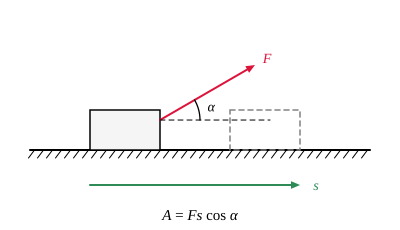
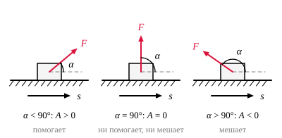

Санки тянут за верёвку, а верёвка идёт не вдоль дороги, а вверх под углом. Вся ли сила тянет санки вперёд? Нет: часть её тянет санки вверх, и эта часть их не везёт. А трение вообще направлено против движения — оно не помогает, а мешает. Как тогда считать работу? В этом уроке научимся.

## Работает только часть силы

Разложим силу $F$ на две составляющие, как в уроке 6.5:

- вдоль перемещения — $F\cos\alpha$. Она тянет ящик вперёд;
- поперёк перемещения — $F\sin\alpha$. Она немного приподнимает ящик, но вперёд его не везёт.

Ящик сдвинулся только вдоль пола, поэтому работу совершает только первая составляющая. Это и есть определение работы, которое дают в 10 классе:

$$
A = F s \cos\alpha.
$$

- $F$ — модуль силы, Н;
- $s$ — модуль перемещения, м;
- $\alpha$ — угол между вектором силы и вектором перемещения.

При $\alpha = 0$ косинус равен единице, и получается знакомое $A = Fs$ из урока 11.1.

**Пример.** Мальчик тянет санки за верёвку с силой $50\ \text{Н}$. Верёвка направлена под углом $60^\circ$ к горизонту, санки проехали по горизонтали $20\ \text{м}$. Перемещение горизонтальное, угол между силой и перемещением $60^\circ$:

$$
A = F s \cos\alpha = 50 \cdot 20 \cdot \cos 60^\circ = 50 \cdot 20 \cdot 0{,}5 = 500\ \text{Дж}.
$$

Вперёд санки тянули только $25\ \text{Н}$ из пятидесяти.

<pp-task id="ks-work-04"></pp-task>

## Знак работы

Косинус бывает и нулём, и отрицательным. Поэтому работа бывает трёх знаков:

- $\alpha < 90^\circ$, $\cos\alpha > 0$ — работа **положительна**: сила помогает движению;
- $\alpha = 90^\circ$, $\cos\alpha = 0$ — работа **равна нулю**: сила перпендикулярна движению;
- $\alpha > 90^\circ$, $\cos\alpha < 0$ — работа **отрицательна**: сила мешает движению.

Самые частые примеры:

- **Трение скольжения** всегда направлено против скорости (урок 6.3): $\alpha = 180^\circ$, $\cos\alpha = -1$, и $A_{\text{тр}} = -F_{\text{тр}}\,s$. Трение скольжения всегда совершает отрицательную работу.
- **Сила реакции опоры** при скольжении по горизонтальному полу перпендикулярна полу и перемещению — работа ноль.
- **Сила тяжести** при движении по горизонтали тоже перпендикулярна перемещению — работа ноль.
- **Сила, которая держит тело на окружности**, всё время перпендикулярна скорости (урок 4.3) — её работа тоже ноль.

Проверь себя: груз массой 1,5 кг равномерно опускают на верёвке на 3 м. Какую работу совершает сила натяжения верёвки?

Груз движется равномерно, значит, натяжение равно силе тяжести: $T = 15\ \text{Н}$. Верёвка тянет вверх, а груз движется вниз: $\alpha = 180^\circ$. $A = 15 \cdot 3 \cdot (-1) = -45\ \text{Дж}$. Работа отрицательна: верёвка сдерживает груз.

<pp-task id="ks-work-05"></pp-task>

## Работа всех сил вместе

На тело обычно действует несколько сил. Работу можно посчитать для каждой силы отдельно и сложить — с учётом знаков. Получится **суммарная работа** всех сил. Она равна работе равнодействующей (урок 5.2): ведь проекции сил на направление перемещения складываются.

**Пример.** Санки тянут горизонтальной силой $70\ \text{Н}$ на $10\ \text{м}$, сила трения $45\ \text{Н}$.

- Сила тяги: $70 \cdot 10 = 700\ \text{Дж}$.
- Трение: $-45 \cdot 10 = -450\ \text{Дж}$.
- Сила тяжести и реакция опоры: по $0$.

Сумма $700 - 450 = 250\ \text{Дж}$. Через равнодействующую: $(70 - 45) \cdot 10 = 250\ \text{Дж}$ — то же самое.

Если тянуть под углом, трение становится меньше: верёвка приподнимает санки, и пол давит на них слабее, $N = mg - F\sin\alpha$ (урок 6.5). Попробуй в модели: у ящика массой $5\ \text{кг}$ задай силу, угол, расстояние и коэффициент трения. Столбики показывают работу каждой силы, последний — сумму.

<pp-work f="30" angle="30" s="6" mu="0.2">Модель: ящик массой 5 кг тянут по полу за верёвку под углом α. Работа силы тяги F s cos α положительна, работа трения отрицательна, работа силы тяжести и реакции опоры равна нулю. Если ящик не сдвинулся, работы нет ни у одной силы.</pp-work>

Посмотри, что выходит:

- столбики силы тяжести и реакции опоры всегда на нуле, как ни меняй угол;
- столбик трения всегда влево — отрицательный;
- поставь угол $90^\circ$ — верёвка тянет прямо вверх, ящик не едет, и работы нет ни у одной силы;
- поставь слабую силу и большое трение — ящик стоит, перемещения нет, все столбики — ноль.

<pp-task id="ks-work-12"></pp-task>

## Частые ловушки

- **Забыли косинус.** Если сила под углом к перемещению, $A = Fs\cos\alpha$, а не $Fs$.
- **Взяли не тот угол.** Нужен угол между силой и **перемещением**. Не между силой и вертикалью и не между силой и наклонной плоскостью, если тело едет по-другому.
- **Потеряли минус у трения.** Трение скольжения против движения — работа отрицательна.
- **Сложили модули работ.** Суммарная работа — сумма со знаками: положительные и отрицательные частично гасят друг друга.

## Коротко

- $A = Fs\cos\alpha$, $\alpha$ — угол между силой и перемещением.
- $\alpha < 90^\circ$ — работа положительна, $90^\circ$ — ноль, больше $90^\circ$ — отрицательна.
- Трение скольжения — работа отрицательна; сила, перпендикулярная перемещению, работы не совершает.
- Суммарная работа всех сил равна работе равнодействующей.

Дальше — урок 11.5: работа силы тяжести, когда тело поднимается и опускается. Оказывается, форма пути ей не важна.
