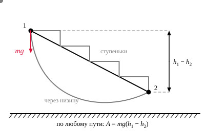

С пятого этажа на первый можно спуститься по лестнице, по пандусу или на лифте. Можно съехать с горки по прямой, а можно по извилистому жёлобу аквапарка. Пути совсем разные. Какую работу совершает сила тяжести на каждом? Ответ удивляет: одну и ту же. В этом уроке поймём почему.

## Вниз и вверх

Когда тело падает (урок 3.2), сила тяжести направлена вниз и тело движется вниз: угол $0^\circ$, работа положительна. Тело упало с высоты $h$ — работа $mgh$.

Когда тело подбросили вверх (урок 3.3), сила тяжести по-прежнему направлена вниз, а тело летит вверх: угол $180^\circ$, работа отрицательна. Тело поднялось на $h$ — работа $-mgh$.

Обе записи объединяет одна формула. Пусть тело было на высоте $h_1$, а оказалось на высоте $h_2$:

$$
A = m g\,(h_1 - h_2).
$$

Спуск: $h_1 > h_2$, работа положительна. Подъём: $h_1 < h_2$, работа отрицательна.

**Пример.** Ты массой $50\ \text{кг}$ спускаешься с пятого этажа на первый, разница высот $12\ \text{м}$:

$$
A = 50 \cdot 10 \cdot 12 = 6000\ \text{Дж}.
$$

Поднимаешься обратно — сила тяжести совершает $-6000\ \text{Дж}$.

## Форма пути не важна

Возьмём три пути из точки 1 в точку 2.

**Ступеньки.** На горизонтальных участках сила тяжести перпендикулярна перемещению — работа ноль (урок 11.4). На вертикальных — работа $mg$ на высоту ступеньки. Сложим ступеньки — получим всю разницу высот: $mg(h_1 - h_2)$.

**Прямой склон.** Это наклонная плоскость из урока 6.5. Вдоль неё на тело действует составляющая силы тяжести $mg\sin\alpha$, а длина склона $l$. Работа $mg\sin\alpha \cdot l$. Но $l\sin\alpha$ — это как раз высота склона $h_1 - h_2$. Снова $mg(h_1 - h_2)$! Чем положе склон, тем меньше составляющая силы, но тем длиннее путь — произведение одно и то же.

**Через низину.** Тело сначала спускается ниже точки 2 — сила тяжести совершает положительную работу. Потом поднимается обратно — отрицательную. Лишний спуск и лишний подъём гасят друг друга. Остаётся всё та же $mg(h_1 - h_2)$.

Любую кривую можно представить мелкими ступеньками, поэтому вывод общий: **работа силы тяжести не зависит от формы пути, только от начальной и конечной высоты**. Силы с таким свойством называют **потенциальными** (или консервативными). Сила упругости пружины тоже такая.

Отсюда следствие: если тело вернулось туда, откуда начало, **работа силы тяжести равна нулю**. Мяч подбросили и поймали — на подъёме $-mgh$, на спуске $+mgh$, вместе ноль.

Проверь себя: камень массой 0,5 кг подбросили, он поднялся на 7,2 м и упал обратно в руку. Какую работу совершила сила тяжести на подъёме? А за весь полёт?

На подъёме $A = -mgh = -0{,}5 \cdot 10 \cdot 7{,}2 = -36\ \text{Дж}$. За весь полёт — ноль: камень вернулся на ту же высоту.

<pp-task id="ks-work-06"></pp-task>

## А трение — зависит

С трением всё иначе. Сила трения скольжения на каждом участке направлена против движения, и её работа на каждом участке отрицательна (урок 11.4). Ничто не гасит её — участки только прибавляются. Чем длиннее путь, тем больше по модулю работа трения. Тащишь ящик из комнаты в комнату кружным путём — работа трения больше, чем по прямой. Вернул ящик на место — работа трения всё равно не ноль.

Поэтому трение — сила **не потенциальная**. Чем это важно, увидим в следующей теме, когда дойдём до энергии.

<pp-task id="ks-work-13"></pp-task>

## Частые ловушки

- **Подставили длину горки вместо высоты.** Работе силы тяжести нужна разность высот, а не длина пути.
- **Перепутали знак.** Спуск — работа силы тяжести положительна, подъём — отрицательна.
- **Сложили весь путь вверх и вниз.** Важны только начальная и конечная точки; подъём и спуск обратно гасят друг друга.
- **Решили, что и работа трения не зависит от пути.** Зависит: чем длиннее путь, тем она больше по модулю.

## Коротко

- Работа силы тяжести $A = mg(h_1 - h_2)$: спуск — плюс, подъём — минус.
- Она не зависит от формы пути, только от начальной и конечной высоты.
- На замкнутом пути работа силы тяжести равна нулю.
- Работа трения зависит от длины пути и всегда отрицательна.

Дальше — урок 11.6: а если сила по дороге меняется, как у растягиваемой пружины? Тогда работу ищут как площадь под графиком.
