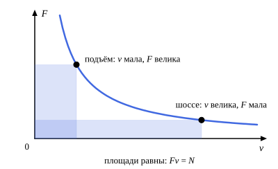

Машина легко мчится по ровному шоссе. Но на крутом подъёме водитель переключается на пониженную передачу и едет медленно. Почему? Двигатель ведь тот же. Дело в том, как связаны мощность, сила тяги и скорость. В этом последнем уроке темы выведем эту связь.

## Вывод формулы

Пусть тело движется с постоянной скоростью $v$ под действием силы $F$, направленной вдоль скорости. За время $t$ оно проходит путь $s = vt$ (урок 1.2). Работа силы $A = Fs = Fvt$. Мощность:

$$
N = \frac{A}{t} = \frac{F v t}{t} = F v.
$$

**Мощность равна силе, умноженной на скорость.** Единицы сходятся: $\text{Н} \cdot \text{м/с} = \text{Дж/с} = \text{Вт}$.

Если сила направлена под углом $\alpha$ к скорости, работает только её составляющая вдоль скорости (урок 11.4): $N = Fv\cos\alpha$.

**Пример.** Трактор тянет плуг с силой $15\ \text{кН}$ и едет с постоянной скоростью $3\ \text{м/с}$:

$$
N = F v = 15\,000 \cdot 3 = 45\,000\ \text{Вт} = 45\ \text{кВт}.
$$

Скорость в задачах часто дают в километрах в час. Переведи в метры в секунду: раздели на $3{,}6$.

Проверь себя: тепловоз тянет поезд с силой 180 кН при скорости 54 км/ч. Какую мощность он развивает?

$54\ \text{км/ч} = 54 / 3{,}6 = 15\ \text{м/с}$. $N = Fv = 180\,000 \cdot 15 = 2\,700\,000\ \text{Вт} = 2{,}7\ \text{МВт}$.

<pp-task id="ks-work-08"></pp-task>

## Зачем пониженная передача

У двигателя есть наибольшая мощность $N$. При этой мощности сила тяги и скорость связаны: $F = N/v$. Чем меньше скорость, тем больше сила.

Посмотри на график. Произведение $Fv$ — площадь прямоугольника под точкой графика. Для обеих точек оно одно и то же — мощность двигателя. Высокий узкий прямоугольник — подъём: скорость мала, сила велика. Низкий широкий — шоссе: скорость велика, сила мала.

**Пример.** Двигатель автомобиля развивает $60\ \text{кВт}$.

- На шоссе при скорости $25\ \text{м/с}$ сила тяги $F = 60\,000 / 25 = 2400\ \text{Н}$ — хватает, чтобы преодолеть сопротивление воздуха.
- На крутом подъёме нужна сила $6000\ \text{Н}$. Её двигатель даст только при скорости $v = 60\,000 / 6000 = 10\ \text{м/с}$.

Пониженная передача позволяет двигателю отдать ту же мощность на малой скорости — и получить большую силу. Это снова «золотое правило» из урока 11.3, только для движения: выигрываешь в силе — проигрываешь в скорости.

Та же формула работает и для подъёма груза. Кран поднимает груз равномерно — сила тяги равна $mg$, и мощность $N = mgv$. Чем тяжелее груз, тем медленнее его поднимает кран той же мощности.

<pp-task id="ks-work-16"></pp-task>

## Мгновенная и средняя мощность

Если скорость меняется, например машина разгоняется, $Fv$ — мощность **в данный момент**, её называют **мгновенной**. При той же силе тяги мгновенная мощность растёт вместе со скоростью.

А **средняя** мощность за время разгона — вся работа, делённая на всё время: $N_{\text{ср}} = A/t$. Подставлять в $Fv$ конечную скорость, чтобы найти среднюю мощность, нельзя.

## Частые ловушки

- **Скорость в км/ч.** В $N = Fv$ скорость — в метрах в секунду.
- **Ватты и киловатты.** Перед расчётом переведи мощность в ватты, в ответе дай то, что просят.
- **Средняя мощность через конечную скорость.** $Fv$ — мгновенная мощность; средняя — $A/t$.
- **Груз поднимают равномерно, а силу тяги ищут отдельно.** При равномерном подъёме сила тяги равна $mg$.

## Коротко

- При постоянной скорости $N = Fv$; под углом — $N = Fv\cos\alpha$.
- При той же мощности меньшая скорость — большая сила тяги: $F = N/v$.
- Равномерный подъём груза: $N = mgv$.
- $Fv$ — мгновенная мощность; средняя — $A/t$.

Это последний урок темы. Ты умеешь находить работу любой силы, мощность и КПД. В уроке 11.6 рука совершила работу, растягивая пружину, а пружина потом может сама сдвинуть груз. Работа будто запасается — это **энергия**. Работа — мера того, насколько изменилась энергия. Об этом следующая тема, «Механическая энергия и её сохранение».
