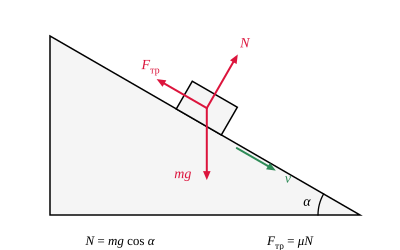

В задачах ЕГЭ почти всегда встречаются одни и те же силы: тяжести, упругости, реакции опоры, натяжения, трения. Если ты уверенно знаешь, куда каждая направлена и от чего зависит, задачи 2, 5, 6 и 26 становятся заметно проще.

Сами силы проходят ещё в 7 классе — с них и начнём. Потом разберём то, на чём чаще всего ошибаются в 10–11 классе: трение покоя, опору на наклонной плоскости и вес в лифте. Пригодятся законы Ньютона из предыдущей темы.

## Шаг 1. Сила тяжести (7 класс)

Любое тело у поверхности Земли притягивается к ней. Эту силу называют **силой тяжести**:

$$
F_{\text{т}} = m g.
$$

- $m$ — масса тела, кг;
- $g \approx 9{,}8\ \text{Н/кг}$ — на ЕГЭ берут $g = 10\ \text{Н/кг}$.

Смысл $g$ здесь простой: на каждый килограмм массы Земля действует с силой около $10$ ньютонов. Это то же самое число, что и ускорение свободного падения $10\ \text{м/с}^2$: $1\ \text{Н/кг} = 1\ \text{м/с}^2$.

Сила тяжести направлена вертикально вниз и приложена к самому телу.

<pp-task id="ks-forces-01"></pp-task>

## Шаг 2. Сила упругости и закон Гука (7 класс)

Растяни пружинку в ручке — она тянет назад. Сожми — толкает. Чем сильнее деформация, тем больше сила. Для небольших деформаций сила пропорциональна удлинению — это **закон Гука**:

$$
F_{\text{упр}} = k\,|\Delta l|.
$$

- $k$ — жёсткость пружины, Н/м: какая сила нужна, чтобы растянуть пружину на $1$ метр;
- $\Delta l$ — удлинение или сжатие, м (**не** длина пружины!).

Сила упругости направлена против деформации — так, чтобы вернуть тело к недеформированному состоянию. Закон Гука работает только при **упругих** деформациях: если пружину перетянуть, она не вернётся в исходную форму, и закон перестанет выполняться.

На законе Гука работает **динамометр** — прибор для измерения силы. Удлинение пружины показывает, с какой силой её тянут.

<pp-task id="ks-forces-02"></pp-task>

## Шаг 3. Вес тела (7 класс)

**Вес** $\vec P$ — сила, с которой тело давит на опору или растягивает подвес. Вес приложен **к опоре**, а не к телу. Это главное отличие от силы тяжести, которая приложена к самому телу.

Если опора или подвес покоятся (или движутся равномерно), вес равен силе тяжести:

$$
P = m g.
$$

Сила реакции опоры $\vec N$ и сила натяжения нити $\vec T$ — тоже силы упругости. Опора толкает тело перпендикулярно своей поверхности. Нить тянет вдоль себя. По третьему закону Ньютона $P = N$: тело давит на стол с той же силой, с какой стол давит на тело.

<pp-task id="ks-forces-03"></pp-task>

## Шаг 4. Сила трения скольжения (7 класс)

Толкни книгу по столу — она проедет и остановится. Её тормозит **сила трения**. Трение возникает из-за неровностей поверхностей и притяжения молекул.

Когда тело скользит, работает **трение скольжения**:

$$
F_{\text{тр}} = \mu N.
$$

- $\mu$ — коэффициент трения, безразмерный, зависит от материалов и обработки поверхностей;
- $N$ — сила нормальной реакции опоры, Н. На горизонтальном столе $N = mg$.

Трение скольжения направлено против скорости тела относительно поверхности. Оно почти не зависит от площади соприкосновения.

Если тело тянут **равномерно**, по первому закону Ньютона сила тяги равна силе трения. Так трение и измеряют динамометром.

<pp-task id="ks-forces-04"></pp-task>

## Шаг 5. Трение покоя (10 класс)

Попробуй сдвинуть тяжёлый шкаф. Сначала толкаешь — он стоит. Толкаешь сильнее — стоит. И вдруг поехал. Пока шкаф стоит, работает **трение покоя**. Оно ровно такое, чтобы удержать шкаф, и не больше. Его максимальное значение $\mu N$.

Трение покоя направлено против той силы, которая пытается сдвинуть тело, и равно ей по модулю (пока не достигнет $\mu N$). Пример: брусок лежит на столе, ты тянешь его с силой $2\ \text{Н}$, а $\mu N = 5\ \text{Н}$. Сила трения равна $2\ \text{Н}$, а не $5$.

Поэтому в задаче сначала проверяй: **сдвинется ли тело?**

- внешняя сила меньше $\mu N$ — тело стоит, трение равно внешней силе;
- больше — тело скользит, трение равно $\mu N$.

<pp-task id="ks-forces-05"></pp-task>

## Шаг 6. Реакция опоры не всегда равна $mg$ (10 класс)

На наклонной плоскости опора наклонена, и толкает тело она перпендикулярно своей поверхности — уже не вертикально. Разложим силу тяжести на две проекции: вдоль склона и поперёк.

Направим ось $Ox$ вдоль склона вниз, $Oy$ — перпендикулярно склону. Тогда:

- поперёк склона тело не движется: $N = mg\cos\alpha$;
- вдоль склона тянет составляющая $mg\sin\alpha$.

Без трения брусок скатывается с ускорением $a = g\sin\alpha$. С трением трение скольжения $\mu N = \mu mg\cos\alpha$ — тоже уже не $\mu mg$.

То же бывает и на горизонтальном полу. Если санки тянут за верёвку вверх под углом, верёвка их немного приподнимает, и $N = mg - F\sin\alpha$.

<pp-task id="ks-forces-06"></pp-task>

## Шаг 7. Вес в лифте и невесомость (10 класс)

Вес не всегда равен $mg$. Встань на весы в лифте: при разгоне вверх они покажут больше, при разгоне вниз — меньше.

Пусть лифт движется с ускорением $a$ вверх. На человека действуют сила тяжести $mg$ вниз и реакция пола $N$ вверх. Второй закон: $N - mg = ma$. Значит,

$$
P = N = m(g + a).
$$

В лифте, который разгоняется вниз (или тормозит при движении вверх): $P = m(g - a)$. Если $a = g$, вес равен нулю — это **невесомость**. Космонавт на станции невесом не потому, что там нет тяжести, а потому что станция и космонавт вместе свободно падают вокруг Земли.

<pp-task id="ks-forces-07"></pp-task>

## Шаг 8. Соединение пружин (10 класс)

Две пружины можно соединить двумя способами.

- **Параллельно** (рядом, тянут груз вместе): каждая растягивается на одно и то же $\Delta l$, силы складываются. Жёсткости складываются: $k = k_1 + k_2$ — система жёстче.
- **Последовательно** (одна за другой): сила в обеих пружинах одна и та же, а удлинения складываются:

$$
\frac{1}{k} = \frac{1}{k_1} + \frac{1}{k_2}.
$$

Система получается мягче самой мягкой пружины.

<pp-task id="ks-forces-08"></pp-task>

## Частые ловушки

- **В законе Гука подставляют длину пружины**, а не удлинение.
- **Всегда пишут $F_{\text{тр}} = \mu N$.** Для покоящегося тела трение покоя может быть меньше.
- **Считают $N = mg$ на наклонной плоскости** или когда тянут под углом. На наклонной $N = mg\cos\alpha$; если тянут вверх под углом, $N = mg - F\sin\alpha$.
- **Путают вес и силу тяжести.** Сила тяжести приложена к телу, вес — к опоре; по модулю они равны только если опора покоится или движется без ускорения.

## Как это выглядит на ЕГЭ

*Ящик массой $20\ \text{кг}$ стоит на полу. Коэффициент трения $0{,}4$. Его толкают горизонтальной силой $60\ \text{Н}$. Чему равна сила трения? $g = 10\ \text{м/с}^2$.*

Сначала проверим, сдвинется ли ящик. Максимальное трение покоя:

$$
\mu N = \mu m g = 0{,}4 \cdot 20 \cdot 10 = 80\ \text{Н}.
$$

Толкают с силой $60\ \text{Н}$ — это меньше $80\ \text{Н}$. Ящик стоит. Значит, сила трения покоя уравновешивает толчок: $F_{\text{тр}} = 60\ \text{Н}$.

Ответ $80\ \text{Н}$ был бы ошибкой: так трение работает, только когда ящик уже скользит.

## Коротко

- $F_{\text{т}} = mg$, вниз, приложена к телу.
- Закон Гука: $F = k|\Delta l|$, только для упругих деформаций.
- Вес приложен к опоре; на неподвижной опоре $P = mg$, в лифте $P = m(g \pm a)$.
- Трение скольжения $\mu N$; трение покоя от нуля до $\mu N$ — сначала проверь, сдвинется ли тело.
- На наклонной $N = mg\cos\alpha$, без трения $a = g\sin\alpha$.
- Невесомость: тело и опора движутся с ускорением $g$.
- Пружины: параллельно $k_1 + k_2$, последовательно $1/k = 1/k_1 + 1/k_2$.
