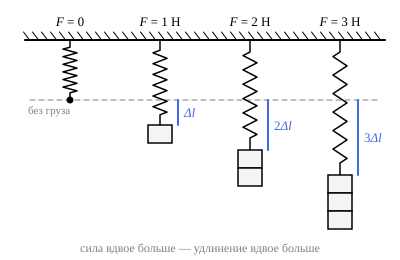

Растяни пружинку из ручки — она тянет пальцы назад. Сожми — толкает. Отпусти — она возвращается к прежней длине. Так же ведут себя резинка, натянутая верёвка, прогнутая линейка. В уроке 5.2 мы говорили, что каждая сила — действие какого-то тела. Здесь действует само деформированное тело: оно «хочет» вернуть себе форму.

## Сила упругости

Тело **деформировано**, если изменились его форма или размеры: пружину растянули, мяч сжали, доску прогнули. Деформированное тело действует на то, что его деформирует. Эту силу называют **силой упругости**.

Она направлена **против деформации**: растянутая пружина тянет к себе, сжатая — отталкивает. Всегда так, чтобы тело вернулось к прежней форме.

Если деформация исчезает, когда тело отпустили, её называют **упругой**. Пружина, резинка, стальная линейка при небольших деформациях упругие. А пластилин — нет: его форма так и остаётся изменённой.

## Чем сильнее растянули, тем сильнее тянет

Подвесим к пружине один, два, три одинаковых груза. Каждый тянет вниз с силой $1\ \text{Н}$. Пружина растягивается, пока её сила упругости не уравновесит груз (урок 5.3).

Посмотри на концы пружины. С одним грузом она стала длиннее на $\Delta l$, с двумя — на $2\Delta l$, с тремя — на $3\Delta l$. Сила вдвое больше — удлинение вдвое больше. Сила упругости **пропорциональна** удлинению.

## Закон Гука

**Закон Гука:** при упругой деформации сила упругости пропорциональна удлинению:

$$
F_{\text{упр}} = k\,|\Delta l|.
$$

- $\Delta l$ — **удлинение**: на сколько пружина стала длиннее (или короче, если её сжали), м;
- $k$ — **жёсткость** пружины, Н/м: с какой силой пружина тянет, если её растянуть на $1\ \text{м}$.

Модуль $|\Delta l|$ стоит потому, что при сжатии удлинение отрицательное, а сила по модулю — всё равно $k|\Delta l|$.

Жёсткость зависит от пружины: от материала, толщины проволоки, числа витков. Толстую короткую пружину трудно растянуть — у неё $k$ большое. Мягкую длинную — легко, $k$ маленькое.

Важно: $\Delta l$ — это **не длина** пружины. Если пружина длиной $10\ \text{см}$ стала длиной $13\ \text{см}$, удлинение $\Delta l = 13 - 10 = 3\ \text{см}$.

**Пример.** Пружину жёсткостью $50\ \text{Н/м}$ растянули на $4\ \text{см}$. Переведём в метры: $\Delta l = 0{,}04\ \text{м}$.

$$
F = k\,\Delta l = 50 \cdot 0{,}04 = 2\ \text{Н}.
$$

<pp-task id="ks-forces-02"></pp-task>

Проверь себя: сила 3 Н растягивает пружину на 2 см. На сколько её растянет сила 6 Н?

На $4\ \text{см}$: сила вдвое больше — удлинение вдвое больше. Жёсткость считать не нужно.

## Динамометр

На законе Гука работает **динамометр** — прибор для измерения силы. Внутри него пружина, к ней прикреплена стрелка. Чем сильнее тянут крючок, тем больше удлинение и тем дальше уходит стрелка. Шкалу размечают сразу в ньютонах: удлинение пропорционально силе, поэтому деления равные.

## Жёсткость по графику

На ЕГЭ жёсткость часто дают графиком: по горизонтали удлинение, по вертикали сила. По закону Гука это прямая из начала координат.

Возьми на прямой удобную точку и раздели силу на удлинение в метрах:

- пружина 1: $k_1 = \dfrac{5\ \text{Н}}{0{,}05\ \text{м}} = 100\ \text{Н/м}$;
- пружина 2: $k_2 = \dfrac{4\ \text{Н}}{0{,}1\ \text{м}} = 40\ \text{Н/м}$.

Чем круче прямая, тем жёстче пружина: при том же удлинении она тянет сильнее.

<pp-task id="ks-forces-09"></pp-task>

## Где кончается закон Гука

Закон Гука верен только для **упругих** деформаций. Если пружину сильно перетянуть, она не вернётся к прежней длине: витки разогнутся. Тогда сила уже не пропорциональна удлинению, и формулой пользоваться нельзя. В задачах ЕГЭ, если не сказано иное, деформации считают упругими.

## Частые ловушки

- **Подставили длину пружины** вместо удлинения. $\Delta l$ — разность длин.
- **Не перевели сантиметры в метры.** Жёсткость в Н/м, удлинение — в метрах.
- **Перепутали направление.** Сила упругости направлена против деформации: растянутая пружина тянет к себе.
- **Перепутали по графику оси.** Жёсткость — это сила, делённая на удлинение, а не наоборот.

## Коротко

- Деформированное тело действует силой упругости, направленной против деформации.
- Закон Гука: $F_{\text{упр}} = k|\Delta l|$, только для упругих деформаций.
- $\Delta l$ — изменение длины, в метрах; $k$ — жёсткость, Н/м.
- По графику $F(\Delta l)$: $k = F / \Delta l$, круче прямая — жёстче пружина.

Дальше — урок 6.2: стол, на котором лежит книга, тоже деформирован. Так появляются сила реакции опоры, натяжение нити и вес.
