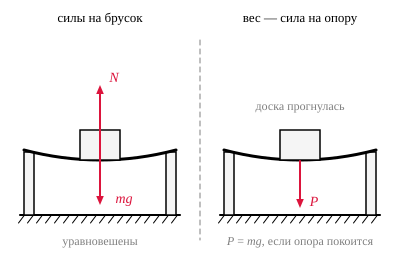

Книга лежит на столе и не падает. В уроке 5.3 мы сказали: её держит стол, сила реакции опоры $N$ уравновешивает силу тяжести. Но как стол «узнаёт», с какой силой толкать? Положи на стол гирю — он толкнёт сильнее. Положи пёрышко — слабее. Ответ — в уроке 6.1: стол деформируется.

## Опора тоже прогибается

Положи тяжёлую книгу на середину тонкой доски, лежащей на двух кирпичах. Доска заметно прогнётся. Прогнутая доска упруга, как пружина: она «хочет» распрямиться и толкает книгу вверх. Чем тяжелее книга, тем сильнее прогиб и тем сильнее толкает доска.

Стол прогибается так же — только так мало, что глазом не заметно. Поэтому:

- **сила реакции опоры** $\vec N$ — это сила упругости опоры. Она направлена **перпендикулярно** поверхности опоры;
- **сила натяжения** $\vec T$ — сила упругости нити, троса, верёвки. Нить чуть-чуть растягивается и тянет тело **вдоль себя**.

Нить не может толкать: если её не тянуть, она провиснет. Поэтому натяжение всегда направлено от тела вдоль нити.

## Вес

По третьему закону (урок 5.5) раз опора толкает тело, то и тело давит на опору — с такой же силой, в обратную сторону.

**Вес** $\vec P$ — сила, с которой тело давит на опору или растягивает подвес.

Посмотри на рисунок справа: стрелка веса начинается **на доске**. Вес приложен к опоре, а не к телу. Это главное, чем вес отличается от силы тяжести.

| | Сила тяжести $m\vec g$ | Вес $\vec P$ |
|---|---|---|
| Кто действует | Земля | тело |
| На кого | на тело | на опору или подвес |
| Природа | притяжение | упругость |

Вес — это **сила**, в ньютонах. В быту «вес» говорят про массу: «вешу $60$ килограммов». В физике так нельзя: масса — в килограммах, вес — в ньютонах.

## Когда вес равен $mg$

Если тело и опора покоятся (или движутся равномерно), силы на тело уравновешены: $N = mg$ (урок 5.3). А вес по третьему закону равен $N$. Значит,

$$
P = N = m g.
$$

**Пример.** Девочка массой $45\ \text{кг}$ стоит на полу. Сила тяжести $mg = 450\ \text{Н}$ приложена к девочке. Пол толкает её вверх с силой $N = 450\ \text{Н}$. А девочка давит на пол с силой $P = 450\ \text{Н}$ — это её вес, он приложен к полу.

Три силы равны по модулю, но это **разные** силы: у них разные тела, к которым они приложены, и разная природа.

<pp-task id="ks-forces-01"></pp-task>

Проверь себя: чемодан массой 12 кг стоит на полу. Чему равны сила тяжести и вес чемодана? К чему приложена каждая?

Обе равны $12 \cdot 10 = 120\ \text{Н}$. Сила тяжести приложена к чемодану, вес — к полу.

Иногда на опору давит не только само тело. Если на одной книге лежит другая, нижняя давит на стол весом обеих: она держит верхнюю и передаёт её давление столу.

<pp-task id="ks-forces-10"></pp-task>

## Груз на подвесе

С подвесом всё так же. Груз висит на нити и не движется. На груз действуют сила тяжести вниз и сила натяжения $T$ вверх; они уравновешены: $T = mg$. А груз тянет нить вниз — это его вес, $P = T = mg$.

Если вместо нити пружина, её удлинение показывает вес: по закону Гука $k\,\Delta l = P$. Так работает динамометр из урока 6.1, когда на нём взвешивают.

**Пример.** Груз массой $200\ \text{г}$ висит на пружине жёсткостью $50\ \text{Н/м}$. Масса в килограммах $0{,}2\ \text{кг}$, вес груза $P = 0{,}2 \cdot 10 = 2\ \text{Н}$. Удлинение

$$
\Delta l = \frac{P}{k} = \frac{2}{50} = 0{,}04\ \text{м} = 4\ \text{см}.
$$

<pp-task id="ks-forces-03"></pp-task>

Заметь слова «если опора покоится». В лифте, который разгоняется, это уже не так: там вес не равен $mg$. Это урок 6.6.

## Частые ловушки

- **«Вес приложен к телу».** Вес приложен к опоре или подвесу. К телу приложена сила тяжести.
- **Вес в килограммах.** Вес — сила, в ньютонах: $P = mg$, если опора покоится.
- **Реакция опоры «всегда вверх».** Она перпендикулярна поверхности опоры. На наклонной плоскости она наклонена (урок 6.5).
- **Нить толкает.** Нить только тянет, вдоль себя.

## Коротко

- Опора и подвес деформируются; сила реакции опоры $N$ и натяжение $T$ — силы упругости.
- $N$ перпендикулярна опоре, $T$ направлена вдоль нити.
- Вес $P$ — сила, с которой тело давит на опору или тянет подвес; приложен к опоре.
- Если опора покоится или движется равномерно, $P = N = mg$.

Дальше — урок 6.3: толкни книгу по столу — она остановится. Что её тормозит?
