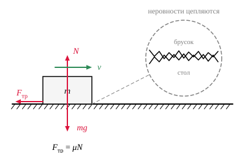

Толкни книгу по столу — она проедет немного и остановится. Толкни шайбу по льду — она уедет далеко, но тоже остановится. В уроке 5.1 мы выяснили: скорость меняется, только если на тело действует другое тело. Здесь это поверхность, по которой тело скользит. Её действие называют **силой трения**.

## Откуда берётся трение

Даже гладкий на вид стол под лупой шершавый. И нижняя сторона книги тоже. Когда книга скользит, бугорки одной поверхности цепляются за бугорки другой и мешают движению. Там, где поверхности прижаты совсем плотно, молекулы ещё и притягиваются друг к другу.

Поэтому трение скольжения направлено **против скорости** тела относительно поверхности. Брусок едет вправо — трение тянет влево.

## От чего зависит трение

Положим на брусок второй такой же и снова протянем его динамометром равномерно. Динамометр покажет вдвое больше. Брусок сильнее прижат к столу — бугорки сильнее вдавлены друг в друга.

Сила, которой стол давит на брусок, — это сила реакции опоры $N$ (урок 6.2). Опыты показывают: трение скольжения пропорционально ей:

$$
F_{\text{тр}} = \mu N.
$$

- $\mu$ («мю») — **коэффициент трения**, число без единиц. Он зависит от того, какие поверхности трутся и как обработаны: резина по сухому асфальту — около $0{,}7$, дерево по дереву — около $0{,}3$, сталь по льду — сотые доли;
- $N$ — сила реакции опоры, Н. На горизонтальной поверхности, если тело тянут горизонтально, $N = mg$.

Ещё два факта из опытов:

- трение скольжения почти **не зависит от площади** соприкосновения. Положи брусок на узкую грань — динамометр покажет то же самое;
- в школьных задачах трение скольжения не зависит и от **скорости**.

**Пример.** Ящик массой $8\ \text{кг}$ скользит по полу, коэффициент трения $0{,}25$. Пол горизонтальный, поэтому $N = mg = 80\ \text{Н}$.

$$
F_{\text{тр}} = \mu N = 0{,}25 \cdot 80 = 20\ \text{Н}.
$$

Проверь себя: брусок тянут по столу. Его перевернули на боковую грань — площадь соприкосновения стала втрое меньше. Как изменилась сила трения?

Почти не изменилась. Трение скольжения зависит от $\mu$ и $N$, а $N = mg$ осталась прежней.

## Как измерить трение

Тянем брусок динамометром **равномерно**. Скорость постоянна — значит, по первому закону (урок 5.3) силы уравновешены: сила тяги равна силе трения. Динамометр показывает трение.

А зная трение и массу, легко найти $\mu$: $\mu = \dfrac{F_{\text{тр}}}{N}$.

<pp-task id="ks-forces-04"></pp-task>

<pp-task id="ks-forces-11"></pp-task>

## Трение тормозит

Если тело скользит само, без тяги, его тормозит одно трение. По второму закону (урок 5.4) $ma = \mu m g$. Масса сокращается:

$$
a = \mu g.
$$

Тяжёлый и лёгкий ящик из одного материала тормозят одинаково.

**Пример.** Машина едет со скоростью $20\ \text{м/с}$, водитель резко тормозит, и колёса скользят по асфальту юзом. Коэффициент трения $0{,}5$. Ускорение $a = 0{,}5 \cdot 10 = 5\ \text{м/с}^2$. Тормозной путь — по формуле урока 2.4:

$$
s = \frac{v_0^2}{2a} = \frac{20^2}{2 \cdot 5} = 40\ \text{м}.
$$

На мокром асфальте $\mu$ меньше — и путь длиннее. Поэтому в дождь держат дистанцию больше.

<pp-task id="ks-forces-12"></pp-task>

## Частые ловушки

- **Трение «по скорости»** или «всегда назад». Трение скольжения направлено против скорости тела относительно поверхности.
- **Забыли $g$:** $F_{\text{тр}} = \mu m$ — это не сила. Правильно $\mu N$, на горизонтальном полу $\mu mg$.
- **«Больше площадь — больше трение».** От площади трение скольжения почти не зависит.
- **$N = mg$ всегда.** Только на горизонтали и если никто не давит и не тянет вверх. Об этом урок 6.5.

## Коротко

- Трение скольжения направлено против скорости тела относительно поверхности.
- $F_{\text{тр}} = \mu N$; $\mu$ без единиц, зависит от поверхностей.
- Не зависит от площади соприкосновения.
- Тело тянут равномерно — сила тяги равна трению.
- Тело тормозит само на горизонтали — $a = \mu g$.

Дальше — урок 6.4: а если толкнуть шкаф, а он не поехал? Есть ли трение, когда тело стоит?
