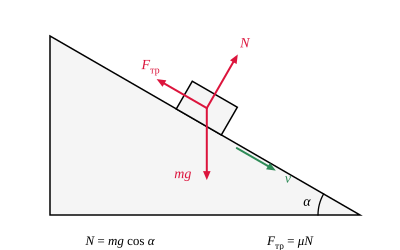
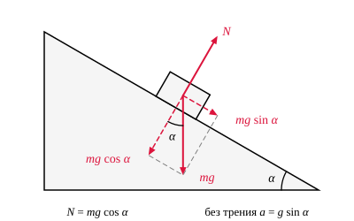
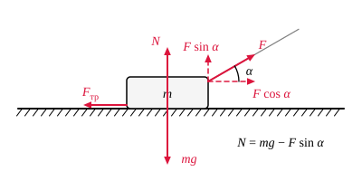

Санки сами съезжают с горки, а с ровного места — нет. Брусок лежит на доске; приподними её край — сначала брусок держится, потом соскальзывает. Сила тяжести та же, направлена так же — вниз. Почему же на склоне тело начинает ехать? И чему тут равна сила реакции опоры, раз опора наклонена?

## Силы на склоне

На брусок на наклонной плоскости действуют те же силы, что на столе: сила тяжести $mg$ вниз, сила реакции опоры $N$ и, может быть, трение. Но опора наклонена, и $N$ направлена **перпендикулярно склону** (урок 6.2), а не вверх. Трение направлено **вдоль склона**.

Силы направлены в три разные стороны. По плану из урока 5.6 выберем оси так, чтобы было удобно:

- $Ox$ — **вдоль склона** вниз, туда, куда может поехать брусок;
- $Oy$ — **перпендикулярно склону**.

Тогда $N$ лежит на оси $Oy$, трение — на оси $Ox$. Наклонена к осям только сила тяжести. Её и разложим.

## Раскладываем силу тяжести

Угол между силой тяжести и перпендикуляром к склону равен углу наклона $\alpha$ (у этих углов взаимно перпендикулярные стороны). Поэтому:

- вдоль склона брусок тянет составляющая $mg\sin\alpha$;
- в склон его прижимает составляющая $mg\cos\alpha$.

Чтобы не путать синус и косинус, проверь крайние случаи. При $\alpha = 0$ склон — это стол: вдоль него ничего не тянет ($\sin 0 = 0$), а прижимает всей силой ($\cos 0 = 1$). При $\alpha = 90^\circ$ — вертикальная стена: тело падает всей силой, а к стене не прижато.

## Сила реакции опоры

Поперёк склона брусок не движется. Значит, по оси $Oy$ силы уравновешены:

$$
N = mg\cos\alpha.
$$

На склоне сила реакции опоры **меньше** $mg$. Значит, и вес бруска меньше, и трение скольжения меньше: $\mu N = \mu mg\cos\alpha$.

**Пример.** Брусок массой $4\ \text{кг}$ лежит на склоне под углом $30^\circ$. $\cos 30^\circ \approx 0{,}87$:

$$
N = 4 \cdot 10 \cdot 0{,}87 \approx 34{,}8\ \text{Н}, \qquad mg\sin 30^\circ = 40 \cdot 0{,}5 = 20\ \text{Н}.
$$

Если брусок лежит неподвижно, вдоль склона его держит трение покоя (урок 6.4). Оно уравновешивает $mg\sin\alpha$, то есть равно $20\ \text{Н}$ и направлено вверх по склону.

<pp-task id="ks-forces-06"></pp-task>

Проверь себя: брусок массой 3 кг неподвижно лежит на склоне 30°. Чему равна сила трения?

Это трение покоя, оно уравновешивает составляющую вдоль склона: $F_{\text{тр}} = mg\sin 30^\circ = 30 \cdot 0{,}5 = 15\ \text{Н}$, вверх по склону. Формула $\mu N$ тут не нужна — коэффициент трения даже не дан.

## Скольжение по склону

Если трения нет, вдоль склона действует одна составляющая $mg\sin\alpha$. По второму закону $ma = mg\sin\alpha$:

$$
a = g\sin\alpha.
$$

На пологой горке ускорение маленькое, на крутой — ближе к $g$.

С трением брусок, скользящий вниз, тормозит трение $\mu mg\cos\alpha$, направленное вверх по склону:

$$
ma = mg\sin\alpha - \mu mg\cos\alpha.
$$

**Пример.** Брусок соскальзывает со склона $30^\circ$, $\mu = 0{,}2$. Масса сокращается: $a = 10 \cdot (0{,}5 - 0{,}2 \cdot 0{,}87) \approx 3{,}3\ \text{м/с}^2$ — заметно меньше, чем без трения.

<pp-task id="ks-forces-15"></pp-task>

## Тянут под углом

$N$ не равна $mg$ и на ровном полу, если тело тянут под углом. Санки тянут за верёвку, направленную вверх под углом $\alpha$ к горизонту.

Разложим силу $F$: вперёд тянет $F\cos\alpha$, вверх — $F\sin\alpha$. Верёвка немного приподнимает санки, и пол давит на них слабее. По вертикали санки не движутся: $N + F\sin\alpha = mg$,

$$
N = mg - F\sin\alpha.
$$

**Пример.** Санки массой $12\ \text{кг}$ тянут с силой $60\ \text{Н}$ под углом $30^\circ$, $\mu = 0{,}1$. Тогда $N = 120 - 60 \cdot 0{,}5 = 90\ \text{Н}$, трение скольжения $\mu N = 9\ \text{Н}$ — а не $12\ \text{Н}$, как было бы при $N = mg$.

Если бы санки не тянули, а толкали сверху вниз под углом, $F\sin\alpha$ прижимала бы их к полу: $N = mg + F\sin\alpha$.

<pp-task id="ks-forces-16"></pp-task>

## Частые ловушки

- **$N = mg$ на склоне.** На склоне $N = mg\cos\alpha$.
- **Перепутали синус и косинус.** Проверь крайний случай $\alpha = 0$: вдоль стола ничего не тянет, значит, вдоль склона — синус.
- **Трение на склоне $\mu mg$.** Трение скольжения $\mu N = \mu mg\cos\alpha$.
- **$\mu N$ для бруска, который лежит.** Неподвижный брусок держит трение покоя $mg\sin\alpha$.
- **Санки под углом: $N = mg$.** Верёвка приподнимает санки: $N = mg - F\sin\alpha$.

## Коротко

- На склоне оси: $Ox$ вдоль склона, $Oy$ поперёк; раскладывается только $mg$.
- Вдоль склона $mg\sin\alpha$, в склон $mg\cos\alpha$; $N = mg\cos\alpha$.
- Без трения $a = g\sin\alpha$; с трением $ma = mg\sin\alpha - \mu mg\cos\alpha$.
- Неподвижный брусок на склоне: трение покоя $mg\sin\alpha$.
- Тянут вверх под углом: $N = mg - F\sin\alpha$.

Дальше — урок 6.6: встань на весы в лифте. Почему они показывают то больше, то меньше?
