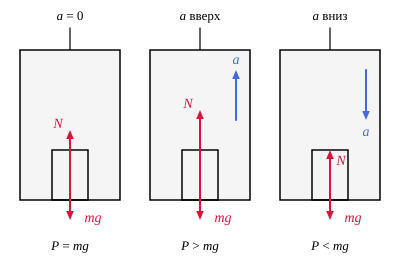

Встань на напольные весы в лифте. Лифт трогается вверх — весы на секунду показывают больше. Едет ровно — столько же, сколько дома. Тормозит у верхнего этажа — меньше. Масса твоя не менялась, Земля тянет так же. Что же тогда показывают весы?

## Что показывают весы

Весы — это опора с пружиной внутри. Они измеряют, с какой силой ты на них давишь, то есть твой **вес** (урок 6.2). В уроке 6.2 мы нашли, что $P = mg$, но с оговоркой: если опора покоится или движется равномерно. В лифте, который разгоняется или тормозит, это условие нарушено.

Найдём вес по плану урока 5.6. На человека действуют сила тяжести $mg$ вниз и сила реакции пола $N$ вверх. По третьему закону вес равен $N$. Значит, достаточно найти $N$.

## Ускорение вверх

Пусть ускорение лифта $a$ направлено вверх. Ось $Oy$ — вверх, по ускорению. Второй закон:

$$
ma = N - mg, \qquad P = N = m(g + a).
$$

Чтобы разгонять человека вверх, пол должен толкать сильнее, чем тянет Земля. Вес **больше** $mg$.

**Пример.** Человек массой $70\ \text{кг}$, лифт разгоняется вверх с ускорением $1\ \text{м/с}^2$. Вес $P = 70 \cdot (10 + 1) = 770\ \text{Н}$, а не $700\ \text{Н}$.

<pp-task id="ks-forces-07"></pp-task>

## Ускорение вниз

Если ускорение направлено вниз, ось удобнее направить вниз: $ma = mg - N$, и

$$
P = N = m(g - a).
$$

Вес **меньше** $mg$.

Главное: смотри на направление **ускорения**, а не скорости. Ускорение вниз бывает в двух случаях:

- лифт едет вниз и разгоняется;
- лифт едет **вверх** и тормозит.

И наоборот: ускорение вверх — когда лифт разгоняется вверх или тормозит, опускаясь. Это то же правило, что в уроке 2.2: при торможении ускорение направлено против скорости.

Проверь себя: лифт едет вверх с постоянной скоростью 3 м/с. Больше, меньше или равен mg вес человека в нём?

Равен $mg$. Скорость постоянна — ускорения нет, силы уравновешены (урок 5.3). От скорости вес не зависит, только от ускорения.

<pp-task id="ks-forces-17"></pp-task>

## Невесомость

Что будет, если ускорение лифта вниз равно $g$? Тогда $P = m(g - g) = 0$. Человек не давит на пол, весы показывают ноль. Это **невесомость**.

Так будет, если лифт свободно падает: и он, и человек движутся с ускорением $g$ (урок 3.1). Человек и пол падают одинаково, и пол человека не держит. Сила тяжести при этом никуда не делась — она и разгоняет обоих.

Космонавт на орбитальной станции невесом по той же причине. Там тоже есть тяжесть: на высоте станции она всего на десятую часть меньше, чем у Земли. Но станция и космонавт вместе свободно падают — летят с ускорением, которое им сообщает только Земля. Почему при этом они не падают на Землю, — следующая тема.

Короткую невесомость ты испытываешь и сам: в прыжке, пока не коснулся земли, ты ни на что не давишь.

## Вес на мосту

Вес меняется не только в лифте. Машина проезжает верхнюю точку выпуклого моста. Там она движется по окружности, и её ускорение $v^2/R$ направлено к центру (уроки 4.3 и 5.6), то есть **вниз**. Это как лифт с ускорением вниз:

$$
P = m\left(g - \frac{v^2}{R}\right).
$$

**Пример.** Машина массой $1200\ \text{кг}$ въезжает на верх моста радиусом $50\ \text{м}$ со скоростью $15\ \text{м/с}$. Ускорение $\dfrac{225}{50} = 4{,}5\ \text{м/с}^2$, вес

$$
P = 1200 \cdot (10 - 4{,}5) = 6600\ \text{Н}
$$

вместо $12\,000\ \text{Н}$ на ровной дороге. Если $v^2/R = g$, то есть $v = \sqrt{gR} \approx 22\ \text{м/с}$, машина в верхней точке невесома: колёса едва касаются моста. В вогнутой яме всё наоборот: центр сверху, ускорение вверх, $P = m(g + v^2/R)$.

<pp-task id="ks-forces-18"></pp-task>

## Частые ловушки

- **Вес всегда $mg$.** Только если опора движется без ускорения.
- **Смотрят на скорость, а не на ускорение.** Лифт едет вверх и тормозит — ускорение вниз, вес меньше.
- **«В невесомости нет силы тяжести».** Тяжесть есть; нет веса, потому что тело и опора падают вместе.
- **Выпуклый мост: $P = m(g + v^2/R)$.** Ускорение направлено к центру, вниз, поэтому минус.

## Коротко

- Весы показывают вес $P = N$, а не силу тяжести.
- Ускорение вверх: $P = m(g + a)$; вниз: $P = m(g - a)$; без ускорения: $P = mg$.
- Важно направление ускорения, а не скорости.
- $a = g$ вниз — невесомость: $P = 0$, а тяжесть по-прежнему действует.
- Верх выпуклого моста: $P = m(g - v^2/R)$.

Дальше — урок 6.7: что если груз держат две пружины? Как найти жёсткость пары?
