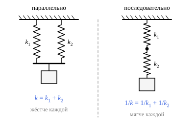

Одна пружина в эспандере тянется легко. Вставь две, рядом друг с другом, — тянуть стало вдвое тяжелее. А если прицепить две пружины одну за другой, получится длинная и мягкая. Две одинаковые пружины, а результат противоположный. В этом уроке разберёмся, почему, и найдём жёсткость пары пружин — заменим две пружины одной, которая растягивается так же. Это то же, что равнодействующая из урока 5.2, только для пружин.

## Два способа соединить

- **Параллельно**: пружины висят рядом и держат груз вместе.
- **Последовательно**: одна пружина прицеплена к другой, груз — к нижней.

## Параллельно: силы складываются

Пружины прикреплены к одной планке, поэтому растянуты **одинаково**, на одно и то же $\Delta l$. Каждая тянет со своей силой по закону Гука (урок 6.1), и вместе они держат груз:

$$
F = k_1\Delta l + k_2\Delta l = (k_1 + k_2)\,\Delta l.
$$

Пара ведёт себя как одна пружина жёсткостью

$$
k = k_1 + k_2.
$$

Система **жёстче** каждой из пружин. Вставил вторую пружину в эспандер — тянуть тяжелее.

**Пример.** Пружины жёсткостью $100\ \text{Н/м}$ и $200\ \text{Н/м}$ соединены параллельно. Жёсткость системы $k = 300\ \text{Н/м}$. Сила $6\ \text{Н}$ растянет обе на $\Delta l = 6/300 = 0{,}02\ \text{м} = 2\ \text{см}$.

<pp-task id="ks-forces-19"></pp-task>

## Последовательно: удлинения складываются

Теперь пружины одна под другой. Нижнюю тянет груз с силой $F$. А что тянет верхнюю? Нижняя пружина — с той же силой $F$: лёгкая пружина передаёт силу дальше, как нить из урока 5.6. В обеих пружинах сила **одна и та же**.

Зато растягивается каждая по-своему: верхняя на $F/k_1$, нижняя на $F/k_2$. Груз опускается на сумму удлинений:

$$
\Delta l = \frac{F}{k_1} + \frac{F}{k_2}.
$$

Для одной пружины жёсткостью $k$ было бы $\Delta l = F/k$. Сравним и сократим $F$:

$$
\frac{1}{k} = \frac{1}{k_1} + \frac{1}{k_2}.
$$

Система **мягче** самой мягкой из пружин: удлинения складываются, и при той же силе груз опускается ниже.

**Пример.** Пружины жёсткостью $60\ \text{Н/м}$ и $30\ \text{Н/м}$ соединены последовательно:

$$
\frac{1}{k} = \frac{1}{60} + \frac{1}{30} = \frac{1}{60} + \frac{2}{60} = \frac{3}{60}, \qquad k = 20\ \text{Н/м}.
$$

$20\ \text{Н/м}$ меньше $30\ \text{Н/м}$ — система мягче мягкой пружины, как и должно быть.

Для двух пружин удобна и готовая формула $k = \dfrac{k_1 k_2}{k_1 + k_2}$: $\dfrac{60 \cdot 30}{90} = 20\ \text{Н/м}$.

<pp-task id="ks-forces-08"></pp-task>

Проверь себя: две одинаковые пружины по 80 Н/м. Какая жёсткость, если соединить их параллельно? А последовательно?

Параллельно: $80 + 80 = 160\ \text{Н/м}$, вдвое жёстче. Последовательно: $\dfrac{1}{k} = \dfrac{2}{80}$, $k = 40\ \text{Н/м}$, вдвое мягче.

## Половинка пружины

Отсюда неожиданный вывод. Целую пружину можно считать двумя половинками, соединёнными последовательно. Под одной и той же силой каждая половинка растягивается на половину общего удлинения. Значит, половинка **вдвое жёстче** целой пружины. А треть — втрое жёстче.

Жёсткость зависит не только от материала и толщины проволоки, но и от длины: чем короче пружина, тем она жёстче.

<pp-task id="ks-forces-20"></pp-task>

## Частые ловушки

- **Перепутали формулы.** Рядом — жёсткости складываются; одна за другой — складываются обратные величины.
- **Забыли перевернуть дробь.** Из $\dfrac{1}{k} = \dfrac{3}{60}$ следует $k = 20$, а не $\dfrac{3}{60}$.
- **Проверка не сделана.** Последовательная система мягче самой мягкой пружины, параллельная — жёстче самой жёсткой. Если вышло иначе — ошибка.
- **«Короткая пружина мягче».** Наоборот: половинка вдвое жёстче целой.

## Коротко

- Параллельно: удлинение общее, силы складываются, $k = k_1 + k_2$ — жёстче.
- Последовательно: сила общая, удлинения складываются, $\dfrac{1}{k} = \dfrac{1}{k_1} + \dfrac{1}{k_2}$ — мягче.
- Для двух пружин последовательно $k = \dfrac{k_1 k_2}{k_1 + k_2}$.
- Половинка пружины вдвое жёстче целой.

Это последний урок темы. Ты знаешь все силы, которые действуют у поверхности Земли. Но сила тяжести — частный случай притяжения, которое действует между любыми телами: Землёй и Луной, Солнцем и планетами. Об этом следующая тема, «Всемирное тяготение и спутники».
