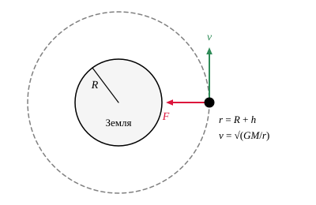

Почему Луна не падает на Землю, а спутник летает годами без двигателя? Ответ даёт закон всемирного тяготения. Эта тема встречается в задаче 2 и в задачах 5–6.

Здесь пригодятся второй закон Ньютона и центростремительное ускорение из темы «Движение по окружности». Начнём с того, почему всё падает, и дойдём до того, как рассчитывают орбиты.

## Шаг 1. Закон всемирного тяготения (9 класс)

Все тела притягиваются друг к другу. Ты притягиваешь соседа по парте, но сила так мала, что её не заметить. Заметной она становится, когда хотя бы одно тело огромное, как планета.

$$
F = G\,\frac{m_1 m_2}{r^2}.
$$

- $m_1$, $m_2$ — массы тел, кг;
- $r$ — расстояние между их центрами, м;
- $G = 6{,}67 \cdot 10^{-11}\ \text{Н} \cdot \text{м}^2/\text{кг}^2$ — гравитационная постоянная.

Формула точна для материальных точек и для шаров (тогда $r$ — расстояние между центрами).

Главное, что надо почувствовать: сила обратно пропорциональна **квадрату** расстояния. Отлетели вдвое дальше от центра планеты — сила стала вчетверо меньше. Втрое — вдевятеро.

<pp-task id="ks-gravity-01"></pp-task>

## Шаг 2. Откуда берётся $g$ (9 класс)

Сила тяжести из темы «Силы в механике» — это и есть сила тяготения со стороны Земли. Приравняем $mg = G\dfrac{mM}{R^2}$, где $M$ и $R$ — масса и радиус планеты. Масса тела сокращается:

$$
g = \frac{GM}{R^2}.
$$

Вот почему все тела падают с одинаковым ускорением: $g$ не зависит от массы тела, только от планеты.

На другой планете $g$ другое. Задачи обычно сравнивают планету с Землёй: во сколько раз больше масса и радиус. Если масса планеты вдвое больше, а радиус вдвое больше, то $g$ меняется в $\dfrac{2}{2^2} = \dfrac12$ раза — вдвое меньше земного.

<pp-task id="ks-gravity-02"></pp-task>

## Шаг 3. $g$ на высоте (9 класс)

Чем дальше от центра Земли, тем слабее притяжение. На высоте $h$ над поверхностью расстояние до центра $R + h$:

$$
g(h) = \frac{GM}{(R + h)^2}.
$$

Удобно сравнивать с поверхностью:

$$
\frac{g(h)}{g_0} = \left(\frac{R}{R+h}\right)^2.
$$

Самая частая ошибка — подставить высоту вместо расстояния до центра. В формулу всегда идёт $R + h$.

<pp-task id="ks-gravity-03"></pp-task>

## Шаг 4. Почему спутник не падает (9 класс)

Брось камень горизонтально — он упадёт недалеко. Брось быстрее — дальше. Если бросить так быстро, что Земля «загибается» под камнем так же быстро, как он падает, камень будет падать вечно, но никогда не долетит до земли. Это и есть орбита.

Спутник на круговой орбите движется с центростремительным ускорением $v^2/r$, которое ему даёт сила тяготения. Для орбиты у самой поверхности это ускорение равно $g$:

$$
\frac{v^2}{R} = g \quad\Rightarrow\quad v_1 = \sqrt{gR}.
$$

Это **первая космическая скорость**. Для Земли $v_1 \approx 7{,}9\ \text{км/с}$. Масса спутника в формулу не входит.

<pp-task id="ks-gravity-04"></pp-task>

## Шаг 5. Скорость на любой орбите (10 класс)

Для орбиты радиусом $r = R + h$ запишем второй закон Ньютона:

$$
\frac{m v^2}{r} = G\,\frac{mM}{r^2} \quad\Rightarrow\quad v = \sqrt{\frac{GM}{r}}.
$$

Масса спутника снова сократилась. А зависимость от радиуса — обратная: **чем выше орбита, тем медленнее спутник**, $v \propto 1/\sqrt r$. Радиус вырос в $4$ раза — скорость уменьшилась в $2$ раза.

Центростремительное ускорение на орбите $a = GM/r^2$ — это просто $g$ на этой высоте.

<pp-task id="ks-gravity-05"></pp-task>

## Шаг 6. Период обращения (10 класс)

За один оборот спутник проходит длину орбиты $2\pi r$:

$$
T = \frac{2\pi r}{v}.
$$

Чем выше орбита, тем длиннее путь и меньше скорость — период растёт быстро: $T^2 \propto r^3$ (третий закон Кеплера). Радиус вырос в $4$ раза — период вырос в $8$ раз.

Так подбирают **геостационарную** орбиту: на ней период ровно сутки, и спутник «висит» над одной точкой экватора.

Сводка для задачи 6 «как изменятся величины» — чем выше орбита (больше $r$):

- скорость **меньше**;
- период **больше**;
- центростремительное ускорение меньше.

<pp-task id="ks-gravity-06"></pp-task>

## Частые ловушки

- **Подставляют высоту над поверхностью вместо расстояния до центра.** В формулу идёт $R + h$.
- **Думают, что на орбите нет тяжести.** Сила тяжести на высоте МКС почти такая же, как у поверхности. Невесомость — из-за свободного падения.
- **Считают, что тяжёлый спутник должен лететь быстрее.** Масса спутника сокращается.
- **«Выше орбита — быстрее спутник».** Наоборот: медленнее.

## Как это выглядит на ЕГЭ

*Спутник перевели с круговой орбиты радиусом $r$ на круговую орбиту радиусом $4r$. Во сколько раз изменилась его скорость?*

Из второго закона Ньютона для спутника $v = \sqrt{GM/r}$. Скорость обратно пропорциональна корню из радиуса. Радиус вырос в $4$ раза — скорость уменьшилась в $\sqrt 4 = 2$ раза.

А период? $T = 2\pi r/v$: радиус вырос в 4 раза, скорость упала в 2 раза — период вырос в $8$ раз.

## Коротко

- $F = G m_1 m_2 / r^2$, $r$ — между центрами; вдвое дальше — вчетверо слабее.
- $g = GM/R^2$ — не зависит от массы тела; на высоте $g(h) = GM/(R+h)^2$.
- $v_1 = \sqrt{gR} \approx 7{,}9\ \text{км/с}$.
- Круговая орбита: $v = \sqrt{GM/r}$, масса спутника не важна.
- $T = 2\pi r / v$, $T^2 \propto r^3$.
- Выше орбита — меньше скорость, больше период.
