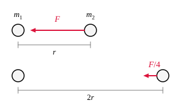

Яблоко отрывается от ветки и падает вниз. Его тянет Земля — это сила тяжести из урока 5.2. А Луну Земля тянет? И почему тогда Земля не тянет к себе всё вокруг — дома, людей, тебя к соседу по парте? Ньютон понял, что это одна и та же сила. Она действует между **любыми** телами. Её называют силой **всемирного тяготения**.

## Все тела притягиваются

Ты притягиваешь соседа по парте, а он тебя. Стол притягивает ручку. Просто эти силы так малы, что их никто не замечает: трение и любой толчок во много раз сильнее. Заметным притяжение становится, когда хотя бы одно тело огромное — как Земля, Луна или Солнце.

Притяжение взаимно. По третьему закону (урок 5.5) Земля тянет яблоко, а яблоко тянет Землю — с **такой же** силой. Падает яблоко, потому что его масса мала, и ускорение $F/m$ большое. У Земли ускорение ничтожное.

## Формула

Сила притяжения двух тел:

$$
F = G\,\frac{m_1 m_2}{r^2}.
$$

- $m_1$, $m_2$ — массы тел, кг;
- $r$ — расстояние между ними, м;
- $G = 6{,}67 \cdot 10^{-11}\ \text{Н} \cdot \text{м}^2/\text{кг}^2$ — **гравитационная постоянная**. Она одна и та же для любых тел.

Формула точна для маленьких тел (материальных точек, урок 1.1) и для шаров. У шаров $r$ — расстояние **между центрами**, а не между поверхностями. Планеты почти шары, поэтому для планеты и тела на ней $r$ — это расстояние до центра планеты.

**Пример.** Два ученика массой $60\ \text{кг}$ и $50\ \text{кг}$ сидят в $1\ \text{м}$ друг от друга:

$$
F = 6{,}67 \cdot 10^{-11} \cdot \frac{60 \cdot 50}{1^2} \approx 2 \cdot 10^{-7}\ \text{Н}.
$$

Столько весит песчинка. А Земля тянет того же ученика массой $60\ \text{кг}$ с силой $600\ \text{Н}$ — в три миллиарда раз сильнее. Вся разница — в массе Земли: около $6 \cdot 10^{24}\ \text{кг}$.

## Массы — в числителе

Чем больше массы, тем сильнее притяжение. Масса одного тела выросла в $3$ раза — сила выросла в $3$ раза. Массы обоих выросли в $2$ раза — сила выросла в $2 \cdot 2 = 4$ раза.

## Расстояние — в квадрате

Самое важное в законе — квадрат в знаменателе. Отодвинем шары вдвое дальше друг от друга.

Расстояние выросло в $2$ раза, $r^2$ — в $2^2 = 4$ раза. Сила стала **вчетверо** меньше, а не вдвое. Такую зависимость называют обратной квадратичной: сила **обратно пропорциональна квадрату** расстояния.

И наоборот: сблизим тела — сила вырастет, и тоже «в квадрате».

Проверь себя: расстояние между центрами двух шаров уменьшили в 2 раза. Как изменилась сила притяжения?

Увеличилась в $4$ раза. Расстояние стоит в знаменателе в квадрате: $r$ стало вдвое меньше, $r^2$ — вчетверо меньше, а сила — вчетверо больше.

<pp-task id="ks-gravity-01"></pp-task>

Массы и расстояние могут меняться одновременно. Тогда посмотри отдельно на числитель и на знаменатель: во сколько раз изменился каждый.

<pp-task id="ks-gravity-07"></pp-task>

## Частые ловушки

- **Забыли квадрат.** Вдвое дальше — сила вчетверо меньше, а не вдвое.
- **Взяли расстояние между поверхностями.** В формулу идёт расстояние между центрами шаров.
- **«Большое тело тянет сильнее, чем его тянут».** Силы взаимодействия равны (урок 5.5). Разные только ускорения.
- **«Между обычными телами притяжения нет».** Есть, но оно очень слабое: $G$ — крошечное число.

## Коротко

- Все тела притягиваются: $F = G\dfrac{m_1 m_2}{r^2}$, $G = 6{,}67 \cdot 10^{-11}\ \text{Н} \cdot \text{м}^2/\text{кг}^2$.
- $r$ — расстояние между центрами.
- Массы в числителе: масса больше — сила больше во столько же раз.
- Расстояние в квадрате в знаменателе: вдвое дальше — вчетверо слабее.
- Силы притяжения двух тел равны и противоположны (третий закон).

Дальше — урок 7.2: сила тяжести, которую мы считали как $mg$, — это и есть притяжение Земли. Откуда тогда берётся $g$?
