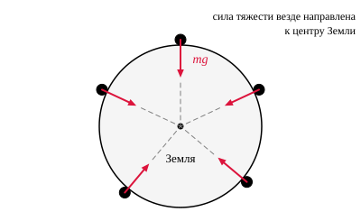

В уроке 3.1 мы видели: в трубке без воздуха перо и монета падают одинаково, с ускорением $g = 10\ \text{м/с}^2$. Почему $g$ одно для всех тел? И почему на Луне оно в шесть раз меньше? Теперь, когда мы знаем закон тяготения, ответ можно получить за две строчки.

## Сила тяжести — это притяжение Земли

Сила тяжести $mg$ из урока 5.2 — не отдельная сила. Это сила всемирного тяготения между телом и Землёй. Расстояние в законе — между центрами (урок 7.1). Тело лежит на поверхности, значит, $r$ — это радиус Земли $R$.

Отсюда новый взгляд на слово «вниз». Сила тяжести направлена к **центру** Земли. На другой стороне планеты «вниз» смотрит в другую сторону — и никто оттуда не падает.

## Откуда берётся $g$

Запишем силу тяжести двумя способами. Это одна и та же сила, поэтому

$$
mg = G\,\frac{mM}{R^2},
$$

где $M$ и $R$ — масса и радиус планеты, $m$ — масса тела. Масса тела $m$ есть с обеих сторон — сокращаем:

$$
g = \frac{GM}{R^2}.
$$

Вот и ответ на вопрос урока 3.1. В формуле для $g$ нет массы тела. Тяжёлое тело Земля тянет сильнее, но и разогнать его труднее (урок 5.4). Вдвое больше масса — вдвое больше сила, а ускорение $F/m$ то же. $g$ зависит только от планеты: от её массы и радиуса.

## $g$ на другой планете

В задачах планету обычно сравнивают с Землёй: масса во столько-то раз больше, радиус во столько-то. Тогда не нужно знать ни $G$, ни массу Земли. Масса стоит в числителе, радиус — в квадрате в знаменателе, как в уроке 7.1.

**Пример.** Масса планеты в $10$ раз меньше массы Земли, а радиус вдвое меньше. Масса уменьшила $g$ в $10$ раз. Радиус вдвое меньше — $R^2$ вчетверо меньше, и это увеличило $g$ в $4$ раза. Вместе:

$$
\frac{g_{\text{пл}}}{g_{\text{З}}} = \frac{1}{10} \cdot 4 = 0{,}4, \qquad g_{\text{пл}} = 0{,}4 \cdot 10 = 4\ \text{м/с}^2.
$$

Примерно так на Марсе.

Проверь себя: масса планеты такая же, как у Земли, а радиус вдвое меньше. Чему равно g на ней?

$40\ \text{м/с}^2$. Масса та же, а $R^2$ вчетверо меньше. $R$ стоит в знаменателе, поэтому $g$ вчетверо больше: $4 \cdot 10 = 40\ \text{м/с}^2$.

<pp-task id="ks-gravity-02"></pp-task>

## Как «взвесить» Землю

Землю не положишь на весы. Но формула $g = GM/R^2$ позволяет найти её массу. $g$ измеряют, бросая тела. Радиус Земли знали ещё древние греки. А $G$ в 1798 году измерил Кавендиш: он заметил, как притягиваются свинцовые шары в лаборатории. Осталось выразить массу:

$$
M = \frac{gR^2}{G}.
$$

<pp-task id="ks-gravity-08"></pp-task>

## Частые ловушки

- **Забыли квадрат радиуса.** Радиус вдвое больше — $g$ вчетверо меньше.
- **Перевернули отношение.** Масса больше — $g$ больше; радиус больше — $g$ меньше. Проверь здравым смыслом.
- **«Тяжёлое тело падает быстрее».** $g$ не зависит от массы тела: сила больше во столько же раз, во сколько больше масса.
- **Радиус в километрах.** Если считаешь через $G$, радиус переводи в метры.

## Коротко

- Сила тяжести — это притяжение Земли: $mg = G\dfrac{mM}{R^2}$.
- $g = \dfrac{GM}{R^2}$ — зависит только от планеты, не от тела.
- Сила тяжести направлена к центру Земли.
- На другой планете: $g$ растёт с массой и убывает как квадрат радиуса.
- $M = gR^2/G$ — так находят массу планеты.

Дальше — урок 7.3: чем выше над Землёй, тем дальше от её центра. Как меняется $g$ на высоте?
