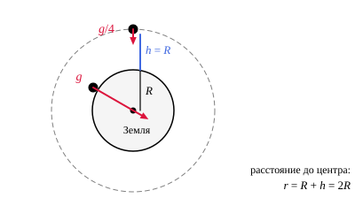

Альпинист поднялся на Эверест, почти на $9\ \text{км}$. Стал ли он легче? Чуть-чуть: меньше чем на полпроцента. А космическая станция летает в $400\ \text{км}$ над Землёй. В уроке 6.6 мы сказали, что тяжесть там всего на десятую часть меньше, чем у поверхности. Откуда это известно? В этом уроке научимся считать $g$ на любой высоте.

## Дальше от центра — слабее

В уроке 7.2 тело лежало на поверхности, и расстояние до центра Земли было $R$. Поднимем тело на высоту $h$. Теперь до центра

$$
r = R + h.
$$

Подставим это расстояние в закон тяготения, как в уроке 7.2:

$$
g(h) = \frac{GM}{(R + h)^2}.
$$

Высоту $h$ отсчитывают **от поверхности**, а в закон тяготения идёт расстояние **от центра**. Это главное в уроке и главная ловушка задач.

## Сравниваем с поверхностью

$GM$ считать не нужно. Поделим $g$ на высоте на $g_0$ у поверхности — $GM$ сократится:

$$
\frac{g(h)}{g_0} = \left(\frac{R}{R + h}\right)^2.
$$

**Пример.** Тело подняли на высоту, равную радиусу Земли: $h = R$. Расстояние до центра $r = R + R = 2R$ — вдвое больше, чем у поверхности. Значит, $g$ вчетверо меньше:

$$
g = \frac{10}{4} = 2{,}5\ \text{м/с}^2.
$$

Не вдвое, хотя «поднялись на один радиус», — расстояние до центра стоит в квадрате.

Так же меняется и сила тяжести $mg$: масса тела та же, а $g$ меньше.

<pp-task id="ks-gravity-03"></pp-task>

## Сколько тяжести на станции

Станция летает на высоте $h = 400\ \text{км}$, радиус Земли $R = 6400\ \text{км}$. Тогда $R + h = 6800\ \text{км}$, и

$$
\frac{g}{g_0} = \left(\frac{6400}{6800}\right)^2 = \left(\frac{16}{17}\right)^2 \approx 0{,}89, \qquad g \approx 8{,}9\ \text{м/с}^2.
$$

Всего на $11\,\%$ меньше, чем у поверхности. Вот откуда «на десятую часть» в уроке 6.6. На станции есть тяжесть, и почти такая же, как на Земле. Невесомость там не из-за того, что Земля «не достаёт». Почему же тогда станция не падает? Это урок 7.4.

А на Эвересте $h = 9\ \text{км}$ — это крошечная доля от $6400\ \text{км}$. Расстояние до центра почти не изменилось, и $g$ тоже.

Проверь себя: на какой высоте над Землёй g будет в 16 раз меньше, чем у поверхности? И чему оно там равно?

$g$ в $16$ раз меньше — расстояние до центра в $\sqrt{16} = 4$ раза больше: $R + h = 4R$, значит, $h = 3R$, а не $4R$. Там $g = 10/16 \approx 0{,}63\ \text{м/с}^2$.

<pp-task id="ks-gravity-09"></pp-task>

## Частые ловушки

- **Подставили высоту вместо расстояния до центра.** В формулу идёт $R + h$. Высота $R$ — это расстояние $2R$.
- **Забыли квадрат.** Расстояние до центра выросло вдвое — $g$ уменьшилось вчетверо.
- **Перепутали ответ.** Если спрашивают высоту, не забудь вычесть $R$ из расстояния до центра.
- **«На орбите тяжести нет».** На высоте станции $g \approx 8{,}9\ \text{м/с}^2$ — почти как у поверхности.

## Коротко

- На высоте $h$ расстояние до центра $r = R + h$.
- $g(h) = \dfrac{GM}{(R+h)^2}$, или $\dfrac{g(h)}{g_0} = \left(\dfrac{R}{R+h}\right)^2$.
- $h = R$ — $g$ вчетверо меньше, а не вдвое.
- На высоте станции, $400\ \text{км}$, $g$ меньше всего на $11\,\%$.

Дальше — урок 7.4: тяжесть на станции почти земная. Почему же станция не падает?
