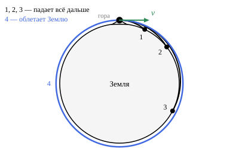
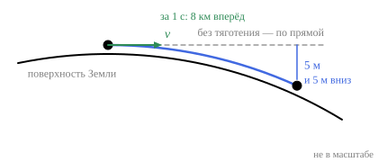

Брось камень горизонтально — он упадёт в нескольких метрах. Брось сильнее — дальше (урок 3.4). А если бросить очень-очень сильно? Ньютон придумал мысленный опыт: пушка на высокой горе стреляет горизонтально. Чем больше скорость ядра, тем дальше оно падает. В этом уроке выясним, что будет, если скорость станет огромной, — и почему станция из урока 6.6 не падает на Землю.

## Пушка Ньютона

Пусть гора такая высокая, что воздух не мешает. На ядро после выстрела действует только сила тяжести, и она направлена к центру Земли (урок 7.2).

- Медленное ядро (1) падает недалеко от горы.
- Быстрее (2) — дальше. На таком расстоянии уже видно, что Земля круглая: под ядром поверхность «загибается» вниз.
- Ещё быстрее (3) — ядро падает на другой стороне Земли.
- И есть такая скорость (4), при которой поверхность загибается так же быстро, как ядро падает. Ядро всё время падает к Земле — и никогда до неё не долетает. Оно облетает Землю по окружности и возвращается к горе.

Это и есть **орбита**. Спутник не «висит» в космосе. Он **падает**, но всё время промахивается мимо Земли.

## Сколько это — «достаточно быстро»

Оценим скорость без формул. За первую секунду любое тело падает на $gt^2/2 = 10 \cdot 1^2/2 = 5\ \text{м}$ (урок 3.2). Значит, ядро не упадёт, если за эту секунду поверхность Земли тоже «уйдёт вниз» на $5\ \text{м}$.

Земля большая, и её поверхность загибается медленно: на $5\ \text{м}$ она опускается, если пройти вдоль неё около $8\ \text{км}$.

Значит, ядро должно пролетать $8\ \text{км}$ за секунду. Скорость $8\ \text{км/с}$ — в $10$ раз быстрее винтовочной пули.

## Первая космическая скорость

Теперь точно, по плану урока 5.6. Спутник летит по окружности радиусом $R$ у самой поверхности (воздух не учитываем). Его ускорение направлено к центру и равно $v^2/R$ (урок 4.3). Единственная сила — сила тяжести $mg$, тоже к центру. Второй закон:

$$
m\frac{v^2}{R} = mg \quad\Rightarrow\quad v_1 = \sqrt{gR}.
$$

Это **первая космическая скорость** — скорость спутника на круговой орбите у самой поверхности планеты.

**Пример.** Для Земли $g = 10\ \text{м/с}^2$, $R = 6400\ \text{км} = 6{,}4 \cdot 10^6\ \text{м}$:

$$
v_1 = \sqrt{10 \cdot 6{,}4 \cdot 10^6} = \sqrt{64 \cdot 10^6} = 8 \cdot 10^3\ \text{м/с} = 8\ \text{км/с}.
$$

Та же оценка, что выше. С точным $g = 9{,}8\ \text{м/с}^2$ выходит $7{,}9\ \text{км/с}$ — это число часто пишут в учебниках.

Масса спутника сократилась. Лёгкому и тяжёлому спутнику нужна одна и та же скорость — как в уроке 7.2 всем телам одно и то же $g$.

Проверь себя: спутник в два раза тяжелее. Нужна ли ему большая скорость, чтобы облетать Землю у поверхности?

Нет, та же $v_1 = \sqrt{gR}$. Земля тянет его вдвое сильнее, но и повернуть его вдвое труднее: масса сокращается.

<pp-task id="ks-gravity-04"></pp-task>

## Модель: пушка на горе

В модели пушка стоит на горе высотой $400\ \text{км}$ — выше воздуха, как станция. Начни с малой скорости и прибавляй. Найди скорость, при которой ядро облетает Землю. Потом попробуй больше.

<pp-orbit v="6">Модель: пушка на горе высотой 400 км стреляет горизонтально. При скорости меньше примерно 7,8 км/с ядро падает на Землю, и чем быстрее, тем дальше. При 7,8 км/с облетает Землю по окружности. Быстрее — летит по вытянутой орбите, а при скорости больше примерно 11 км/с улетает от Земли навсегда.</pp-orbit>

Круговая скорость в модели — около $7{,}8\ \text{км/с}$, чуть меньше $8$. Гора высокая, а наверху притяжение слабее (урок 7.3) — и скорость нужна меньше. Как именно она зависит от высоты, разберём в уроке 7.5.

Что ещё видно в модели:

- сила тяготения всё время смотрит к центру Земли, а скорость — по касательной: она поворачивает скорость, как в уроке 4.3;
- быстрее круговой скорости ядро улетает дальше от Земли и возвращается — орбита вытягивается в эллипс;
- около $11\ \text{км/с}$ ядро улетает навсегда. Это **вторая космическая скорость**; у поверхности Земли она $11{,}2\ \text{км/с}$.

<pp-task id="ks-gravity-10"></pp-task>

## Почему на станции невесомость

Теперь можно закрыть вопрос урока 6.6. Станция и космонавт — то же ядро пушки Ньютона. Они падают к Земле с ускорением $g$ на своей высоте (урок 7.3) и всё время промахиваются. Падают **вместе**, с одним ускорением, поэтому космонавт не давит на пол: вес $P = m(g - a) = 0$. Тяжесть есть — она и держит станцию на орбите. Нет веса.

## Частые ловушки

- **«Спутник не падает, потому что там нет тяжести».** Тяжесть есть, почти как у Земли. Спутник падает, но промахивается.
- **«Тяжёлому спутнику нужна большая скорость».** Масса сокращается.
- **Радиус в километрах.** В $v_1 = \sqrt{gR}$ радиус — в метрах, ответ — в м/с.
- **Скорость направлена к Земле.** Скорость спутника — по касательной к орбите, к центру направлены сила и ускорение.

## Коротко

- Спутник всё время падает к Земле, но поверхность «уходит» из-под него.
- На круговой орбите сила тяжести создаёт центростремительное ускорение: $mv^2/R = mg$.
- Первая космическая скорость $v_1 = \sqrt{gR}$; для Земли $\approx 8\ \text{км/с}$.
- Масса спутника не важна.
- На станции невесомость: станция и космонавт падают вместе.

Дальше — урок 7.5: а с какой скоростью летит спутник высоко над Землёй?
