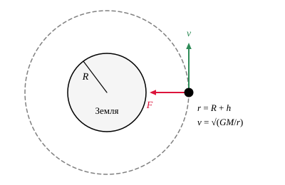
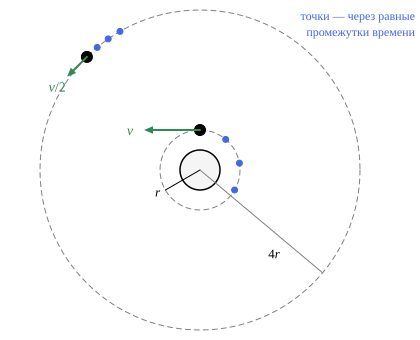

Станция летает в $400\ \text{км}$ над Землёй, спутники связи — в $36\,000\ \text{км}$, а Луна — в $380\,000\ \text{км}$. Кто из них быстрее? Кажется, что тот, кто выше: ему же больше пролетать. В этом уроке выясним, что всё наоборот.

## Второй закон для спутника

В уроке 7.4 спутник летал у самой поверхности, и сила тяжести была $mg$. Теперь орбита высокая, радиус $r = R + h$ (урок 7.3). Сила тяготения — по закону из урока 7.1, расстояние до центра $r$.

Сила направлена к центру и создаёт центростремительное ускорение $v^2/r$ (уроки 4.3 и 5.6):

$$
m\frac{v^2}{r} = G\frac{mM}{r^2}.
$$

Масса спутника $m$ сокращается, как в уроке 7.4. Одно $r$ в знаменателе тоже:

$$
v = \sqrt{\frac{GM}{r}}.
$$

Скорость зависит только от массы планеты и радиуса орбиты.

## Удобная запись

$GM$ в задачах обычно не дают. Но из урока 7.2 $GM = gR^2$, где $g$ и $R$ — у поверхности. Подставим:

$$
v = \sqrt{\frac{gR^2}{r}} = \sqrt{gR}\cdot\sqrt{\frac{R}{r}} = v_1\sqrt{\frac{R}{r}}.
$$

Скорость на орбите — это первая космическая скорость $v_1 \approx 8\ \text{км/с}$, умноженная на $\sqrt{R/r}$.

**Пример.** Спутник летает на высоте $h = R$ над Землёй. Радиус орбиты $r = R + R = 2R$, и

$$
v = \frac{v_1}{\sqrt 2} = \frac{8}{1{,}41} \approx 5{,}7\ \text{км/с}.
$$

## Выше — медленнее

$r$ стоит в знаменателе, под корнем. Поэтому **чем выше орбита, тем меньше скорость**. Радиус вырос в $4$ раза — скорость уменьшилась в $\sqrt 4 = 2$ раза.

Почему так? Высоко притяжение слабое (урок 7.3). Слабой силе под силу завернуть только медленный спутник: при большой скорости он улетел бы по касательной. Сила притяжения и скорость должны быть «согласованы»: $v^2/r$ равно $g$ на этой высоте.

<pp-task id="ks-gravity-05"></pp-task>

Проверь себя: станция летает на высоте 400 км, спутник связи — на высоте 36 000 км. Кто быстрее?

Станция. Её орбита ниже, а чем меньше радиус орбиты, тем больше скорость. Станция летит со скоростью около $7{,}8\ \text{км/с}$, спутник связи — около $3\ \text{км/с}$.

<pp-task id="ks-gravity-11"></pp-task>

## Ускорение на орбите

Ускорение спутника $a = v^2/r$. Подставим $v^2 = GM/r$:

$$
a = \frac{GM}{r^2}.
$$

Это то же $g$ на высоте орбиты из урока 7.3. Спутник ускоряется так же, как любое тело, свободно падающее на этой высоте. Выше орбита — меньше ускорение. На станции оно около $8{,}9\ \text{м/с}^2$, и всё на борту падает с ним вместе — отсюда невесомость (урок 7.4).

## Частые ловушки

- **«Выше орбита — быстрее спутник».** Наоборот: $v = \sqrt{GM/r}$, выше — медленнее.
- **Забыли корень.** Радиус вырос в $100$ раз — скорость меньше в $10$ раз, а не в $100$.
- **Взяли высоту вместо радиуса орбиты.** $r = R + h$.
- **«Тяжёлый спутник летит быстрее».** Масса спутника сокращается.

## Коротко

- Круговая орбита: $m\dfrac{v^2}{r} = G\dfrac{mM}{r^2}$, отсюда $v = \sqrt{\dfrac{GM}{r}}$.
- Удобно: $v = v_1\sqrt{R/r}$, $v_1 \approx 8\ \text{км/с}$.
- Выше орбита — меньше скорость: $v \propto 1/\sqrt r$.
- Масса спутника не важна.
- Ускорение на орбите $a = GM/r^2$ — это $g$ на этой высоте.

Дальше — урок 7.6: сколько длится один оборот и как спутник «висит» над одной точкой Земли.
