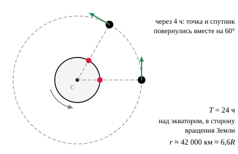

Спутниковая антенна на балконе смотрит в одну точку неба и не поворачивается. Значит, спутник, с которого она принимает сигнал, всё время «висит» на одном месте. Но висеть в космосе нельзя: в уроке 7.4 мы выяснили, что спутник всё время падает и летит. Как же он остаётся над одной точкой? Ответ — в периоде обращения.

## Период

**Период обращения** — время одного оборота вокруг планеты, как в уроке 4.1. За оборот спутник проходит длину орбиты $2\pi r$ с постоянной скоростью $v$ (урок 4.2):

$$
T = \frac{2\pi r}{v}.
$$

Скорость берём из урока 7.4 или 7.5, если она не дана.

**Пример.** Спутник летает вокруг планеты по орбите радиусом $3000\ \text{км}$ со скоростью $3\ \text{км/с}$:

$$
T = \frac{2 \cdot 3{,}14 \cdot 3 \cdot 10^6}{3 \cdot 10^3} = 6280\ \text{с} \approx 105\ \text{мин}.
$$

Километры можно оставить: $\dfrac{2 \cdot 3{,}14 \cdot 3000\ \text{км}}{3\ \text{км/с}}$ — те же $6280\ \text{с}$. Главное — одинаковые единицы длины.

<pp-task id="ks-gravity-06"></pp-task>

## Выше — намного дольше

Когда орбита выше, период растёт по двум причинам сразу:

- длина орбиты $2\pi r$ больше;
- скорость меньше: $v \propto 1/\sqrt r$ (урок 7.5).

**Пример.** Радиус орбиты вырос в $4$ раза. Путь за оборот вырос в $4$ раза, скорость уменьшилась в $\sqrt 4 = 2$ раза. Время оборота выросло в $4 \cdot 2 = 8$ раз.

Если подставить $v = \sqrt{GM/r}$ в $T = 2\pi r/v$, выйдет

$$
T = 2\pi\sqrt{\frac{r^3}{GM}}, \qquad T^2 \propto r^3.
$$

Квадраты периодов относятся как кубы радиусов. Это **третий закон Кеплера**. Кеплер нашёл его по наблюдениям планет вокруг Солнца, ещё до Ньютона. Проверим на примере: $8^2 = 64 = 4^3$.

<pp-task id="ks-gravity-12"></pp-task>

## Геостационарная орбита

Вернёмся к антенне. Земля поворачивается вокруг оси за сутки. Если спутник облетает Землю тоже ровно за сутки и в ту же сторону, он поворачивается вместе с Землёй. Угловые скорости одинаковые (урок 4.4), и спутник всё время над одной точкой.

Это **геостационарная** орбита:

- период $T = 24\ \text{ч}$;
- в ту же сторону, куда вращается Земля;
- над экватором;
- радиус по закону Кеплера выходит около $42\,000\ \text{км}$, то есть $6{,}6$ радиуса Земли; высота над поверхностью — около $36\,000\ \text{км}$.

Радиус нельзя выбрать: период задан, а $T^2 \propto r^3$. Поэтому все геостационарные спутники летают на одной высоте, «бусами» над экватором.

Проверь себя: можно ли запустить геостационарный спутник, который висит над Москвой?

Нельзя. Сила тяготения направлена к центру Земли, поэтому центр любой орбиты — центр Земли. Точка над Москвой за сутки описывает окружность вокруг земной оси, а её центр лежит на оси выше центра Земли. Спутник по такой окружности летать не может. Только над экватором центр «суточной» окружности совпадает с центром Земли.

## Как это выглядит на ЕГЭ

В задаче 6 часто спрашивают, как изменятся величины, если спутник перейдёт на другую круговую орбиту. Всё следует из $v = \sqrt{GM/r}$ и $T = 2\pi r/v$. Чем **выше** орбита (больше $r$):

| величина | как меняется |
|---|---|
| скорость $v$ | уменьшается, $v \propto 1/\sqrt r$ |
| период $T$ | увеличивается, $T \propto r\sqrt r$ |
| ускорение $a$ | уменьшается, $a = GM/r^2$ |
| сила притяжения к Земле | уменьшается |

*Спутник перевели с орбиты радиусом $r$ на орбиту радиусом $4r$. Как изменились скорость, период и ускорение?* Скорость уменьшилась в $2$ раза, период вырос в $8$ раз, ускорение уменьшилось в $4^2 = 16$ раз.

## Частые ловушки

- **Ответ в секундах, а просили минуты или часы.** $T = 2\pi r / v$ даёт секунды, если $r$ в метрах, а $v$ в м/с.
- **Забыли $2\pi$.** Длина орбиты — $2\pi r$, а не $r$.
- **$T \propto r$.** Нет: скорость тоже меняется. $T^2 \propto r^3$.
- **Геостационарный спутник над любой точкой.** Только над экватором и только на одной высоте.

## Коротко

- $T = \dfrac{2\pi r}{v}$.
- Выше орбита — длиннее путь и меньше скорость: $T^2 \propto r^3$ (третий закон Кеплера).
- Радиус вырос в $4$ раза — период в $8$ раз больше.
- Геостационарная орбита: $T = 24\ \text{ч}$, над экватором, $r \approx 42\,000\ \text{км}$.
- Выше орбита: $v$, $a$ и сила меньше, $T$ больше.

Это последний урок темы. Ты знаешь, как силы разгоняют тела и заворачивают их по окружности. А что, если тело не должно двигаться вообще? Почему дверь легко открыть за ручку и трудно — если толкать её у петель? Об этом следующая тема, «Момент силы и равновесие тела».
