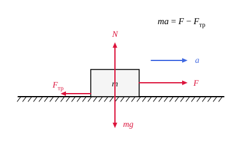

Кинематика описывает, как тело движется. Динамика объясняет, **почему**. Три закона Ньютона — основа задачи 2, задач 5–6 и большей части второй части по механике.

Начнём с того, что проходят в 7 классе: инерция, масса, сила. Потом — три закона Ньютона из 9 класса и, наконец, векторная запись, которой решают задачи ЕГЭ. После шагов есть задачи на то, что уже прочитано.

## Шаг 1. Инерция (7 класс)

Представь, что ты едешь в автобусе и он резко тормозит. Тебя бросает вперёд, хотя тебя никто не толкал. Почему? Твоё тело просто продолжает двигаться так же, как двигалось. Это и есть **инерция**.

Скорость тела меняется, только если на него действуют другие тела. Мяч покатился, потому что по нему ударили. Остановился, потому что его тормозили трава и воздух. На гладком льду шайба скользит очень долго: тормозить её почти нечему.

Отсюда главная мысль всей динамики: **чтобы тело двигалось, сила не нужна. Сила нужна, чтобы скорость изменить.**

## Шаг 2. Масса (7 класс)

Тяжёлую тележку из магазина трудно и разогнать, и остановить. Пустую — легко. Свойство тела сопротивляться изменению скорости называют **инертностью**, а её меру — **массой** $m$. Единица — килограмм.

Масса проявляется при любом взаимодействии. Два человека на коньках оттолкнулись друг от друга. Лёгкий отъедет быстро, тяжёлый — медленно. Скорости, которые они получили, обратно пропорциональны массам:

$$
\frac{v_1}{v_2} = \frac{m_2}{m_1}.
$$

Во сколько раз тело тяжелее, во столько раз меньшую скорость оно получает.

<pp-task id="ks-newton-01"></pp-task>

## Шаг 3. Сила и равнодействующая (7 класс)

**Сила** $\vec F$ — мера действия одного тела на другое. Единица — ньютон (Н). У силы есть модуль, направление и точка приложения: это вектор.

Если на тело действуют несколько сил, их можно заменить одной — **равнодействующей**. Для сил вдоль одной прямой правило простое:

- силы в одну сторону **складываются**;
- силы в разные стороны **вычитаются**, и равнодействующая направлена в сторону большей.

Перетягивание каната: одна команда тянет с силой $500\ \text{Н}$, другая — $450\ \text{Н}$. Равнодействующая $50\ \text{Н}$ в сторону первой команды. Если силы равны, равнодействующая равна нулю — силы **уравновешены**.

<pp-task id="ks-newton-02"></pp-task>

## Шаг 4. Первый закон Ньютона (9 класс)

Соберём шаги 1 и 3 в закон. Существуют такие системы отсчёта, в которых тело сохраняет скорость постоянной, если на него не действуют другие тела или их действия скомпенсированы. Такие системы называют **инерциальными**. Земля для большинства задач — инерциальная система.

Тормозящий автобус — **не** инерциальная система. Поэтому в нём тебя «бросает» без всякой силы.

Самое полезное следствие для задач: **если тело движется с постоянной скоростью или покоится, равнодействующая всех сил равна нулю.** Машина едет равномерно — значит, сила тяги ровно уравновешивает сопротивление.

<pp-task id="ks-newton-03"></pp-task>

## Шаг 5. Второй закон Ньютона (9 класс)

Толкни пустую тележку и тележку с покупками одинаково — пустая разгонится сильнее. Чем больше сила, тем больше ускорение; чем больше масса, тем ускорение меньше:

$$
a = \frac{F}{m}, \qquad F = m a.
$$

- $F$ — равнодействующая всех сил, Н;
- $m$ — масса тела, кг;
- $a$ — ускорение, $\text{м/с}^2$.

Отсюда и сам ньютон: $1\ \text{Н}$ — сила, которая телу массой $1\ \text{кг}$ сообщает ускорение $1\ \text{м/с}^2$.

Главное: в формулу идёт **равнодействующая**, а не одна какая-то сила. Сначала сложи все силы, потом дели на массу.

<pp-task id="ks-newton-04"></pp-task>

## Шаг 6. Сила + кинематика (9 класс)

Второй закон даёт ускорение. А с ускорением ты уже умеешь всё: скорость $v = v_0 + at$, путь $s = v_0 t + \dfrac{at^2}{2}$ и так далее.

Так устроена почти любая задача динамики:

1. по силам найти ускорение: $a = F/m$;
2. по ускорению найти то, что спрашивают, формулами кинематики.

Бывает и наоборот: по движению (разгон, торможение) находят ускорение, а по нему — силу.

<pp-task id="ks-newton-05"></pp-task>

## Шаг 7. Третий закон Ньютона (9 класс)

Ты отталкиваешься от стенки в бассейне и уплываешь. Ты толкнул стенку, а стенка толкнула тебя.

$$
\vec F_{12} = -\vec F_{21}.
$$

Тела действуют друг на друга с силами, равными по модулю и противоположными по направлению. Эти силы одной природы и приложены **к разным телам**. Поэтому они никогда не «уравновешивают» друг друга.

Земля притягивает яблоко с силой $1\ \text{Н}$ — и яблоко притягивает Землю с силой $1\ \text{Н}$. Просто у Земли огромная масса, и её ускорение ничтожно.

Вспомни конькобежцев из шага 2: они толкали друг друга с равными силами, а скорости получили разные — из-за разных масс.

<pp-task id="ks-newton-06"></pp-task>

## Шаг 8. Второй закон в векторах (10 класс)

Силы не обязаны лежать на одной прямой. Тогда их складывают **как векторы**, и второй закон записывают так:

$$
m\vec{a} = \sum_i \vec{F}_i .
$$

Он верен в инерциальной системе отсчёта и для скоростей, много меньших скорости света.

Ускорение всегда направлено **по равнодействующей**, а не по скорости. Тело может лететь вверх, а ускорение быть направлено вниз (брошенный мяч).

Считать удобно в проекциях, как в кинематике: выбираешь оси и пишешь закон для каждой оси отдельно, $m a_x = \sum F_x$, $m a_y = \sum F_y$. Если две силы перпендикулярны, модуль равнодействующей находят по теореме Пифагора.

<pp-task id="ks-newton-07"></pp-task>

## Шаг 9. Как решать задачи. Связанные тела (10 класс)

1. Нарисуй тело и **все** силы, которые на него действуют. Для каждой силы назови тело, которое её создаёт.
2. Выбери оси. Удобно одну ось направить по ускорению.
3. Запиши второй закон в проекциях на каждую ось.
4. Добавь формулы для сил (трение, упругость) и реши систему.

Для системы связанных тел (бруски на нити) пиши второй закон для каждого тела отдельно. Если нить нерастяжима, ускорения тел по модулю равны. Часто удобно сначала найти общее ускорение для всей системы сразу, а потом силу натяжения — из уравнения для одного тела.

<pp-task id="ks-newton-08"></pp-task>

## Частые ловушки

- **«Тело движется — значит, на него действует сила по движению».** Нет. При постоянной скорости равнодействующая равна нулю.
- **Складывают силы из третьего закона**, как будто они действуют на одно тело. Они приложены к разным телам.
- **Добавляют «силу инерции» или «центробежную силу»** в инерциальной системе. Таких сил там нет.
- **Пишут закон в векторах, а числа подставляют без проекций.** Знаки решают всё.

## Как это выглядит на ЕГЭ

*Два бруска массами $1\ \text{кг}$ и $3\ \text{кг}$ связаны лёгкой нерастяжимой нитью и лежат на гладком столе. К первому бруску приложили горизонтальную силу $8\ \text{Н}$ и тянут систему. Найди силу натяжения нити.*

Нить нерастяжима — ускорение у брусков одно и то же. Для всей системы сразу:

$$
a = \frac{F}{m_1 + m_2} = \frac{8}{4} = 2\ \text{м/с}^2.
$$

Второй брусок нить тянет с силой $T$, и больше по горизонтали на него ничего не действует:

$$
T = m_2 a = 3 \cdot 2 = 6\ \text{Н}.
$$

Проверим через первый брусок: $m_1 a = F - T$, то есть $1 \cdot 2 = 8 - 6$. Сходится.

## Сила трения скольжения

Подробно про силы — в отдельной теме. Здесь главное:

$$
F_{\text{тр}} = \mu N,
$$

где $N$ — сила нормальной реакции опоры, $\mu$ — коэффициент трения (безразмерный). На горизонтальной поверхности без других вертикальных сил $N = mg$.

## Коротко

- Инерция: без действия других тел скорость не меняется. Сила нужна, чтобы изменить скорость.
- Масса — мера инертности; при взаимодействии $v_1/v_2 = m_2/m_1$.
- Силы вдоль прямой: в одну сторону складываются, в разные — вычитаются.
- Первый закон: в инерциальной системе без внешних воздействий скорость постоянна; равномерно — значит, $\sum \vec F = 0$.
- Второй закон: $m\vec a = \sum \vec F$; ускорение направлено по равнодействующей.
- Третий закон: $\vec F_{12} = -\vec F_{21}$, силы приложены к разным телам.
- Решение: рисунок сил → оси → проекции → система уравнений.
