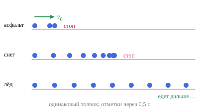
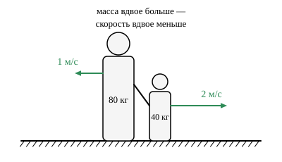

Ты стоишь в автобусе, и он резко тормозит. Тебя бросает вперёд, хотя никто тебя не толкал. А когда автобус резко трогается, тебя прижимает назад. Почему тело ведёт себя так, будто «не хочет» менять скорость? С этого вопроса начинается вся динамика.

## Что останавливает шайбу

Толкни шайбу клюшкой по асфальту — она проедет совсем немного. По снегу — дальше. По гладкому льду — очень далеко. Толчок одинаковый, а результат разный.

Что изменилось? Только то, **насколько сильно поверхность тормозит** шайбу. Асфальт тормозит сильно, снег слабее, лёд почти не тормозит. Посмотри на отметки на льду: они стоят почти на равных расстояниях. Шайба едет почти равномерно.

Теперь представь поверхность, которая не тормозит совсем, и нет воздуха. Шайба поехала бы по прямой с той же скоростью — и ехала бы так бесконечно. Останавливать её было бы нечему.

## Инерция

Свойство тел сохранять свою скорость, если на них не действуют другие тела, называют **инерцией**. Слово «скорость» здесь значит сразу и быстроту, и направление.

Вот главная мысль всей динамики:

- чтобы тело **двигалось**, ничего не нужно — оно движется само, по инерции;
- чтобы **изменить** скорость — разогнать, затормозить или повернуть, — нужно действие другого тела.

Это противоречит житейскому опыту: телега едет, пока лошадь тянет, и останавливается, когда лошадь встаёт. Но телега останавливается не «сама». Её тормозят дорога и воздух. Лошадь не столько разгоняет телегу, сколько не даёт ей затормозить.

Теперь понятно, что было в автобусе. Автобус затормозил: его остановила дорога. А тебя дорога не тормозила. Ноги притормозил пол, а остальное тело продолжало ехать с прежней скоростью — и «упало» вперёд.

Проверь себя: автобус резко повернул налево. Куда качнутся пассажиры и почему?

Направо. Автобус повернул, а пассажиры по инерции продолжают двигаться прямо. Относительно автобуса, который ушёл влево, это выглядит как наклон вправо.

## Инертность и масса

Попробуй разогнать пустую тележку в магазине, а потом — нагруженную. Пустая разгоняется легко, нагруженная — с трудом. И остановить нагруженную тоже труднее. Одни тела меняют скорость легко, другие — неохотно.

Это свойство называют **инертностью**. Чем тело инертнее, тем труднее изменить его скорость. Мера инертности — **масса** $m$. Единица массы — килограмм (кг).

Не путай два слова. **Инерция** — явление: тело сохраняет скорость, пока его не трогают. **Инертность** — свойство: насколько трудно изменить скорость тела. У всех тел есть инерция, но инертность разная.

## Сравнить массы толчком

Как сравнить массы, если весов нет? Нужно, чтобы два тела **подействовали друг на друга** и разъехались. Например, папа и сын стоят на льду в коньках и отталкиваются ладонями.

Сын поехал со скоростью $2\ \text{м/с}$, папа — $1\ \text{м/с}$ в другую сторону. Папа вдвое массивнее — и получил вдвое меньшую скорость. Опыты показывают, что так всегда: при взаимодействии двух тел, которые стояли,

$$
\frac{v_1}{v_2} = \frac{m_2}{m_1}.
$$

Во сколько раз тело массивнее, во столько раз меньшую скорость оно получает. Обрати внимание: в правой части массы стоят «наоборот» — вверху масса **второго** тела.

**Пример.** Два шара на гладком столе расталкивает сжатая пружина. Шар массой $3\ \text{кг}$ получил скорость $0{,}3\ \text{м/с}$, а второй — $0{,}9\ \text{м/с}$. Второй получил скорость в $3$ раза больше, значит, его масса в $3$ раза меньше: $3 / 3 = 1\ \text{кг}$.

Проверь ответ здравым смыслом: лёгкое тело всегда отлетает быстрее тяжёлого.

<pp-task id="ks-newton-01"></pp-task>

<pp-task id="ks-newton-09"></pp-task>

## Частые ловушки

- **«Чтобы тело двигалось, на него должна действовать сила».** Нет. Двигаться тело может само, по инерции. Действие нужно, чтобы **изменить** скорость.
- **«Тело остановилось само».** Само тело скорость не меняет. Если оно остановилось, его что-то затормозило: трение, воздух, вода.
- **Перевернули отношение масс.** Лёгкое тело получает **большую** скорость. Если по ответу тяжёлый уехал быстрее — ошибка.
- **Спутали инерцию и инертность.** Инерция — явление, инертность — свойство, масса — её мера.

## Коротко

- Инерция: если на тело не действуют другие тела, его скорость не меняется — ни по величине, ни по направлению.
- Чтобы тело двигалось, ничего не нужно. Чтобы изменить скорость, нужно действие другого тела.
- Инертность — свойство тела сопротивляться изменению скорости. Мера инертности — масса, кг.
- Два тела оттолкнулись друг от друга: $\dfrac{v_1}{v_2} = \dfrac{m_2}{m_1}$. Массивное тело получает меньшую скорость.

Дальше — урок 5.2: как измерить, насколько сильно одно тело действует на другое. Для этого есть сила.
