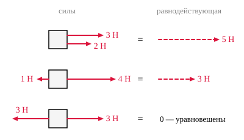

Ты толкаешь шкаф. Толкнёшь слабо — он не сдвинется. Сильнее — поедет. Толкнёшь в бок — поедет в бок. Значит, у действия одного тела на другое есть величина и направление. В уроке 5.1 мы говорили «действие другого тела». Теперь научимся его измерять.

## Сила

**Сила** $\vec F$ — мера действия одного тела на другое. Единица силы — **ньютон** (Н). Сила $1\ \text{Н}$ — это немного: примерно с такой силой яблоко средних размеров давит на ладонь.

У силы есть:

- **модуль** — насколько сильно действуют, в ньютонах;
- **направление** — куда толкают или тянут;
- **точка приложения** — к какому телу и в каком месте приложена сила.

Модуль и направление — значит, сила **вектор**, как скорость и перемещение из урока 1.4. На рисунках силу рисуют стрелкой от точки приложения. Длина стрелки показывает модуль.

Каждая сила — это действие **конкретного** тела. Нить тянет, пол давит, Земля притягивает, вода тормозит. Если не можешь назвать тело, которое действует, — силы нет.

## Сила тяжести

Самая частая сила в задачах — притяжение Земли, **сила тяжести**. Она направлена вертикально вниз и равна

$$
F_{\text{тяж}} = m g,
$$

где $m$ — масса тела, а $g \approx 10\ \text{Н/кг}$. На тело массой $1\ \text{кг}$ Земля действует с силой $10\ \text{Н}$, на тело массой $2\ \text{кг}$ — с силой $20\ \text{Н}$.

Это то же $g$, что в свободном падении (урок 3.1), только записанное в других единицах: $\text{Н/кг}$ и $\text{м/с}^2$ — одно и то же. Почему — увидим в уроке 5.4.

## Равнодействующая

Обычно на тело действует сразу несколько сил. Ведро тянет вверх верёвка, а вниз — Земля. Санки тянет вперёд верёвка, а назад их тормозит снег. Что в итоге произойдёт с телом?

Оказывается, все силы можно заменить **одной**, которая действует так же, как все они вместе. Её называют **равнодействующей**. Для сил вдоль одной прямой правило простое:

- силы в **одну** сторону складываются;
- силы в **разные** стороны вычитаются, и равнодействующая направлена в сторону большей.

Если силы в разные стороны равны, равнодействующая равна нулю. Тогда говорят, что силы **уравновешены**: тело ведёт себя так, будто на него ничего не действует.

**Пример.** Перетягивание каната. Одна команда тянет с силой $500\ \text{Н}$, другая — $450\ \text{Н}$ в противоположную сторону. Равнодействующая:

$$
F = 500 - 450 = 50\ \text{Н},
$$

в сторону первой команды. Канат с командами поползёт к ней.

Если сил больше двух, удобно сначала сложить все силы в одну сторону, потом все в другую, и вычесть меньшее из большего.

Проверь себя: на тело действуют силы 7 Н и 2 Н вправо и 9 Н влево. Чему равна равнодействующая?

Вправо: $7 + 2 = 9\ \text{Н}$. Влево: $9\ \text{Н}$. Равнодействующая $9 - 9 = 0$: силы уравновешены.

<pp-task id="ks-newton-02"></pp-task>

## Когда одна сила — сила тяжести

В задачах с вертикальными силами не забывай про Землю. Даже если в условии о ней ни слова, на любое тело у поверхности Земли действует сила тяжести $mg$.

**Пример.** Ящик массой $20\ \text{кг}$ поднимают на верёвке, она тянет вверх с силой $260\ \text{Н}$. Сила тяжести $20 \cdot 10 = 200\ \text{Н}$ вниз. Равнодействующая $260 - 200 = 60\ \text{Н}$ вверх.

<pp-task id="ks-newton-10"></pp-task>

## Частые ловушки

- **Сложили все силы подряд**, не глядя на направления. Силы в разные стороны вычитаются.
- **Забыли силу тяжести.** Она действует всегда, даже если в условии про неё ничего не сказано.
- **Сила «без тела».** Для каждой силы назови тело, которое её создаёт. Если не получается, такой силы нет.
- **Спутали массу и силу тяжести.** Масса — в килограммах, сила тяжести $mg$ — в ньютонах.

## Коротко

- Сила — мера действия одного тела на другое, вектор. Единица — ньютон (Н).
- Сила тяжести $F_{\text{тяж}} = mg$, вниз; $g \approx 10\ \text{Н/кг}$.
- Равнодействующая заменяет все силы одной. Вдоль прямой: в одну сторону — складываем, в разные — вычитаем.
- Если равнодействующая равна нулю, силы уравновешены.

Дальше — урок 5.3: что происходит с телом, когда силы уравновешены. Это первый закон Ньютона.
