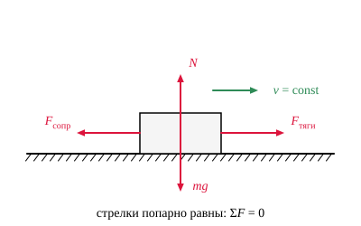

Машина едет по ровной дороге с постоянной скоростью $60\ \text{км/ч}$. Двигатель работает, колёса крутятся, мотор что-то делает. Значит, сила тяги больше, чем сопротивление? Иначе зачем мотор? В этом уроке выясним, что это не так, — и это одна из самых важных мыслей ЕГЭ по механике.

## Закон

Соберём уроки 5.1 и 5.2 вместе. В уроке 5.1 скорость тела менялась, только если на него действовали другие тела. В уроке 5.2 мы узнали, что несколько сил могут уравновесить друг друга — и тогда тело ведёт себя так, будто сил нет.

**Первый закон Ньютона:** существуют такие системы отсчёта, в которых тело сохраняет свою скорость постоянной, если на него не действуют другие тела или их действия скомпенсированы.

«Сохраняет скорость постоянной» — значит, либо **покоится**, либо движется **равномерно и прямолинейно**. Для закона это одно и то же: покой — это просто движение с нулевой скоростью.

Посмотри на модель. Сила сейчас ноль, а у тележки есть начальная скорость. Нажми «Пуск» и посмотри на отметки под рельсами.

<pp-cart f="0" m="2" v0="3">Модель: тележка на гладких рельсах. Если сила равна нулю, тележка едет с постоянной скоростью — отметки через каждую секунду стоят на равных расстояниях. Задав силу, можно увидеть, как скорость меняется.</pp-cart>

Отметки стоят на равных расстояниях: скорость не меняется. Тележку никто не толкает, а она едет. Попробуй задать силу — равномерность сразу пропадёт.

## Что следует для задач

Закон удобнее всего читать **наоборот**:

> если тело покоится или движется с постоянной скоростью по прямой, то равнодействующая всех сил, действующих на него, равна нулю.

Вернёмся к машине. Скорость постоянна — значит, силы уравновешены. Сила тяги двигателя **ровно равна** силе сопротивления (трение, воздух). А по вертикали сила тяжести $mg$ уравновешена силой, с которой дорога давит на колёса снизу, — **силой реакции опоры** $N$.

Зачем тогда мотор? Без него сопротивление осталось бы без пары, равнодействующая смотрела бы назад, и машина начала бы тормозить. Мотор не разгоняет машину, а не даёт ей затормозить. Как лошадь с телегой из урока 5.1.

**Пример.** Люстра массой $4\ \text{кг}$ висит на проводе. Она покоится — значит, силы уравновешены. Земля тянет её вниз с силой $mg = 4 \cdot 10 = 40\ \text{Н}$. Значит, провод тянет её вверх с силой $40\ \text{Н}$.

Проверь себя: кабина лифта массой 400 кг поднимается с постоянной скоростью. С какой силой её тянет трос?

Скорость постоянна, силы уравновешены: трос тянет вверх с той же силой, с какой Земля — вниз. $T = mg = 400 \cdot 10 = 4000\ \text{Н}$. То, что лифт едет вверх, а не стоит, ничего не меняет.

<pp-task id="ks-newton-03"></pp-task>

<pp-task id="ks-newton-11"></pp-task>

## Инерциальные системы отсчёта

В законе есть хитрое начало: «существуют такие системы отсчёта». Почему не «всегда»?

Вспомни автобус из урока 5.1. Он резко тормозит. Мяч лежал на полу — и вдруг покатился вперёд. Пассажир, глядя из автобуса, видит: мяч ни с чем не взаимодействовал, а скорость получил. В системе отсчёта «автобус» первый закон не выполняется.

А для человека на остановке всё в порядке. Мяч просто продолжает ехать с прежней скоростью, а автобус под ним тормозит.

Системы отсчёта, в которых первый закон выполняется, называют **инерциальными**. В них тело без внешних воздействий движется равномерно и прямолинейно. Как выбирать систему отсчёта, ты знаешь из уроков 1.4 и 1.6.

- Земля — инерциальная система для почти всех задач ЕГЭ.
- Поезд или автобус, который едет **равномерно и прямолинейно** относительно Земли, — тоже инерциальная система. В таком поезде мяч на полу лежит спокойно.
- Автобус, который разгоняется, тормозит или поворачивает, — **неинерциальная** система. В нём тела «сами» начинают двигаться.

Законы Ньютона мы всегда пишем в инерциальной системе — обычно в системе отсчёта, связанной с Землёй.

## Частые ловушки

- **«Тело движется — значит, равнодействующая направлена по движению».** При постоянной скорости равнодействующая равна **нулю**, куда бы тело ни ехало.
- **«Сила тяги чуть больше сопротивления, раз машина едет».** Если скорость постоянна, они равны.
- **Лишние данные.** Скорость в задаче на равномерное движение часто дана для отвлечения: силы от неё не зависят.
- **Применили закон в разгоняющемся автобусе.** Законы Ньютона пишем в инерциальной системе — относительно Земли.

## Коротко

- Первый закон: существуют инерциальные системы отсчёта, в которых тело сохраняет скорость, если на него не действуют другие тела или их действия скомпенсированы.
- Покой и равномерное прямолинейное движение для закона одинаковы.
- Для задач: скорость постоянна $\iff$ равнодействующая равна нулю.
- Земля и всё, что движется относительно неё равномерно и прямолинейно, — инерциальные системы. Разгоняющийся, тормозящий или поворачивающий транспорт — нет.

Дальше — урок 5.4: что будет, если равнодействующая **не** равна нулю. Это второй закон Ньютона.
